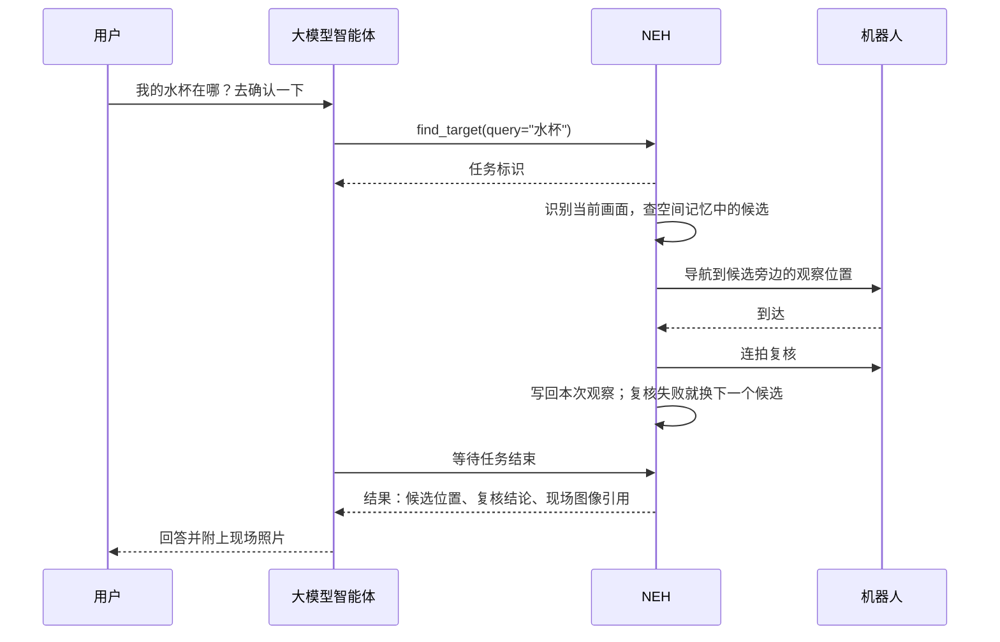
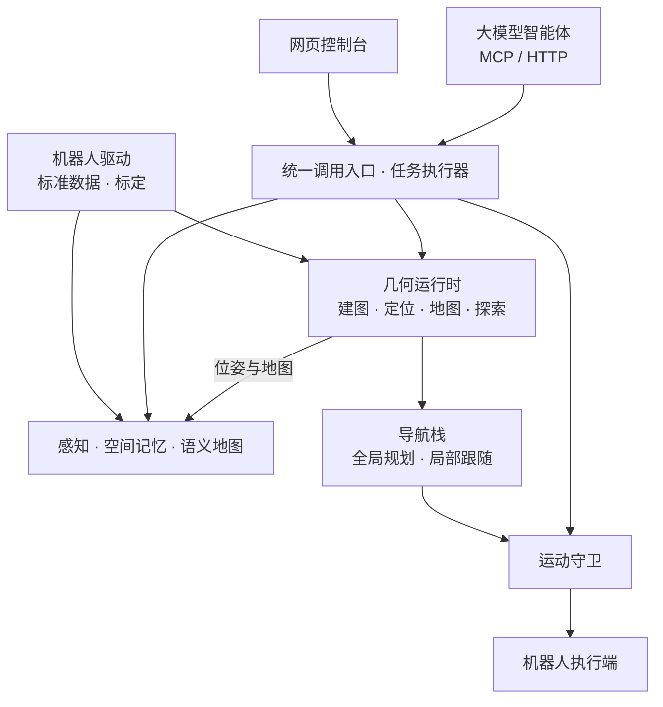

# NEH · Nuwax Embodied Harness

**具身智能侧的 Harness（智能体运行框架）：让大模型驱动机器人，在真实空间里完成长距离、长程任务。**

Claude Code、Codex 这类编码智能体能在代码仓库里连续完成复杂工作，靠的是模型外面那层 harness：它把仓库和终端变成模型能用的工具，保存跨会话的项目上下文，管理长时间运行的命令，并用权限控制把危险操作管起来。

NEH 在机器人上做同一件事。机器人提供传感器数据和运动执行；NEH 负责定位建图、导航探索、视觉感知、空间记忆和任务管理，并把这些整理成七十余项能力，通过 MCP（模型上下文协议）和 HTTP（超文本传输协议）接口交给上层的大模型智能体。人在网页控制台里操作的也是同一组能力。

[快速上手](docs/公开文档/快速上手.md) · [功能列表](docs/公开文档/功能列表.md) · [智能体接入](docs/公开文档/智能体接入.md) · [接入自己的机器人](docs/公开文档/架构与机器人接入.md) · [安装与更新](docs/公开文档/安装与更新.md) · [完整文档](docs/公开文档/阅读指南.md)

## 要解决的问题

大模型直接调用机器人的运动接口，能做的多是眼前几步：前进一米、转个身、拍一张照片。真实需求往往跨越整个空间，也会持续较长时间：

- “去厨房看看灯关了没”：要知道厨房在哪、从这里怎么过去、到了以后看什么。
- “我的水杯在哪”：要记得之前在哪里见过它，并能回去确认它还在不在。
- “把每个房间走一遍，告诉我各是什么”：要持续探索一段时间，中途可能暂停，之后接着走。

完成这类任务，机器人要一直清楚四件事：**自己在哪、东西在哪、怎么过去、任务做到了哪一步**。NEH 用 SLAM（同步定位与建图）、导航探索、空间记忆、语义地图和任务管理分别回答这四个问题，让机器人具备长距离移动和长程任务的执行能力。

## 与编码智能体 harness 的对照

| 编码智能体的 harness 提供 | NEH 在机器人上对应提供 |
| --- | --- |
| 工作环境：代码仓库与终端 | 物理空间：SLAM 建出的地图，加载后自动重定位 |
| 工具：读写文件、搜索、执行命令 | 工具：观察、拍照识别、前往某处、探索、找东西、记住某个地点 |
| 跨会话的项目记忆，例如 `CLAUDE.md`、`AGENTS.md` | 空间记忆与语义地图：看见过什么、在哪里、属于哪个区域，随地图长期保存 |
| 长命令在后台运行，可查看输出、可中断 | 长任务：导航、探索、找目标返回任务标识，可等待、订阅进度、取消；探索可存档后恢复 |
| 权限控制，危险操作需要确认 | 运动守卫：所有运动经过同一道关口，急停立即生效，新命令接管旧命令 |
| 执行结果回传给模型，模型据此决定下一步 | 结果带证据：是否到达、现场图像、失败时具体缺什么，交给模型判断下一步 |

模型负责理解目标、拆分步骤和组织回答；空间里的计算、长期保存的知识和运动安全由 NEH 承担。

## 长距离、长程任务靠什么实现

### SLAM：把空间变成可以长期使用的地图

- 两条完整链路：二维激光链，以及三维激光惯性链（FastLIO2、PointLIO 两种 LIO（激光惯性里程计）可选），三维链可开启回环校正。
- 建图时按雷达射线删除走过的人等动态物体留下的残影；已保存的三维地图还可以离线清理后另存。
- 地图是长期资产：保存、加载、在旧图上续建。加载后自动重定位，机器人重启后重新加载地图即可回到同一坐标系，之前标记的地点和记忆继续可用。
- 每张地图有自己的禁行区，保存后下一次规划即生效。

### 导航与探索：在大范围空间里移动

- 目标可以是地图坐标、命名地点或记忆中的物体。
- 三维导航基于实测地面规划路线，考虑坡度、台阶和净空；二维导航按机器人真实外形检查碰撞。
- 定位、地图或位姿暂时没就绪时，任务停在“等待输入”并写明缺哪一项，就绪后自动继续。
- 探索未知区域时按边界、时长、目标数或覆盖率结束；可设行程预算，按剩余路程返航；可暂停并保存地图和进度，之后从检查点恢复。
- 楼宇与跨层：登记楼层地图和电梯、门等设施后，可以前往指定楼层或逐层探索整栋建筑（依赖真实设施接口，实机待验收）。

### 空间记忆：记住看见过什么、在哪里

- 识别结果和它的地图位置、观察时间、图像证据一起写入记忆；多次观察合并成同一个物品，持续更新位置与置信度。
- 支持文本和图像检索，默认使用本地向量模型。
- 每张地图有同名记忆库，随地图打开、切换和删除，记忆里的坐标始终对应当前地图。
- “看见过”和“知道位置”分开记录：只有观察者位置、缺少物体几何依据的记录标为“仅观察”，不会被当作物体坐标去导航。

### 语义地图：把栅格变成房间和连接（实验能力）

- 从占据栅格中划分区域，选取带位姿的观察照片请模型判断区域用途；证据充分时才采用名称，人工修改过的名称受保护。
- 关系图把区域、连接口和物品连起来。智能体可以查询自己所在的区域、区域之间的邻接与候选路线，也可以取得带编号的地图图像。
- 默认关闭，需要时在配置中开启。

### 任务管理：长任务可跟踪、可打断

- 导航、探索、找目标、保存与加载地图等长任务立即返回任务标识，之后按需等待、订阅进度或取消。
- 关闭网页、退出客户端或等待超时，都不会取消已受理的任务。
- 新的运动命令直接接管正在执行的运动任务，不需要先取消。

### 组合技能：一次调用找到东西

`find_target`（找目标）把“回忆、前往、确认、更新记忆”放在一个任务里完成。没有候选时，`explore_and_find_target` 先探索再找。



检索命中、导航到达和视觉确认是三个独立的结果，智能体据此如实回答，也据此决定下一步。

## 设计原则

- **人的命令优先。** 新命令覆盖旧命令，急停立即生效。所有运动经过运动守卫，执行方停止续租后 0.75 秒内速度归零。
- **人和智能体使用同一组能力。** 网页、MCP、HTTP 进入同一个调用入口，行为和错误一致。
- **结论要有证据。** 历史记忆说明“曾经看见”；判断“现在还在不在”需要新的观察。
- **机器人无关。** 设备只需提供标准数据、真实标定和速度执行端，建图、导航、记忆和智能体工具整套复用。
- **面向端侧设备。** 计算核心用 Rust（系统编程语言）与原生算法实现，主链不依赖 ROS 2（机器人操作系统第二版）；视觉模型等重型组件按需启动，照顾 8GB 内存级别的嵌入式设备。
- **仿真按真机接入。** 仿真平台作为一台设备，走和真机相同的驱动与配置路径，仿真里测到的就是生产链路。

## 架构



几何运行时和导航栈在 Rust 工作区，Python 负责设备驱动、网关、任务、感知与记忆。业务进程由监督者统一启停，几何运行时、导航栈和运动守卫在调用需要时启动。分层与源码导航见[架构与机器人接入](docs/公开文档/架构与机器人接入.md)。

## 当前状态

项目处于开发阶段。下表是当前版本的实际情况，逐项实现与验证见[项目功能与实现情况清单](docs/公开文档/项目功能与实现情况清单.md)。

| 范围 | 情况 |
| --- | --- |
| 仿真平台（Go2 型号，办公室场景） | 11 月重构后的版本（2026-11-08）完成实时建图中的选点导航（到达误差约 3—13 厘米）、找目标并到达复核、运动中急停；边界探索按时长结束，子目标规划仍有失败 |
| Go2（宇树四足机器人）实机 | 有接入与现场使用记录；当前版本待统一复验，旧版本地图需要重新建图 |
| 建图、定位与地图资产 | 已实现；对称场景重定位、长路线精度仍有限制 |
| 导航与探索 | 已接通，复杂三维场景与探索子目标成功率在持续改进 |
| 空间记忆与找目标 | 已实现，真实场景的检索质量待更多验证 |
| 语义地图与关系图 | 实验能力，默认关闭 |
| 楼宇与跨层 | 已接通，实机待验收 |
| 机械臂操作 | 提供把自然语言指令转交外部设备并跟踪结果的接口 |

## 快速开始

在目标设备（Linux x86_64 或 ARM64，Debian/Ubuntu 系）的普通用户终端运行：

```bash
curl -fsSL https://raw.githubusercontent.com/Molun0301/nuwax-embodied-harness/main/get-neh.sh | bash
```

打开安装输出中的管理网页，选择机型、安装位置和模块。之后日常更新：

```bash
neh update
```

设备按固定源码提交安装和更新，失败时保留旧版本。自定义目录、更新通道、自动提醒与恢复见[安装与更新](docs/公开文档/安装与更新.md)。

### 接入智能体

在支持 MCP 的智能体客户端里添加 HTTP 类型的 MCP 服务器，设备本机地址为 `http://127.0.0.1:8766/mcp`。每项能力就是一个工具，客户端通过工具发现即可拿到名称、说明和参数结构。

也可以用仓库自带的单文件客户端（只依赖 Python 标准库）查看和调用能力：

```bash
python3 clients/robot_client.py --url http://127.0.0.1:8766 tools
python3 clients/robot_client.py invoke get_robot_status
```

从其它电脑或容器连接、长任务跟踪、图像读取见[智能体接入](docs/公开文档/智能体接入.md)。配套的系统提示词见[机器人智能体提示词](docs/公开文档/机器人智能体提示词.md)。

### 接入机器人

管理页可以直接安装 `go2`、`unitree_sim`（仿真设备）和 `customrobot`（通用接入）。接入其它机器人时按需提供：

| 想要的能力 | 需要提供 |
| --- | --- |
| 状态、视频与拍照 | 机器人状态、图像帧；空间定位还需相机内外参 |
| 三维建图与定位 | 带逐点时间的雷达帧、惯性测量单元数据及外参；设备已有可靠里程计时也可直接使用 |
| 二维建图与定位 | 二维激光扫描与里程计 |
| 导航、探索与跟随 | 速度与停止接口、设备速度上限、机体外形 |

数据格式、时间与坐标约定、注册新机型的步骤见[架构与机器人接入](docs/公开文档/架构与机器人接入.md)。

## 文档

| 文档 | 内容 |
| --- | --- |
| [快速上手](docs/公开文档/快速上手.md) · [安装前准备](docs/公开文档/安装前准备.md) · [安装与更新](docs/公开文档/安装与更新.md) | 从安装到第一次建图、导航 |
| [控制台使用指南](docs/公开文档/控制台使用指南.md) · [配置说明](docs/公开文档/配置说明.md) | 网页操作与设置项 |
| [功能列表](docs/公开文档/功能列表.md) · [项目功能与实现情况清单](docs/公开文档/项目功能与实现情况清单.md) | 能力说明与验证边界 |
| [智能体接入](docs/公开文档/智能体接入.md) · [机器人智能体提示词](docs/公开文档/机器人智能体提示词.md) · [Go2 提示词示例](docs/公开文档/Go2提示词示例.md) | 让大模型使用机器人 |
| [架构与机器人接入](docs/公开文档/架构与机器人接入.md) · [部署文档](docs/公开文档/部署文档.md) | 分层、进程与接入新设备 |
| [双LIO建图与回环纠偏](docs/公开文档/双LIO建图与回环纠偏.md) · [开发工具使用指南](docs/公开文档/开发工具使用指南.md) | 建图细节、建图对比与导航测试台 |
| [常见问题与排障](docs/公开文档/常见问题与排障.md) · [发布与兼容性](docs/公开文档/发布与兼容性.md) | 排障、版本与已知限制 |

## 参与与反馈

- [贡献指南](docs/公开文档/贡献指南.md)：设备接入、问题报告、修改与验证要求。
- [问题反馈](https://github.com/Molun0301/nuwax-embodied-harness/issues)：提交前请移除凭据、私有地图和个人数据。

## 许可

项目自有代码按 [GPL-2.0-or-later](LICENSE)（GNU 通用公共许可证第 2 版或更高版本）提供。第三方代码与模型保留各自许可，见[第三方许可证说明](docs/公开文档/第三方许可证说明.md)；FastLIO2 与 PointLIO 始终在设备本机从源码编译，不随本项目分发二进制，出货预装前需要取得兼容授权。预编译程序的组成与审核结论见[预编译许可证清单](docs/公开文档/预编译许可证清单.md)。

项目对外名称为 NEH；内部的 `nuwax_*` 包名、协议与服务名称沿用原名，见[发布与兼容性](docs/公开文档/发布与兼容性.md#名称兼容)。
