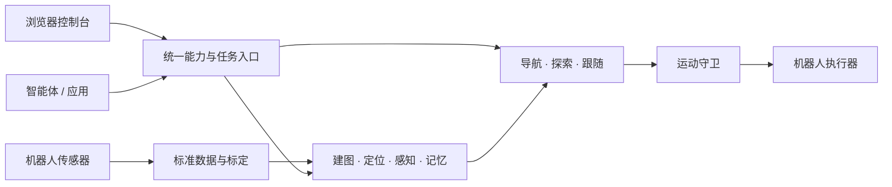

# Nuwax Robot Bridge

**让机器人拥有可被人和智能体共同调用的空间能力。**

Nuwax Robot Bridge 是一个通用具身能力平台。它把机器人的传感器与运动执行接入统一接口，在其上提供建图、定位、导航、探索、视觉感知和空间记忆。你可以在浏览器中观察和操作机器人，也可以让上层智能体通过 MCP（模型上下文协议）调用同一组能力。

从“看见一张桌子”到“记住它在哪里”，从“建立环境地图”到“前往一个已知地点”，平台将观察、空间数据与任务执行连接起来，让每一步都有可查询的状态和结果。

[快速上手](docs/公开文档/快速上手.md) · [功能介绍](docs/公开文档/功能列表.md) · [智能体接入](docs/公开文档/智能体接入.md) · [部署指南](docs/公开文档/部署文档.md) · [全部文档](docs/公开文档/阅读指南.md)

## 从环境到行动

### 建立可以继续使用的地图

支持二维激光与三维激光惯性两条完整链路。三维建图可选择 FastLIO2（快速激光惯性里程计）或 PointLIO（逐点激光惯性里程计），共用地图管理与回环纠偏。地图可以保存、重新激活，并在资产和定位条件满足时继续建图。

控制台提供二维栅格、三维点云和完整扫描点云视图，可叠加机器人轨迹、物品与禁行区域。三维链路的二维图用于观察水平切片，实际导航仍使用三维支撑与净空信息。

### 在空间中组织任务

在地图上选点、前往命名地点，或在给定边界内探索未知区域。导航和探索使用统一任务机制，提供进度、取消和错误反馈；单层探索支持行程预算、返航策略，以及停车后保存进度、重新定位后恢复。

运动请求通过统一运动守卫进入设备执行器。地图、定位、规划和执行条件共同决定一次任务能否开展。

### 把观察积累为空间记忆

视觉感知支持目标检测、跟踪、可选分割与几何投影。空间记忆把场景、物品、命名地点和观察证据绑定到地图，支持文本或图像检索，并为具备有效空间依据的记录生成导航候选。

新增的语义地图可以从几何图中提取区域，结合观察给出名称候选，并在控制台查看区域、连接口、物品与证据之间的关系。这部分仍处于实验阶段，详见[功能与当前边界](docs/公开文档/功能列表.md)。

### 人和智能体使用同一套能力

浏览器控制台汇集地图、视频、任务、记忆、日志和设置。网页操作与智能体调用进入同一服务与任务链，浏览器断开后，已受理任务继续由服务管理。

智能体可以通过 MCP 接入；普通应用也可使用 HTTP（超文本传输协议）接口和仓库自带的轻量客户端，完成能力发现、调用、等待任务和读取图像等结果。对话与高层任务规划由上层应用负责。

## 如何组合



机器人接入方提供数据、标定和真实执行接口，平台承担通用空间能力。计算核心采用 Rust（系统编程语言）及原生算法，Python（编程语言）负责服务编排和网关。当前平台计算主链不依赖 ROS 2（机器人操作系统第二版）。

已有 Go2（宇树四足机器人）设备接入和通用机器人装配入口。接入新的设备，从[架构与机器人接入](docs/公开文档/架构与机器人接入.md)开始。

## 开始使用

在 Debian 或 Ubuntu（操作系统）系列机器上，进入仓库根目录，以普通用户运行：

```bash
./install.sh
```

安装器检测环境，按需选择模块并补齐依赖。只想先查看控制台与接口，可以安装基础网关：

```bash
./install.sh install --modules core --yes
./install.sh start
```

启动后打开 [机器人控制台](http://127.0.0.1:8766/console)。基础网关提供界面和接口；实时数据由机器人接入提供，建图、识别和运动还需要对应模块与配置。

选择二维或三维链路、配置设备、执行第一次建图，见[快速上手](docs/公开文档/快速上手.md)。更新已有 Go2 部署，见[部署指南](docs/公开文档/部署文档.md)。

## 当前进展

项目持续开发中，本文对应当前源码；设备上的已部署版本可能不同。已有能力覆盖从数据接入到地图、感知、记忆和任务执行的主要流程。现场表现仍取决于传感器、标定、计算资源、地图质量和底层运动能力。

二维设备现场验收、复杂三维环境的导航与探索，以及语义区域的真实用途识别仍有待完善。完整的能力条件与验证边界集中维护在[功能介绍](docs/公开文档/功能列表.md)，不以模拟结果承诺实机精度、速度或自主任务成功率。
