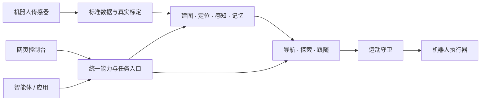

# Nuwax Embodied Harness

**NEH（具身运行框架）——把不同机器人接入同一套空间能力与智能体工具。**

Nuwax Embodied Harness 面向机器人开发者，提供标准数据接入、建图、定位、导航、探索、视觉感知与空间记忆。你负责设备驱动、真实标定和运动执行；NEH 组织空间计算、任务状态和结果，让人通过网页、让上层智能体通过 MCP（模型上下文协议）调用同一组能力。

[快速上手](docs/公开文档/快速上手.md) · [安装部署](docs/公开文档/部署文档.md) · [接入自己的机器人](docs/公开文档/架构与机器人接入.md) · [智能体接入](docs/公开文档/智能体接入.md) · [完整文档](docs/公开文档/阅读指南.md)

> 当前为开发预览，适合设备接入与受控场景验证。仓库保持私有，项目许可证待定。当前开发分支为 `refactor/map-explore-nav`；默认分支 `main` 尚未同步这套安装与使用流程。支持范围见[发布与兼容性](docs/公开文档/发布与兼容性.md)。

## 从接入到任务

| 你要实现的事情 | NEH 提供的能力 | 你需要准备的条件 |
| --- | --- | --- |
| 看见机器人和环境 | 状态、视频、二维/三维地图控制台 | 设备状态和传感器输入 |
| 建立可复用的地图 | 二维激光、三维激光惯性建图，地图保存与激活 | 连续数据、时间与坐标标定 |
| 前往目标或探索环境 | 选点导航、探索任务、进度与取消 | 地图定位、机体参数、执行器与运动守卫 |
| 记住物品与位置 | 检测、跟踪、空间记录、文本/图像检索 | 图像、所选模型及有效空间证据 |
| 让智能体使用机器人 | 工具发现、调用、异步任务、图像等结果读取 | 上层应用与可达的网关地址 |

三维定位支持 FastLIO2（快速激光惯性里程计）与 PointLIO（逐点激光惯性里程计）。语义地图和区域关系图仍属实验能力。详细能力和验证边界见[功能列表](docs/公开文档/功能列表.md)。

## 开始使用

在 Debian 或 Ubuntu（操作系统）系列的64位机器上，以普通用户打开终端。需要 Python（编程语言）3.8—3.12、Git（版本管理工具）及仓库读取权限；完整准备说明见[安装前准备](docs/公开文档/安装前准备.md)。

```bash
git clone --branch refactor/map-explore-nav https://github.com/Molun0301/nuwax-embodied-harness.git
cd nuwax-embodied-harness
./install.sh
```

向导显示环境、每个模块的用途及安装内容。首次可以输入 `basic` 选择基础接入；使用二维雷达可选 `map2d`，使用三维雷达与惯性传感器可选 `map3d`。导航、视觉和本地记忆按需增加。

希望直接安装基础网关并体验界面，可以执行：

```bash
./install.sh doctor --preset basic --robot customrobot
./install.sh install --preset basic --robot customrobot --yes
./install.sh start
```

打开 [NEH 控制台](http://127.0.0.1:8766/console)。没有设备输入时会显示等待或缺项；安装成功不会产生模拟地图或自动完成设备接入。新安装默认供本机访问，远程使用见[安全与数据说明](docs/公开文档/安全与数据说明.md)。

下一步：[完成第一次接入](docs/公开文档/快速上手.md) → [配置说明](docs/公开文档/配置说明.md) → [控制台使用](docs/公开文档/控制台使用指南.md)。

## 工作方式



计算核心使用 Rust（系统编程语言）与原生算法，Python 负责服务编排和网关。平台计算主链不依赖 ROS 2（机器人操作系统第二版）；现有设备协议保留在机器人适配层。机器人入口通过注册表加载，安装器按所选适配器准备设备依赖，所有适配器共用同一套安装、运行与更新流程。注册条目不代表设备的全部功能已经实现：通用装配仍需接入真实数据、标定与执行器，骨架适配器需要继续开发。

## 安装后的常用操作

```bash
./install.sh list               # 查看模块与初始配置位置
./install.sh doctor             # 检查安装前提及已有产物
./install.sh stop               # 按已保存的运行模式停止当前安装
./install.sh add navigation     # 增加导航与探索，自动补齐依赖
./install.sh install --repair   # 修复当前选择的安装产物
./install.sh update check       # 通过运行中的网关检查更新
./install.sh update install --yes --wait  # 安全准入通过后更新并等待结果
```

模块变更前先停止网关。安装器将源码位置、模块集合、机器人适配器、监听地址和运行模式保存在安装描述中。网页与命令行读取同一份描述，执行同一更新事务，保留原来的模块选择与运行拥有方。

默认使用普通进程模式（`foreground`）。在具有可用用户级 systemd 管理器的 Linux 主机上，也可选择用户服务模式；安装只记录选择，显式启动时才创建并启动该安装的用户服务：

```bash
./install.sh install --service-mode systemd-user --yes
./install.sh start
```

两种运行模式使用同一模块安装器。更新独立于网关进程执行，停止网关不会取消已受理的更新；用户服务模式通过独立的用户级更新服务执行，不把网关提升为 root。用户服务不会因安装而自动设置开机启动，其会话与退出行为受本机用户服务管理器配置影响。

系统服务形式的运动守卫、设备网络准备等仍是可选设备能力的安全基础，不因统一更新入口而删除。未注册设备、未完成适配器、缺少设备依赖或不支持的操作系统会明确报错，不会因为选择通用平台就自动具备硬件能力。源码、数据备份和恢复规则见[升级与恢复](docs/公开文档/升级与恢复.md)。

## 获取帮助与参与开发

- [常见问题与排障](docs/公开文档/常见问题与排障.md)：安装失败、页面打不开、无数据、设置不生效。
- [贡献指南](docs/公开文档/贡献指南.md)：设备接入、问题报告、修改与验证要求。
- [问题反馈](https://github.com/Molun0301/nuwax-embodied-harness/issues)：需仓库访问权限，请先移除凭据、私有地图和个人数据。
- [发布与兼容性](docs/公开文档/发布与兼容性.md)：版本阶段、命名迁移、已知限制和上线准备。

项目名称与网页品牌已采用 NEH；内部 `nuwax_*` 包名、`NUWAX_*` 配置键、协议及系统服务名称继续兼容。许可证确定前不声明开源或商业再分发授权；第三方代码与模型遵循各自许可。
