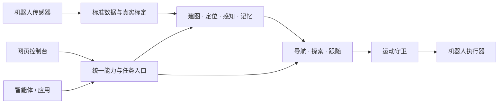

# Nuwax Embodied Harness

**NEH（具身运行框架）——把不同机器人接入同一套空间能力与智能体工具。**

Nuwax Embodied Harness 面向机器人开发者，提供标准数据接入、建图、定位、导航、探索、视觉感知与空间记忆。你负责设备驱动、真实标定和运动执行；NEH 组织空间计算、任务状态和结果，让人通过网页、让上层智能体通过 MCP（模型上下文协议）调用同一组能力。

[轻量安装与自动发布](docs/公开文档/轻量安装与自动发布.md) · [快速上手](docs/公开文档/快速上手.md) · [安装部署](docs/公开文档/部署文档.md) · [接入自己的机器人](docs/公开文档/架构与机器人接入.md) · [智能体接入](docs/公开文档/智能体接入.md) · [完整文档](docs/公开文档/阅读指南.md)

> 正式版本从 `main`（主分支）的固定修订自动构建并发布，设备通过独立管理页安装和更新。仓库保持私有，下载需要仓库读取权限；项目许可证待定。已发布平台、模块组合与设备验证范围见[发布与兼容性](docs/公开文档/发布与兼容性.md)。

## 从接入到任务

| 你要实现的事情 | NEH 提供的能力 | 你需要准备的条件 |
| --- | --- | --- |
| 看见机器人和环境 | 状态、视频、二维/三维地图控制台 | 设备状态和传感器输入 |
| 建立可复用的地图 | 二维激光、三维激光惯性建图，地图保存与激活 | 连续数据、时间与坐标标定 |
| 前往目标或探索环境 | 选点导航、探索任务、进度与取消 | 地图定位、机体参数、执行器与运动守卫 |
| 记住物品与位置 | 检测、跟踪、空间记录、文本/图像检索 | 图像、所选模型及有效空间证据 |
| 让智能体使用机器人 | 工具发现、调用、异步任务、图像等结果读取 | 上层应用与可达的网关地址 |

三维定位支持 FastLIO2（快速激光惯性里程计）与 PointLIO（逐点激光惯性里程计）。语义地图和区域关系图仍属实验能力。详细能力和验证边界见[功能列表](docs/公开文档/功能列表.md)。

## 开始使用

在[最新发布页](https://github.com/Molun0301/nuwax-embodied-harness/releases/latest)下载 `get-neh.sh`，以普通用户执行。仓库保持私有，先按[安装说明](docs/公开文档/轻量安装与自动发布.md)准备仅能读取本仓库内容的下载凭据文件，再运行：

```bash
bash ./get-neh.sh --token-file ~/.config/neh/github-token
```

引导程序安装管理服务并打开设备管理页。按页面选择机器人、模块和配置，查看实际下载量后开始安装；业务包保持轻量，第三方依赖和模型在安装时从固定来源下载并缓存。当前可选的正式包以发布目录为准。

管理页默认位于 `http://设备地址:8765/`，业务控制台通过管理页进入。没有桌面的设备会输出访问地址；需要纯命令行向导时加 `--cli`。默认免密码，可在管理页设置密码；本机使用可加 `--host 127.0.0.1`。

需要从源码开发时，克隆 `main` 并使用[源码模块安装入口](docs/公开文档/部署文档.md)。已克隆源码也可执行 `./install.sh product --token-file ~/.config/neh/github-token`，进入相同的正式版本安装流程。

下一步：[完成第一次接入](docs/公开文档/快速上手.md) → [配置说明](docs/公开文档/配置说明.md) → [控制台使用](docs/公开文档/控制台使用指南.md)。

## 工作方式



计算核心使用 Rust（系统编程语言）与原生算法，Python 负责服务编排和网关。平台计算主链不依赖 ROS 2（机器人操作系统第二版）；现有设备协议保留在机器人适配层。机器人入口通过注册表加载，安装器按所选适配器准备设备依赖，所有适配器共用同一套安装、运行与更新流程。注册条目不代表设备的全部功能已经实现：通用装配仍需接入真实数据、标定与执行器，骨架适配器需要继续开发。

## 安装后的常用操作

管理网页提供版本、模块、配置、启停、更新和回退入口。命令行调用同一个任务流程：

```bash
~/.local/share/neh/bin/neh status              # 查看真实安装及运行状态
~/.local/share/neh/bin/neh releases --refresh # 查询正式版本
~/.local/share/neh/bin/neh wizard             # 交互配置安装或更新
~/.local/share/neh/bin/neh stop --wait         # 等待原拥有方停止
~/.local/share/neh/bin/neh start --wait        # 启动并核对网关
~/.local/share/neh/bin/neh config              # 查看当前配置项
```

更新先准备并校验候选环境，再切换完整版本；配置、地图和用户数据保存在稳定目录。终端或网页断开不会取消已受理任务。需要回退时在管理页选择上一版本，或运行 `~/.local/share/neh/bin/neh rollback --stop-running --wait`。管理程序自身更新与业务更新分别提供入口。

设备输入、标定、运动执行与现场验收仍由接入方负责。完整操作、凭据管理与恢复方法见[轻量安装与自动发布](docs/公开文档/轻量安装与自动发布.md)。

## 获取帮助与参与开发

- [常见问题与排障](docs/公开文档/常见问题与排障.md)：安装失败、页面打不开、无数据、设置不生效。
- [贡献指南](docs/公开文档/贡献指南.md)：设备接入、问题报告、修改与验证要求。
- [问题反馈](https://github.com/Molun0301/nuwax-embodied-harness/issues)：需仓库访问权限，请先移除凭据、私有地图和个人数据。
- [发布与兼容性](docs/公开文档/发布与兼容性.md)：版本阶段、命名迁移、已知限制和上线准备。

项目名称与网页品牌已采用 NEH；内部 `nuwax_*` 包名、`NUWAX_*` 配置键、协议及系统服务名称继续兼容。许可证确定前不声明开源或商业再分发授权；第三方代码与模型遵循各自许可。
