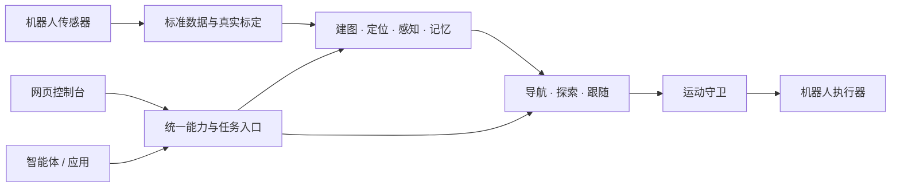

# Nuwax Embodied Harness

**NEH（具身运行框架）——把不同机器人接入同一套空间能力与智能体工具。**

Nuwax Embodied Harness 面向机器人开发者，提供标准数据接入、建图、定位、导航、探索、视觉感知与空间记忆。你负责设备驱动、真实标定和运动执行；NEH 组织空间计算、任务状态和结果，让人通过网页、让上层智能体通过 MCP（模型上下文协议）调用同一组能力。

[轻量安装与自动发布](docs/公开文档/轻量安装与自动发布.md) · [快速上手](docs/公开文档/快速上手.md) · [安装部署](docs/公开文档/部署文档.md) · [接入自己的机器人](docs/公开文档/架构与机器人接入.md) · [智能体接入](docs/公开文档/智能体接入.md) · [完整文档](docs/公开文档/阅读指南.md)

> 设备通过独立管理页从 `main`（主分支）取得固定源码提交，在本机增量构建、安装和更新。项目自有代码采用 GPL-2.0-or-later（GNU 通用公共许可证第 2 版或更高版本）。平台、模块与设备验证范围见[发布与兼容性](docs/公开文档/发布与兼容性.md)。

## 从接入到任务

| 你要实现的事情 | NEH 提供的能力 | 你需要准备的条件 |
| --- | --- | --- |
| 看见机器人和环境 | 状态、视频、二维/三维地图控制台 | 设备状态和传感器输入 |
| 建立可复用的地图 | 二维激光、三维激光惯性建图，地图保存与激活 | 连续数据、时间与坐标标定 |
| 前往目标或探索环境 | 选点导航、探索任务、进度与取消 | 地图定位、机体参数、执行器与运动守卫 |
| 记住物品与位置 | 检测、跟踪、空间记录、文本/图像检索 | 图像、所选模型及有效空间证据 |
| 让智能体使用机器人 | 工具发现、调用、异步任务、图像等结果读取 | 上层应用与可达的网关地址 |

三维定位支持 FastLIO2（快速激光惯性里程计）与 PointLIO（逐点激光惯性里程计）。两个 LIO 程序始终在设备本机从源码增量编译，编译产物不随本项目分发；出货预装前需取得兼容授权，详见[许可说明](docs/公开文档/第三方许可证说明.md#lio-程序的源码编译与分发范围)。语义地图和区域关系图仍属实验能力。详细能力和验证边界见[功能列表](docs/公开文档/功能列表.md)。

## 开始使用

在目标设备的普通用户终端运行：

```bash
curl -fsSL https://raw.githubusercontent.com/Molun0301/nuwax-embodied-harness/main/get-neh.sh | bash
```

命令匿名获取管理程序、安装服务并打开网页。详细步骤见[安装说明](docs/公开文档/轻量安装与自动发布.md#一条命令安装并打开网页)。

网页打开后先选择设备上的安装目录，再选择机器人与功能模块，安装器自动获取源码、下载依赖并在设备构建；后续更新复用构建缓存。后续配置、启动和更新均在同一管理页操作；无桌面设备会打印可访问的网址。

新安装默认位于 `~/Nuwax-embodied-harness`。首次安装可在网页输入或浏览选择父目录，安装器在其中创建 `Nuwax-embodied-harness` 文件夹，并在保存前显示最终位置；父目录可以已有其他文件。轻量管理程序保留原位置，业务程序、构建缓存、配置与数据使用选定的安装文件夹。已有旧默认位置 `~/.local/share/neh` 的安装继续沿用原位置。也支持 `--install-dir "目标目录"`、`NEH_HOME` 和终端交互 `--cli`。具体步骤见[自定义安装位置](docs/公开文档/轻量安装与自动发布.md#自定义安装位置)。

需要从源码开发时，使用[开发者部署说明](docs/公开文档/部署文档.md)；普通安装按上面的单命令入口进行。

## 工作方式



计算核心使用 Rust（系统编程语言）与原生算法，Python 负责服务编排和网关。平台计算主链不依赖 ROS 2（机器人操作系统第二版）；现有设备协议保留在机器人适配层。机器人入口通过注册表加载，安装器按所选适配器准备设备依赖，所有适配器共用同一套安装、运行与更新流程。注册条目不代表设备的全部功能已经实现：通用装配仍需接入真实数据、标定与执行器，骨架适配器需要继续开发。

## 安装后的常用操作

管理网页提供版本、模块、配置、启停、更新和回退入口。命令行调用同一个任务流程：

以下使用新安装的默认管理入口；已有旧安装或通过安装命令指定了管理根目录时，改用原目录下的 `bin/neh`。在网页选择业务安装目录后，原管理入口保持可用，后续命令会自动沿用网页保存的位置。

```bash
~/Nuwax-embodied-harness/bin/neh status              # 查看真实安装及运行状态
~/Nuwax-embodied-harness/bin/neh releases --refresh # 查询正式版本
~/Nuwax-embodied-harness/bin/neh wizard             # 交互配置安装或更新
~/Nuwax-embodied-harness/bin/neh stop --wait         # 等待原拥有方停止
~/Nuwax-embodied-harness/bin/neh start --wait        # 启动并核对网关
~/Nuwax-embodied-harness/bin/neh config              # 查看当前配置项
```

更新先准备并校验候选环境，再切换完整版本；配置、地图和用户数据保存在稳定目录。终端或网页断开不会取消已受理任务。需要回退时在管理页选择上一版本，或运行 `~/Nuwax-embodied-harness/bin/neh rollback --stop-running --wait`。管理程序自身更新与业务更新分别提供入口。

设备输入、标定、运动执行与现场验收仍由接入方负责。完整操作与恢复方法见[轻量安装与自动发布](docs/公开文档/轻量安装与自动发布.md)。

## 获取帮助与参与开发

- [开发工具使用指南](docs/公开文档/开发工具使用指南.md)：LIO建图对比、导航测试台、数据导入与自动执行。
- [常见问题与排障](docs/公开文档/常见问题与排障.md)：安装失败、页面打不开、无数据、设置不生效。
- [贡献指南](docs/公开文档/贡献指南.md)：设备接入、问题报告、修改与验证要求。
- [问题反馈](https://github.com/Molun0301/nuwax-embodied-harness/issues)：请先移除凭据、私有地图和个人数据。
- [发布与兼容性](docs/公开文档/发布与兼容性.md)：版本阶段、命名迁移、已知限制和上线准备。

项目名称与网页品牌已采用 NEH；内部 `nuwax_*` 包名、`NUWAX_*` 配置键、协议及系统服务名称继续兼容。项目自有代码按 [GPL-2.0-or-later](LICENSE) 提供；第三方代码、模型及其分发条件见[第三方许可证说明](docs/公开文档/第三方许可证说明.md)。
