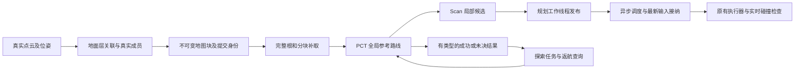
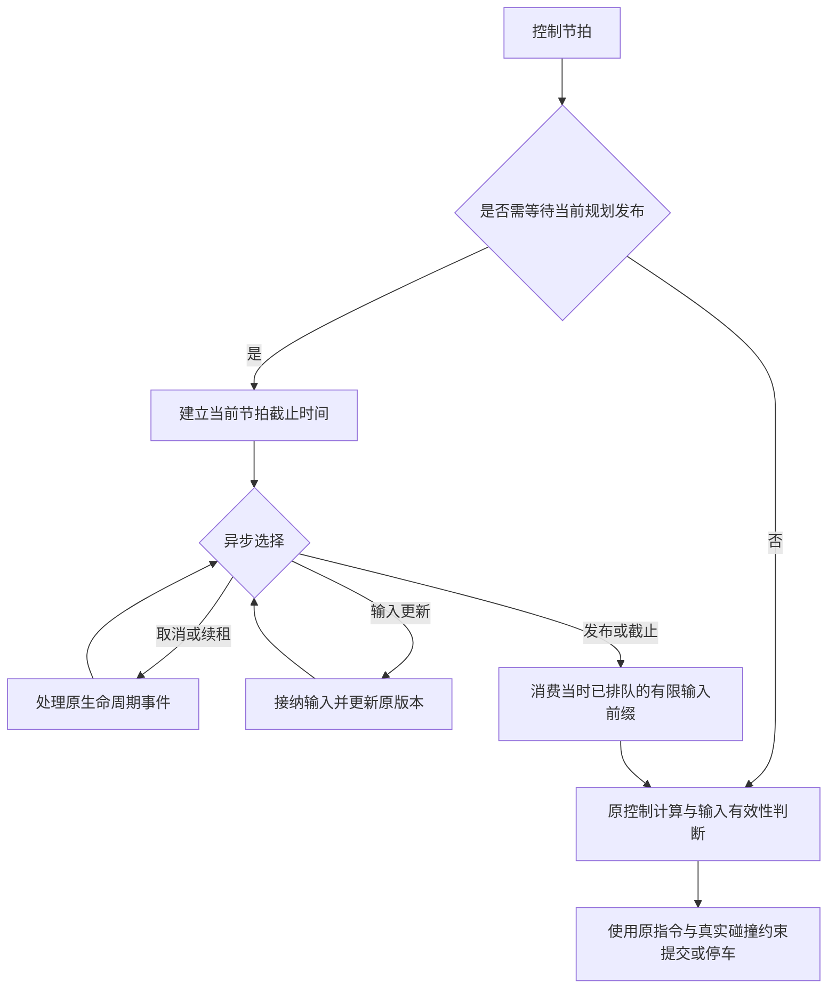

# 建图、导航与探索持续复查：2026-10-17 晚间

## 范围与基准

- 接入开发机提交后的基准：`23278603aa87b12c730665cbf7bb91462688bf0a`
- 已包含上午云端修复：`4ddfcd3dee25a720ad2c3796211c8cb537bd10ad`
- 云端 x86_64，Rust 1.88.0，运行时 Python 3.8.10；开发模拟工具另外验证 Python 3.12
- 所有 Rust 构建复用一个 `CARGO_TARGET_DIR`，不复制每个版本的完整构建产物
- 本报告是持续专项的阶段记录。通过某组离线测试不代表 Go2 实机问题已全部解决

## 链路与本轮检查位置

本轮不增加导航准入门槛、不提高搜索预算、不以未知地面伪造观测，也不删除真实障碍碰撞检查。

## 已复现的问题及修改原则

### 1. 地面层关联遍历无关列

`ground_observations.rs` 原关联路径为每个候选扫描整个块的已有地面层，随后才排除不同 XY 的层。
改为利用已有锚点编码，仅查询同一 XY 的候选，并按实际已存在的高度范围限制查询。
关联优先级、原始样本、平面和成员必须逐项等价。

真实 geometry release 测试二进制中的 Writer/地面回归已完成：20 项通过、3 项原有手动诊断忽略；完整层、样本与来源逐值等价。
独立 harness 的内存存储替身不覆盖生产验证、脏块计数和 IO，因此其加速结果不能当作整机收益。

真实二进制另执行关联阶段 12 布局 × 7 对交替样本，每次 1024 次更新，全部输出等价。初始同列查询在少量记录但 Z 跨度大的场景回退，已按实际记录数与待查询 Z 键数选择更小枚举，两路保留原升序和同一个处理函数。最终 4 列高跨度中位数 241.6 → 196.6 μs；1024 列单层 11221.1 → 509.8 μs，4 层 42666.3 → 1080.0 μs。极小布局接近持平；以上不含 capture、Writer IO 或整机导航。

### 2. 同粗格内地面选择不一致

真实 MLS 反例：上层直接查询为 0.07500000111758709 m，定位接口却返回 0.02500000037252903 m，随后机身验证错误拒绝。
修复在同一实际查询 XY 上比较各个实测层与高度参考，再把已选平面投影到原粗格坐标。
不能在粗格中心重新选一次层，也不能把另一层的实体成员一并豁免。

同格上层、下层碰撞、未分类回波、实时障碍、离中心平行斜面及高度缓存隔离已加入成对测试。
相邻粗格的层连续性另行验证：首个推测反例实际通过，已保留该结果。
随后在实际允许的图单元上构造 21.8° 平行坡面，真实每列增高 0.04 m，却因中间列错选层形成 0.10 m 假台阶；真实二进制已复现 patch 缺少下一合法单元。对应最小平面参考传播修正已经通过最终 MLS 全套：360 通过、0 失败、18 原有忽略。原步高和成员判定保持不变。缺失成员配对测试曾因删除整排而非单细列的夹具错误失败，修正夹具后通过，原失败日志保留。

### 3. 地图分片重复读取整个对象

协议分片为 256 KiB，但旧服务端每个分片均读取完整对象再复制切片。
4 MiB 对象的 16 次请求累计返回了 64 MiB 文件读取结果。
新方法复用原对象打开和类型/长度检查，定位并读取所需范围，保持原根保留关系及错误类型。
不增加传输会话、全量缓存或额外逐片 metadata 检查。

实际仓库方法的暖缓存 A/B，50 组交替样本，逐次核对重组字节：

| 对象 | 旧中位数 | 新中位数 | 旧 P95 | 新 P95 |
|---|---:|---:|---:|---:|
| 4 MiB / 16 片 | 16.033 ms | 2.197 ms | 22.596 ms | 6.413 ms |
| 393232 B / 2 片 | 0.0548 ms | 0.0363 ms | — | — |

这是本机文件读取与重组耗时，不含 RPC、真实磁盘冷读或机器人导航。
64 → 4 MiB 表示成功读取结果的累计长度，不是物理磁盘 IO 或进程峰值内存。

### 4. 搜索中的重复工作与测试默认值偏差

- PCT 对精确相同状态先判断代价是否严格改善，再执行完整的边段验证和状态分配
- 保留原过滤回调顺序；半径外的边仍完整验证后才可构成计算域截断证据
- Scan 普通测试改为使用生产的加权公式和调用方预算；显式诊断覆盖仍保留
- 红测发现配置预算 0 原来仍展开 256 个状态；修复后实际展开数对应 0、1、3
- 不改变生产权重，不提高预算，不把预算耗尽称为物理不可达

PCT 全套 65 通过、3 忽略；Scan 全套 68 通过、1 忽略。
全套运行时有并行任务，不用其耗时计算加速倍数。

### 5. 同步等待堵塞调度器

原 `PlannerWorker::step` 的 publication 条件变量等待阻塞调度器线程。
真实 scheduler 加真实 worker 线程的 gated 测试复现：

- 取消请求等待约 30.86 ms
- 位姿在 70 ms 到期，却在约 85 ms 仍提交非零意图
- 5 ms 配置仍进入固定 50 ms 等待

改为 publication watch 驱动异步等待。取消、续租和输入仍可处理；完成通知前先消费有限的已排队输入前缀；不延长原等待期限。
已有位姿有效性判断在等待结束后执行，不用额外重复校验补偿阻塞。

8 个真实 scheduler 定向用例重复 3 次通过；取消约 0.153–0.178 ms；新结果仍在下一节拍前被接纳。
这些数字使用立即确认的 FakeMotion，衡量调度器阻塞，不是 Go2、UDS 或网络延迟。
完整 runtime 当前为 279 通过、58 原有忽略；5 个已确认 UDS EPERM 用例明确过滤。
另外显式运行三个原有真实几何 scheduler 场景，均保持原运动历史/制动 oracle：持续障碍绕行到原目标（248 条唯一回执、768 条实际运动边）、障碍真正消失后恢复（239/734）、取消后替换目标（186/574）。这些仍是进程内确认的模拟执行器闭环，不是真机资格证明。
异步等待之后的续租/运输期间位姿到期竞态仍是独立待查边界，不据此宣布全部时效问题解决。

### 6. 工具入口和测试契约

- 模拟矩阵入口现在复用 NativeWorker 的点云验证及 JSON 数组/JSONL 位姿归一化，保留原输入路径溯源
- 新输入测试最初误设了 Python 3.10 以下跳过；父审查实际验证 Python 3.8.10 可导入并执行全部三项，已删除该跳过，生产脚本无需兼容性改动
- 补齐交付记录器直接导入的 TFMessage Python 生成模块；与已入库 C 协议字段及递归指纹一致
- 安装器刻意在启动时派生导航 profile；过期测试改为验证没有遗留 profile 锁死后续切换，不修改生产安装行为
- CLI 缺失 owner 测试显式使用二维链，并在独立子进程配置环境，避免依赖已变为三维的默认值

## 基线与环境限制

未经本轮修改的基线：PCT 63、Scan 64、MLS 352、地图块 71 项通过；runtime 269 项通过、5 项 UDS 绑定 EPERM；stack 308 项通过、2 项失败。

- 云端没有该测试所需的 multicast 路由，原分块 RPC 子进程与新增多片测试均在 liblcm 初始化失败；不能报告真实多进程传输通过
- 不更改网络策略、路由或测试期限来制造通过
- 两项 stack 预算用例在并行负载下等待结果尚未完成，原条件串行复跑通过；保留失败和复跑日志，不将其耗时作空载基准
- 真实机器人、ARM 端侧 CPU、生产传感器及实际执行器仍未在本云端验证

## 本阶段交付边界

本次提交包含已验证的 MLS、PCT/Scan、异步调度、地图块范围读取方法和 Python 工具入口。第一阶段之后，geometry Writer 关联优化已补齐实际回归和独占关联 A/B，作为后续单独阶段交付。后续第三阶段已完成 RPC owner 接线的 4 项明确 unit_transport 服务回归，包含错误分层、完整末片、换 frame 保留旧根及已接纳但排队等待 IO 的请求取消。真实 LCM 服务测试仍在缺少 multicast 路由的初始化阶段失败，进程内服务测试不等于真实传输覆盖。

## 第三阶段：探索任务资格与错误归因

- 真实返航核已返回 ResourceLimited，探索 owner 却提前归为连续失败。已保留底层错误类型，将未决资源结果映射到既有 PlanningResourceLimited；真实 owner 完整回归与 candidate 对照通过，不增加重试线程或导航门槛
- 真实 composite builder 证明地图输入完全相同，仅 committed_map revision/sequence 前进时，旧实现会在 Accept 前 Discard 或 Accept 后 Cancelled。两项实际红测保留
- 修复只对 Surface：完整 same_source_view 不变、原坐标域相同且提交单调前进时保留计算。Planar 仍要求原完整身份相等。GoalIntent 保留捕获时的原始来源，不改写成新提交
- 复用导航现有域比较函数，保留 session、generation、frame、boot 与真实 ground/observations/recent-obstacle/mask 的资格；7 项正负例及无 LCM 的生产准入函数测试全部通过
- 终点附近转向的另一个怀疑经真实几何测试不成立：默认 256 预算下受阻中心公开入口只展开 4 次就成功，开放中心也成功。该场景关闭缺陷假设，保留 3 项诊断回归，没有修改生产搜索优先级
- 射线历史点物化优化前，6 项真实 kernel/PGO 基线已通过并保存完整业务数据；包含节流、flush、检查点恢复、48 帧 interval=0、并行分片和取消后继续。随后单独完成射线优化，见下节

## 第四阶段：取消射线历史点云的无消费者物化

射线核构图使用当前帧点云，但旧代码为了检查点中的健康点数，每次候选构建仍导出、转成 f64 并排序全部健康历史点云；PGO 的 interval=0 会逐帧执行。现在用现成 healthy_count 的同一个 health>0 谓词取得计数，取消该派生数组与恢复时的重建；不改变当前帧占据计算、错误路径或检查点原计数的提交时刻。诊断测试显式需要点坐标时才按需物化。

- 优化前后同一 6 项真实 kernel/PGO 用例均通过，六份完整业务 JSON 与检查点 byte 数组逐值、逐字节一致
- 现有 mapping_backend 21 项、PGO 11 项回归通过；5 个原手动 PGO 诊断未运行
- 这些测试不覆盖生产监督 sidecar 的跨进程协议，不宣称该项通过
- healthy_count 仍遍历体素，复杂度 O(V)；没有端侧时延或整机加速倍数声明
- 探索缓存工作量也得到实际基准：同源的 3 次真实 Goal 选择各冷算全部 3000 格，夹着的 Pending 为 0，共 9000 格；随后复用优化见下节

## 第五阶段：真实探索 owner 复用私有前沿查询

唯一 backend 保留一份符合完整来源与配置资格的私有查询视图。普通反馈和活跃检查点读取不清除它；来源或配置改变、取消、Discard、Stop、Install、Retire 等仍按原生命周期释放。不共享或获取原源图缓存锁，不改变原 fork 隔离，也不新增全图复制、哈希或独立缓存系统。

- 真实 owner 的 4 次 capture 实际重建次数从冷基线对应的重复构建变为 [1,0,0,0]，实际 evaluated_cells=[3000,0,0,0]，累计 3000，对旧核实测 9000；不是读取旧 stats 冒充零工作
- geometry 工作量 1 项、backend 25 项、其余 owner 31 项全部通过，包含冷暖结果一致、配置/来源失效和停止释放
- workspace Surface adapter 56 项通过、5 项原忽略；MLS 源缓存隔离 2 项、frontier 9 项通过
- 本阶段只复用前沿相关私有查询；Tomogram 每次派生的问题尚未处理。没有宣称完整探索耗时按比例降低

## 第六阶段：投影段与执行索引一致

真实 partial 反馈试验发现：完整 detour 从较早位姿计算返回时，机器人已靠近墙前。原接纳把 progress 更新到后方投影段，却把 path_index 重置为 1，导致重新消费该段之前的旧支点转向。冻结采样回归中，wide/short 应采用投影段索引 55/35，旧版都是 1；早到同路径、完整机体扫掠资格均通过。

最小修复仅在原投影计算返回时携带段终节点索引，并与 progress 一起接纳。保留原几何投影、tie 规则、当前 applied、控制器和碰撞守卫，不引入完整姿态连接器、不要求所有移动换轨停车。精确顶点仍保留 incoming 节点及后续同 XY 朝向序列。

- 旧版 2 个移动/退化正例通过，4 个结构回归实际失败；修后 6 项结构全部通过
- wide/short 修后实际 admission_index 为 55/35，实际 target 为 175/171，不再回放旧 pivot
- 普通 runtime 全套 283 通过、64 ignored；仅精确过滤已知 5 个 UDS 权限用例；其中正常 SurfaceFollower 68 项通过
- 原两个更强的晚到首转向进展诊断仍失败：现在是新前瞻目标的对齐转向被真实墙体扫掠拒绝。没有放宽原 oracle，不能把结构修复称为靠墙恢复已解决
- 原 45 秒模型窗 normal 未到达、detour-first 对照到达停稳的证据保留；模型时间不是实时周期性能。相关长诊断按原样显式 ignored，必须手动运行，普通绿套件不代表它们已通过

## 第七阶段：精确重复失败不再重跑全局 PCT

原真实墙前日志中，停稳后的请求输入完全相同，两个 Scan 分支已经命中既有失败缓存，但每次仍先执行成功的 PCT 参考搜索。将原两槽资格从“已派生参考”改为“该分支的精确输入”，在 PCT 前命中；不另造缓存、等待或任务。仍只复用原有非取消 Scan 失败，不把预算不足变成物理不可达结论。

Scan 预算与 partial 首点/最小进度纳入真实资格；共享 PctPlanner 成本可同 epoch 改变，因此复用本次原有成本快照并让两槽共享，PCT 也使用同一快照。保留位姿、来源、边界、目标、最终朝向及原 epoch/取消规则，无额外哈希或新锁。

- 真实 wide/short 首次 PCT 各 1 次（42276/39713 展开），精确重复变为 0 次；两分支原失败的逐位输出一致
- 同 epoch 的真实成本 report/clear 均重新规划，并实际改变/恢复参考，与 fresh kernel 结果相同；预算改变、真实安全位姿恢复、取消和新 epoch 均验证
- route_planning 13 项、真实重复回归 2 项通过；同生产的 route_follower 44 项通过、6 项原 ignored
- 旧 seed 测试曾把两个合法分支槽互换却要求全部失效；保留失败日志，修为真实双向分支隔离与同分支命中，不修改生产规则迁就测试
- 本改动省掉没有新信息的重复计算，不能让本来无法从当前站姿完成的动作变得可行，也不代表墙前整体恢复已经解决

## 第八阶段：复用探索层析图，并测清初始规划阶段

现有 opaque planning pair 持有私有 PctPlanner，仅调用其 map 缓存不可变 Tomogram，随现有合格私有查询一起 rebind/释放；没有第二套清理协议。实际当前碰撞、候选/搜索预算、路线代价和历史仍走原逻辑，普通同步调用保留原构图入口。

- 原 builder 实际 owner builds=[1,1,0,1]、cells=[3000,3000,0,3000]；候选实际变为 [1,0,0,0]、[3000,0,0,0]。共 9000→3000 格，前沿原已复用的 3000 格不变
- 真实 owner 主项 1、其余 Surface owner 11、backend 25 全通过；来源/observations 替换及取消后 retirement 仍冷重建
- workspace Surface adapter 60 通过、5 ignored；MLS 隔离 2、PCT 取消/来源 3 通过。原默认 feature 的七包 tests 类型检查另通过
- 原构建没有终态回执时，同一 target 增量恢复，保留旧日志为未证实完成；最终实际 binary 及全部结果均重新取得终态，未用旧 binary 冒充

新增阶段观测仅显式 Scan/profile 或 cfg(test) 生效，默认生产行为不变；8 个手动资格测试通过计数分割断言。公开弧目标先由 quick_direct 完成，root-arc 为 NOT_QUALIFIED；私有 root 弧另验证 0 展开，不能混为公开弧结果。

同一 profile 诊断内，两墙 nominal 剩余搜索为 7.957/8.729 秒、各 256 展开；root miss 约 0.22/0.21 ms。detour 由 PCT 240.6/190.5 ms 加参考样条 1100.3/899.8 ms 完整，无局部搜索。反例同时成立：公开 1cm 出发用例只展开 1 次，remaining 75.25 ms；固定窄边界 detour 先花失败 PCT 40.48 ms，仍搜索 7.959 秒并只得到 partial。因此不把所有请求改成 PCT 优先，先保留现有排序。

尺度限定：两墙源体素为 1cm、122241 输入点，规划网格虽为 10cm，仍是密集细源压力场景；体型 0.60×0.32m。1cm 出发反例机体宽仅 3.98cm。以上不是 Go2 常规 5cm 实测，也不能直接与旧无 profile 墙钟比较或推导完整导航加速倍数。

## 第九阶段：去除地面查询中无用的兼容工作

同一不可变观察源、同一 voxel key 的相邻重复 get 已直接复用既有存在性结果。实测层选择提取为共享借用 helper，成功与“有实测层但不合格”都直接返回原结果；仅真正 legacy 列走原单次批读与冷建。没有新缓存、哈希、锁或精度/避障变化，mixed 列原顺序与 legacy 回退边界不变。

- tests-only 旧核在预期工作量断言失败：measured bands 4 对目标 0，mixed 4 keys 对目标 2；完整冻结旧 selector 与 Option 契约先通过
- 合并候选五项精确测试通过；180 条完整 pose/motion 旧新 trace 逐字节一致，包含合法/拒绝结果及 witness；measured 拒绝没有转入 legacy 放行
- MLS 364 通过/19 ignored，Scan 75/10 ignored，runtime 287/67 ignored且仅已知5 UDS过滤，Surface 60/5 ignored；默认无 Scan/profile 的七包 tests 类型检查通过
- 原8项阶段观测一致性通过，解析出的11条观测在路径类别、资格、展开、几何调用计数及阶段顺序/结果方面均与原记录相同，公共arc-root仍为NOT_QUALIFIED
- 4→0、mixed4→2仅是这段真实缓存工作量；完整pose其他路径仍可能构建bands。未做受控耗时A/B，不宣称全链时延下降或已解决1cm墙压力热点

## 第十阶段：普通生产 sidecar 的真实跨进程协议

使用普通 `cargo build --release --bin nuwax-geometry-runtime` 产物（Cargo artifact 的 test=false），以 stdin/stdout 实际驱动生产 ray sidecar。完整生命周期、新进程恢复、历史计数、三类待决取消、STOP/EOF 和错误事务/阶段/来源共 11 项全部通过，候选业务 wire bytes 与完整 checkpoint 对照一致。没有用测试 binary 冒充生产入口。

首次第10项因诊断脚本漏写生产 Option 调试文本的 Some(...) 失败；只修脚本精确预期，ERROR帧、阶段、exit1/EOF都保留，同一binary全量重跑通过。原失败和前9项证据保留。诊断脚本已在repo路径、不同cwd及相对参数下用Python3.8.10再次完成11项；不强制用户Python恰为3.8.10，结果记录实际版本。

可复用入口为 `scripts/diagnostics/qualify_mapping_sidecar.py`，说明见 `mapping-sidecar-production-qualification.md`。大oracle、构建产物及原始响应保留在外部工作目录，不入Git。本资格不包含生产父supervisor/commit-owner/watchdog、LCM网络、ARM或真实机器人，也不推导端侧性能。

## 第十一阶段：旋转采样不再构造未使用的接触几何

旋转地形采样只读取原四帧插值、归一化端点和中间姿态，旧实现却同时构造完整机身顶点、面、边及各自扫掠范围。现提取私有 MotionInterpolation，采样只构造所需数据；完整 RotationEvents 在实际接触检查处仍复用同样插值并构造原几何。没有新增缓存、锁、哈希、采样容差或运动许可，也未删除地形、机体及边界检查。

- tests-only 先验证原实现：4 项数学/真实接触/异常分类对照通过，结构断言实际 1 对预期 0 失败；候选同一 5 项全部通过，支撑网格不再构造未消费的完整几何
- 486 组完整采样时刻逐位对照；完整接触预计算字段和接触区间与冻结原构造器一致。实际接触路径仍构造完整几何，纯平移原路径不变
- 真实 pose/project/motion、近期障碍、凹边界及 first witness 的 240 条完整旧新 trace 逐字节一致；原 clear/interior-obstacle/boundary sanity 保持
- 默认无 Scan/profile 的同配置增量 check/no-run 通过；MLS 369 通过/20 ignored，Scan 71/1 ignored，runtime 287/67 ignored且仅原5 UDS过滤，Surface adapter 60/5 ignored全部通过。默认与此前profile配置的测试数量不同，不混为新增跳过
- 验证后只删除新测试文件末尾一个多余空行，未改变任何语句。结构构造减少不代表全导航耗时比例；未做受控整链或端侧性能比较

原晚到路径进展失败、真实网络/ARM限制仍保留。新的5cm诊断另外发现旧Wall测试把无边界未知域当成禁止域；该测试契约正在独立纠正，不混入本性能补丁，也不追溯改判旧失败。

## 第十二阶段：真实来源与测试世界诊断（闭环仍有失败）

新增显式真实输入捕获、fixed-recent测量资格、无mask平地与显式mask许可域测试。默认导航策略不变。默认/显式构建通过，16项纯控制和preflight通过；3项新live测试失败，fixedWall未运行，不能称为完整导航资格通过。旧Wall观测域前提冲突、新时序碰撞、fixedBox晚到绕行分别保留和归因。

诊断自身的fork-owner误断言已修正：原request source用于账本关联，实际planning fork用于复放，二者不能用owner相等替代数据继承关系。两个真实fork接缝回归通过，合成admission不是实际h资格。详细结果、守卫与时序边界、可重跑入口见 [真实owner资格记录](navigation-real-owner-qualification-20261017.md)。后续仍需实际分支和actor时序观测，未实施新选择策略或延长超时。

## 第十三阶段：证实首个 partial 的真实分支来源

新增独立首partial事实窗口，保留原h资格与默认导航策略。显式增量check/no-run和两个fork接缝回归通过；一次原参数fixed Box闭环仍失败（38.16秒，PlannerFailed），但本次来源测量、原连续运动oracle及cleanup均通过。实际捕获唯一Inserted来源的nominal partial，request/branch detour均false，尚未尝试另一分支即返回。具体输入、输出、不可推导的接纳/执行关系与候选边界见 [真实owner资格记录](navigation-real-owner-qualification-20261017.md)。

这验证了选择策略候选的触发条件，并未实施该候选或宣称改善。输入延迟诊断另行进行，不能用上次晚期过期解释本次持续有效输入下的规划失败。

## 第十四阶段：分离实际 actor 耗时与最终状态推断

增加仅显式诊断会话启用的定容、非等待标量记录，观察真实输入、状态输出ACK以及renew当时内部快照。原数据/线程/控制/TTL不变，默认不开启记录。6项控制和显式/默认增量类型检查通过；唯一flat Wall运行原到达与几何oracle通过，但42701条记录有91条竞争丢失，时间观察不完整，也没有复现旧失败。旧失败保留，不称为时序修复或性能收益。细节见 [真实owner资格记录](navigation-real-owner-qualification-20261017.md)。

## 第十五阶段：保留 nominal partial，只探测快速完整绕行

原实现遇到 nominal partial 即返回，未给已有 detour 参考候选一次完整接续机会。曾试验“保存 partial 后运行完整 detour”，但固定窄域反例额外执行一轮 256 展开仍只得 partial；这份中间策略没有单独发布。

本阶段保留原 partial 的所有权，仅为此情况调用共享 Scan 的 reference-only 入口：复用原参考候选、几何、到达与取消逻辑，在 search_prepare 之前返回 Complete 或 Miss。Complete 优先；Miss/普通失败保留原 partial，不写入完整搜索失败缓存。取消仍丢弃过期结果。nominal full、nominal 真正失败及显式 detour 请求仍使用原完整路径。没有复制参考算法、增加搜索预算、改精度、放宽避障或延长超时。

- Scan tests-only 旧 Full 适配器：3 控制通过、2 目标断言红；候选同 5 项绿。普通 Scan 79 通过/11 ignored，原 256-partial 资格用例另外通过；probe Miss 的 search_prepare/root/remaining 工作为零
- runtime tests-only：7 控制通过、7 reference-only 选择断言红；候选 14 矩阵和 4 observer/fork 控制通过。route_planning 27、route_follower 46/9 ignored、planning_owner 4 通过；这些计数互有重叠，不相加为独立覆盖数
- 独立 arrival=None 的参考交接断言通过。默认无 Scan/profile 的七包 tests 类型检查通过；诊断 feature 与默认配置的结果分开记录
- 真实 wide/short 阶段均为 N256 partial→T quick_spline_reference full，无 T 剩余搜索；旧 N-only/noPCT 资格公式仍如实为 NOT_QUALIFIED。true-only full 仍为 QUALIFIED
- bounded false 保留原 N256 partial，T 明确为 reference_miss，未进入 search_prepare/root/remaining。本次 T Scan 仍花 330.872ms，前置 PCT 52.485ms，不能称免费探测。bounded true 仍执行原完整 T256 partial
- 机会损失反例保留：真实 Full 可经 1 次展开找到完整路径，而 reference-only 返回 Miss。Miss 不等于没有路径；这是仅在已有可用 partial 时采用的有限探测策略

同原 A/D 配置的单次 fixedRecentBox 闭环使用 recovery-only、Scan=[]、trace=None：12.80s，原目标/停车 fence/cleanup/固定近期障碍测量与连续几何 oracle 均通过，728 段实际 SE2 运动检查通过。该运行没有分支观察器，不能证明 E 的可选探测实际被触发；A、D、E 各一次运行本来都成功，不构成原失败被修复或统计加速的证据。此为同实例真实 liblcm memq/codec 仿真，不是 UDP、ARM 或 Go2 实机资格。

当前显式 profile 的 N remaining 仍分别约 17.385/16.883/7.769 秒，主要落在 project 与 sweep。它们是含调度影响的墙钟，不是 CPU 独占耗时；嵌套阶段不能重复相加，也不能和旧版本直接算倍数。此前完整 runtime 的一次 urgent cancellation 50.768ms 超过原 20ms 断言仍未解释，后续独立观察成功不撤销该失败。探索早终态交接另行修复和验证，不混入本阶段通过结论。

## 第十六阶段：探索不再丢失提交返回前的导航终态

真实交接顺序存在空窗：Nav 已分配目标并收到结束结果，但 Explore 尚未拿到 submit 返回的 ticket；实时 fanout 找不到已附着的子目标，随后 Explore 反而装入一个已经结束的 child。Stop 再取消这个已退休目标也会失败，留下逻辑占用。

修复复用 Nav 原有 32 条有界终态记录，在原精确执行退休点保留该条结果的自然退休出处。Explore 安装并发布 child 身份后，只回读一次该目标的结束结果；读取等待者被取消时，由下一 tick 的原 active-child 分支续读，保留既有 Stop/返航优先级。补读和实时反馈共用原去重与源状态结算。Stop 对已自然结束的 child 结算原待决动作，不重开普通反馈，也不伪造 Nav 的取消结果。已发出的取消仍要求原票据对应的真实 ZERO；旧路径记录不能冒充当前执行已结束。

- 旧实现的 early Reached、已退休 Failed/Reached 后 Stop 三项命中真实逻辑红。early Failed 首轮被错误的缓存 diagnostics 断言挡住，未计作合格目标红
- 最终原 7 项加新 10 项共 17 个 exact 全通过：早终态、停止优先、等待者取消恢复、重复反馈、旧路径/原始结果归属、取消事务、忙 telemetry 下的第二次结果查询等均保留原限制
- 前一批 69 个既有相关回归已通过；43 个原 UDPM 测试在当前云环境的 lcm_create/组播路由初始化受阻，没有以 memq 替换或记为通过。上述是分批证据，不是同一次 129 项全通过
- 测试使用实际 geometry bin 的原 release/LTO 构建。最后增量 check 1m07s、no-run 14m28s；实际 binary 与冻结源码核对，单一 target 复用，没有降低构建配置
- 验证中修正了测试前提：源历史经原 owner inspection 读取，不能把最后一次 poll 的 diagnostics 当作反馈后的状态；无 MappingAdapter 的 Bridge 使用 frame=0，不能为公开 checkpoint 强设 frame=1；独立 workspace TMPDIR 避免不同执行 namespace 重用 PID 时读到上轮 journal。原失败日志与旧 journal 保留，生产接纳、first-winner 和 ZERO 合同未放宽

此阶段修复的是终态交接与探索逻辑占用，不是实机路径质量、网络通信或主搜索耗时资格。主搜索的细分归因与建图增量成本优化继续进行。

## 第十七阶段：局部地图查询裁剪目录并借用 dirty 块

Writer::region 原来逐项扫描全部持久块和 dirty 块目录，再筛选附近范围。现复用仓内 ArchiveReader 已有的 BTreeMap X 范围查询，再执行原 Y/Z 与体素边界筛选；原有序集合去重、dirty 优先、块内输出及错误/预算顺序不变。dirty 分支直接只读借用现有 Block，持久分支仍以 reader 返回的局部 Arc 保活，省去每个命中 dirty 块的临时整块 clone 和 Arc 分配。

- 独立测试先在原生产上验证 11 项全部通过，再装入候选验证同一 11 项；这是等价验证，不制造虚假的 RED。冻结原全扫/clone oracle 未随候选改写
- 完整 map-chunks 84 通过、1 原 ignored、0 filtered；默认七包 tests 类型检查通过。负坐标、跨块边界、删除空块、dirty 覆盖、预算/读取错误优先级、极值、移动窗口及部分 flush 失败保持原结果；返回拥有值在后续修改后仍不变
- 结构模型中 131072 个目录 key 缩为 1248 个 X 范围候选，之后仍需 Y/Z 精筛。这不是生产访问计数或同倍数耗时收益；地图沿 Y 延伸且 X 均在窗口内时，仍可能扫描全部 key
- 原必须执行的块内读取/坐标转换/输出分配保持，未新增空间索引、缓存、锁、哈希或运行时校验。没有整链或实机提速结论

## 第十八阶段：净几何未变时顺序继承块版本

Writer::seal 只在原 same_domain 且 changed_members 为空时，按新旧相同的有序 key 顺序读取旧 geometry_revision，避免逐块重复二分。现有编辑、flush、恢复与 rehome 路径保证所有净 key 差均进入 membership_touched，再进入 changed_members；因此该窄分支的新旧 key 集合相同，真实继承次数 L=N=M。没有新增运行时 key 比对、全图统计、缓存或哈希。净几何变化与换域仍沿原路径，避免“删多保少”或只剩少量查找时无条件扫描旧目录的退化。

- 先在原生产上跑 10 项冻结旧 seal oracle 的等价测试，再装候选跑同 10 项，均通过；完整 map-chunks 94 通过/1 原 ignored/0 filtered，默认七包 tests 类型检查通过
- 完整 Manifest、工作状态、I/O 计数及旧读者保持与原算法一致。用异质旧 geometry_revision 检测错位，覆盖 evidence-only、真实 pressure flush、净删除重加、同数换 key、rehome、失败重试、恢复与换域
- 原完整 staging clone、root Vec、root.validate、安装与失败副作用顺序保留；没有改变 membership 阶段的二分、Receiver 或 GC。只减少被选分支的版本继承查找，不声称整个 seal 线性化、零复制或已测得整链提速

## 第十九阶段：用实际搜索记录定位机体计算成本

在显式 body-query-profile 下增加固定阶段、缓存事件计数与完成查询边界快照；默认 feature-off 不编入新增计时。观察器沿实际同步 PlanKernel owner 采集原 Scan 阶段，不回放几何、不改变预算、缓存键/容量、边界或规划决策。仅补齐测试使用的既有 serde_json 开发依赖，没有新增包版本。

唯一一次原 bounded 1cm 压力夹具中，false/true 两请求仍各展开 256 并保留原 partial 资格；两份逐阶段计数分解均守恒。N remaining 为 7310.527ms，其中 known-terrain 检查 8093 次合计 38.928ms，不能据此把秒级延迟归咎于该检查。project/sweep 分别 4046.115/3190.551ms；投影内 FinalBodyValidation 2407.454ms、contact_frame 1623.867ms，后者含 contact_domain 1367.925ms及其中 BFS 689.782ms。这些是嵌套 inclusive 墙钟，不能相加或当独占 CPU。旧 estimated fallback 的部分 guard 生命周期跨越后续调用，不能仅按标签作互斥归因。

整子进程 wall 17.106s、user CPU 16.986s、system CPU 0.099s、RSS 98744KiB，包含夹具、两请求和输出清理。此样本主要消耗 CPU，但不是逐阶段 CPU，也不是 Go2/5cm 实机性能。N pose hit/miss 为 3554/14140、一次容量清理；非空边界 motion bypass 1597 次，不能据此推出安全缓存键、重复边率或调大缓存的收益。

验证：R2 251 通过、1 个旧 profile-only 合同断言失败、15 原 ignored；该断言要求的 expiry/ObservationInputCells 已与原生产 geometry-only 适配器不符。保留原失败日志，仅修正这一测试并保留真实占据拒绝/witness、缓存断言。R3 精确 14 项全通过（13 项重复），当前合同分批 252 个不同成功项，不声称同一次全绿。默认七包 tests 类型检查 14.23s 通过。初次缺开发依赖及离线全 workspace metadata 缺缓存包的失败也保留，未下载依赖或更改版本。全部复用原 release、单一增量 target。

下一步围绕现有细占据列索引减少空 Z 查询，以及 contact-domain BFS 重复读取建立原算法等价对照。此阶段交付诊断与定位，不宣称已加速主搜索；此前 urgent cancellation 超时和实机资格仍未解决。

## 第二十阶段：用反证筛掉未命中热点和无一致收益的候选

给真实 check_body_pose 的 assigned 粗列内细 Z 循环增加三个显式 profile-only 工作量计数：原整数跨度、实际候选数和空 get。局部累加、函数退出一次汇总，默认构建不含这些代码。五项新测试用完整冻结旧核对照真实结果和首个 witness 的浮点位模式，覆盖 1cm/5cm 输入、完整/部分源、真实 measured members、接触豁免、空 XY 与后续 Fine 命中优先序；15 条真实分支观察证明计数接线有效。

但原 bounded 压力场景两个请求的三计数全为零。地面列在实际细 Z 碰撞循环前就按高度跳过，前置细地面选择仍可能执行；墙可能走已有索引的 unassigned/fringe。不能由这个零值声称没有细几何，也不能据此优化不曾执行的循环并宣称解决主热点。故 indexed-Z 六行候选未应用、未提交。

另对 BFS 的 visited 优先读取候选进行了独立试验：9 项冻结 BFS/points/fit oracle 全通过，完整 MLS 390 通过、20 原 ignored；同配置一次 A/B 的全部计数、阶段次数和原 partial 资格相同，但 N/T BFS 墙钟由 541/553ms 变为 618/612ms。追加原 5cm 微基准 B→恢复 A 有限对照后，15 个内置比例/冷热样本仅 4 个 production-domain 读数更低，没有一致收益。因此候选已精确撤回、不接受；不把单次差异解释成稳定退化或编造噪声归因。

最终源码只保留三个诊断计数和五项测试。原 A 的新测试/计数控制 14 项、独立 BFS 9 项均通过；390 项完整 MLS 属于含候选 B，不能冒称恢复 A 同次全绿。恢复 A 的增量 check/no-run、微基准及默认七包 tests check 14.22s 通过，三源文件与原 A 逐字节相同（提交时仅更新新测试顶部的草案状态注释）。全部原失败/计时日志保留，单一 target、原 release 与预算不变。下一步仅细分实际 pose 核的前置构造和整段粗列处理，定位后再修改算法。

## 第二十一阶段：将实际机体成本定位到粗列处理

仅在显式诊断下增加真实未缓存 pose 核 T、前置构造 P、整段粗 XY 循环 C 三个计时和 assigned/unassigned 两个局部累加计数；保留原 locals 生命周期、早返顺序及默认 feature-off 排除。32 以上计数数组仅补 Default 和测试 JSON slice 兼容，不修改几何算法。

原同一 bounded 两请求仍保留 256 partial 资格，32 阶段/34 计数分解完整，原 32 计数、旧阶段次数及分支结果与上一 A 一致。N remaining 的 T/P/C 为 5256.397/86.254/5136.035ms；T 请求对应 5483.811/86.514/5366.313ms。粗列循环约占实际 pose 核 97.71%/97.86%；assigned/unassigned 分支次数分别 454542/2750 和 405870/2889。次数不能直接用于分摊耗时，尚不能将 C 全归于 assigned 或某一个 helper。

末段 assigned-Z 计数仍全零，前置 pose 构造 P 不是此样本的大头。下一审查目标收敛到粗列循环内地面/contact 选择、临时结构构造及真实 unassigned 检查。T 包含 project 与 sweep 调用，不与其相加；T−P−C 还含尾部、局部清理和诊断汇总，不能叫纯 fringe 时间。不同插桩批次不作提速比较。

原单 target 增量 check/no-run 12.00s/2m48s；实际 22 个 exact 全通过，含成功/早返计时边界、新完整旧核/witness、既有计数/cache 控制；默认七包 tests check 15.40s 通过。唯一原压力诊断 exit0，两份守恒均成立；整进程 wall19.316s、user19.162s、system0.140s 包含两请求和夹具。没有本批全量 MLS 或实机资格结论，旧失败和环境限制保留。

## 第二十二阶段：仅构造实际会消费的细地面数据

粗列中原占据 Z 范围若全部严格位于机体上下界之外，原碰撞循环不会使用 contacts/XY 行信息，只有高度会进入 ground_points。现在在这个窄条件下复用现有 fine_ground_height（CONTACTS=false），保留同一有序地面选择和最大值；有任何潜在 Z 交叠仍走完整原路径。闭端点接触不当作分离，原 f32 bounds/fallback、Some(all-None)、precise_ground 优先级、横坡/ground-relation 尾检查与错误/witness 顺序均保留。新增范围预扫的成本计入实测，没有新计时/缓存/锁。

测试先在原生产通过，再同套对照候选：26 focused 全通过，完整 MLS 396 通过/20 原 ignored、Scan79/11、route_planning27、route_follower46/9、planning_owner4；默认七包 tests 检查通过。新增四项覆盖真实无 Z 交叠、上下端点 ULP 边界、mixed 首 witness、Some(all-None)、多列横坡及独立 source 重建。更正旧注释：planning fork 不代表所有缓存冷启动，source legacy_reference_cache 仍共享 Arc；完整旧核比较有效，新增独立 source 对照用于真正源缓存 cold 控制。

限定 ABBA 各两次原 1cm 压力观察，8 个原请求的全部阶段调用数、34 计数、分支和 256 partial 结果完全一致。整子进程 wall A18.185–19.316s，B15.345–16.057s；N remaining A6.953–7.815s，B6.498–6.724s；T remaining A8.068–8.262s，B6.085–6.568s。两个 B 样本均低于两个 A，故接受此窄优化；这些范围不是统计稳定百分比或 Go2 实机收益，不能把嵌套阶段相加或将全部差额当作 contacts 独占成本。

最终精确恢复已验证 B 源码，再增量 check/no-run、默认七包检查通过，无第三次 B 计时，单一 target 继续复用。未应用此前无收益的 BFS P1 和未命中热点的 indexed-Z02。原 urgent cancellation、UDP/UDS及实机失败范围保留。

## 第二十三阶段：明确未投递的返航拒绝进入原失败预算

真实复现：返航预算允许一次重试，但两次已知 admission 前拒绝后的 return_failures 仍为 [0,0]，原预期是 [1,2]。该 home 标识不属于普通 source，旧 source Failed 反馈不能替代返航预算结算；旧回报还可能清掉正在等待的另一请求。

Bridge 保留原 typed readiness/source/session 分类优先，只对确定本次没有安装执行 owner、没有发布 Goal 的拒绝给出 RejectedBeforePublish。非 accepted + None lease 的原产生点均符合此事实；Some lease、accepted 无 lease、错票和 reply 丢失不被强转为“没发出”。返航结算在原 inner 临界区内依据原 generation/request/parent 身份一次性消费 pending、累加原预算并提交耗尽结果；不添加浮点 payload 相等、Arc 身份或哈希门槛。普通 frontier 继续原 source Failed/ACK，两段同步 Stop helper 复用原逻辑，公共 Stop 发布顺序保持。

RED 先只加入分类和测试，原结算不动：24 新 exact 中 16 通过、8 个逻辑断言失败，原 39 项全部通过。主预算、旧回报及单独 request/parent 不匹配确实到达目标断言；其他用例先在预算处失败，未声称 RED 覆盖后续每个断言。GREEN 只补剩余三个结算 hunk，24+39 共 63 个 exact 全通过，含原 17 项终态/取消控制（去重），覆盖 Stop 两序、重启、重复/旧请求、普通 frontier 真 source ACK 和 Bridge 分类。测试收尾执行原 shutdown/join，全部原失败日志保留。

使用真实 geometry bin 默认 real-lcm-bridge 的原 release/LTO，增量 GREEN check54.60s/no-run14m08s；既有 GTSAM fresh，无 SDK 下载重建或新 target。两项原真实 UDPM 期待迁移仅编译、未运行，不记通过；新 Bridge 验证使用 RecordingBackend。发布后未知归属、reply/rollback 故障和物理停稳没有被本次小修解决，不将逻辑预算终态冒充运动停止证明。

## 第二十四阶段：高度归约输出 Vec 候选未接受

试验将原 fine-ground producer 的输出收集器泛型化，用完全消费原顺序的最大值归约替代高度临时 Vec，输入批读、三个 Vec 消费者、None/Some 语义不变。独立冻结完整 batch/旧 height wrapper 后，35 focused、MLS401/20原ignored、Scan79/11、原 runtime27+46/9+4、默认七包均通过；首次两处 tests-only E0716 仅以局部数组绑定修复，原编译失败保留。

唯一同配置 bounded 观察的整进程 wall16.360s、N remaining6.945s，没有优于已接受上一优化的两个样本（wall15.345–16.057s、N6.498–6.724s）；T remaining6.158s落在原范围6.085–6.568s内。结果/calls/计数一致，但没有一致性能收益。故精确撤回该生产和测试候选，未提交收集器抽象，不据单次结果宣称稳定退化。原全部试验材料保留，未清缓存、复制binary或重复原A全套；后续Cargo正常增量更新。

## 第二十五阶段：暂时缺块不撤销仍合格的完整探索地图

实入口 RED 使用真实 Writer/发布 codec、同context memq owned订阅、原cache和retained worker。初始完整地图和 ACTIVE child成功后，合法新root省略一个新对象，原无provider RPC超时；旧实现清空source/identity/receipt并撤销探索任务、定向取消child。失败位于首个ready保留断言，后续未到达；两套owner均实际清理join后保留失败日志。

修复从原产生点保留 IncompleteFineSource 类型，仅当原缓存完整source、同域同virtual mask、原ticket资格和实际已安装Arc对应时，保留原源并重试。原message所有权回同一latest_pending槽，不深复制地图、不新建线程/缓存/锁；同失败candidate沿1秒限速，新root不继承旧退避。旧receipt及source时间不刷新，原2秒TTL照常；Invalid、变mask、clear/换域、owner故障仍原失效与精确child取消。mask借原layout/积分存储比较，无额外全mask副本或哈希。原允许较旧在途成功安装的合同保留，不把所有非latest结果丢弃。

GREEN实际44个不同exact通过（54次执行含10重复）：geometry30/30、stack typed/chunk/mask13/13、新Some/Some retained入口1项四变体及重复mask10项。主例原source/identity/receipt、generation和child保留且无取消；覆盖实际新pending不被旧退避拖住、原期限到期Pending、真实clear/换域、真实Receiver Invalid与mask变化终止、独立cache Arc不冒充安装来源。Some/Some正例真实Incomplete后允许同内容但新receipt/load时钟，cell/layout/domain变化拒绝。

原release/LTO单target，geometry修正后check1m06/no-run14m04，GTSAM fresh；默认七包15.82s通过。保留初次stack未开mls导致selector零匹配的执行前拒绝，以及tests-only cloud_revision权限E0616后最窄cfg(test)getter修正。完成观测改用同Writer跨session递增cloud_revision，避免新域occupancy revision复用；未改生产身份。

恢复验证采用更高完整inline root，不声称隔离memq跨context RPC补齐、UDP或实机通过。750ms仅本次warm测试判别窗口，不是性能保证。导航旧退避、F2纯水位观察owner更新、旧urgent/live失败均未被本阶段顺手修改。

## 第二十六阶段：纯水位刷新保留观察视图和已准备的目标

FineMapReader 原本在新 root 无任何块删除或替换时仍新建 observations Arc，导致查询身份变化并丢弃已准备的探索 Goal。现在仅在原块遍历没有实际修改、且旧 observations 已完整时复用原 Arc。真实 evidence 或 layer statistics 更新仍进入原替换分支；不以 changed_columns 为空推断数据相同，不放宽接纳、来源或 TTL。根版本和安装 receipt 继续原流程更新。

原实现的九项 targeted RED 中四项业务失败、五项负例通过。首次候选批次 stack35/35、geometry38/39：主水位复用通过，但 evidence 负例第二次冷计算预期 ACTIVE 时为 ACCEPTED，后续缓存断言未执行。该原失败保留。一次独立测试诊断通过，实际第二轮在 receipt 年龄1.885528s接纳、1.885604s复验，第一轮则因真实 source-view 变化丢弃；这不能唯一解释历史失败，亦不作性能比较。

最终将该夹具拆成两个明确阶段：先确认真实 evidence 变更使旧计算 Discard；第二次真实冷计算准备 Goal 后，由第二个有界 gate 暂停，经真实 Writer/codec/cache/begin/finish 发布仅水位变化的 root3，核验完整 refs/object bytes/evidence 与 root2 相同，再放行。仍使用原2秒有效期和全部原断言，最终 GoalIntent 保留 root2身份而不是改写成root3。第二阶段明确依赖本修复，不冒称旧实现独立负例。两个 gate、Stop、compute/native owner 均在失败路径清理。

最终修改夹具后的17个 exact 全通过（F2三项及14个原 gate 控制），默认七包 tests check通过；原35个stack和其余geometry成功结果按原批次保留，不将不同版本执行相加冒充一次全绿。实际冷 Tomogram/frontier 各1次、3000单元；水位主例复用原 query/Tomogram/frontier，真实scatter变化控制仍通过。临时诊断接缝精确撤回，ComputeService和ExploreRuntime与提交前逐字节一致；生产变更仅reader的9增1删。沿用唯一target、原release/LTO、既有GTSAM缓存，无实机或跨进程运动结论。

## 第二十七阶段：调度观察者退出不丢失已接纳的目标发送

真实 RED 经过原 scheduler.shutdown→worker abort→释放发送 gate，原 Goal publish future 被丢弃，留下原 attempt/完整 lease 的 in-flight。原精确 Cancel 等待500ms仍 Pending，tracker Idle、Goal调用1/Cancel调用0，无Explore child；stranded_signature=true，目标断言失败。scheduler/compute/root任务均完成清理，Nav遗留只随隔离fixture销毁，不是物理停车。该反证永久保留。

修复把原 tick permit 与完整 submit、Nav结算、attach/orphan continuation 一起交给既有 root Retained，scheduler只观察结果。同步注册在原inner/admission锁内完成，成功后才置单个窄owned位；Stop/Start不清它，完整操作显式结束才清，panic由原root报告且残留不被新tick覆盖。注册拒绝没有Goal副作用，保留原pending按原周期处理，不扣Goal失败预算。

attach与root关闭在原admission锁下决定；关闭先赢时，同一Retained负责精确orphan收尾，不在关闭后重新注册后继任务。复用原cancel单步与orphan循环，legacy分支保持原recover/should_cancel/public cancel行为；新inline分支沿原generation重试。取消证明读取原typed ZEROED或原精确Cancelled receipt，先排除同child仍active，foreign新目标只读旧证明不受取消。没有新增Mutex、unmanaged spawn、静默永久pending默认或registry phase。

审查拒绝了“tick_gate忙就阻止映射停止”的泛化方案，因为tick还包含只读计算。最终只有已登记dispatch的owned位进入原blocks投影；纯compute Stop不增加这一阻塞。外部orphan reconcile复用原try_gate，内部使用已持permit入口，不递归锁。显式private owner能力由真正Bridge提供，旧fake sink仅显式tests-only Inline，真实root拒绝不会退回Inline。

GREEN同一原release/LTO二进制51个exact全部通过：原RED与5新控制、Bridge25、Explore20。覆盖真实root登记、Stop清pending后owned仍可见、root关闭期间保持unsettled并延后Persistent stop、精确结算后join、纯计算不阻塞、真实新admission覆盖tracker后的旧取消receipt、同child旧path负例。原RED在候选上0.818s通过；测试支持合法Cancel Pending/JOIN之后等待原发布实际结算再冻结，不改变生产JOIN合同。本次三个scheduler/root用例实际均返回CANCEL_PENDING_ZERO_ACK，未声称命中JOIN文本。模型ACK仅用于明确票据的进程内证明/清理，不代表LCM接收或实机反馈。

另外20项原Nav rollback/JOIN、ProcessStop、typed receipt测试固定使用UDPM，原构造器忽略环境URL；已有multicast初始化失败证据，本批未重跑或改成memq冒充通过。check1m13、原LTO no-run16m10，另普通非test geometry check45.63s与默认七包tests check16.97s通过，唯一target增量与GTSAM fresh。通用Err/Unknown分阶段rollback、UDP晚Goal、独立Cancel future被drop、panic主动恢复仍待后续；此阶段只修复已复现的Goal观察者取消归属漏洞。

## 第二十八阶段：细格 SAT 全通过证书候选撤回

候选利用原轴、原中心/半径表达式及1e-10，按实际fine索引矩形计算极值，一次证明所有细格的旧SAT均为true后省略逐格比较。它不是矩形几何全包含；N≤2不尝试，失败或非有限数值仍回原路径，不改选层/contacts/prism。先在旧路径跑5项冻结oracle，再候选9新+54旧exact、完整默认MLS387/20原ignored、Scan75/2、runtime27+46/9+4通过，去重539 PASS/31原ignored。提案测试配置0.1 tread不足现有0.1voxel要求，测试值修为0.2，未放宽生产约束。私有fine_bands首轮冷不等于全部source冷。

固定A1→B1→B2→A2，每次原1cm bounded两请求及已有5cm完整uncached-pose benchmark，共8进程；A/B保持同helper与测试，只切换调用接入，A生产不调用helper。构建和烟测不计时，唯一target。1cm每请求50姿态全部bits、partial、分支/search、profile调用与计数一致；5cm每进程252行，全Result/首witness断言通过。

1cm false kernel A8.721–10.563s/B8.205–10.295s，true A8.177–8.231s/B8.062–8.523s，均重叠，无一致整段收益。5cm跨版本new_ns总和A2.367–2.731s/B2.250–2.287s，但36组中13组B全低、22重叠、1组B全高（MLS7.5cm clear/1frame，A66.96–71.29ms/B75.05–87.56ms）。没有SAT输入的coarse-only也同向波动，不能把总和全部归因候选；5cm是已预热cache的完整body核，非完整导航端到端。原benchmark内old/new比值不是本次SAT收益。

据此拒绝候选，不追加样本、不宣称稳定退化。原计划恢复B编译结束后，精确撤回生产/helper与9测试，body.rs与99ddbd5b逐字节相同，所有材料保留仓外。仅保留现有cfg(test)+profile输出中的四行candidate partial/pose bits，位于原计算捕获之后，用于以后核验真实路径等价；没有新增hash、时钟或热路径处理。

## 第二十九阶段：暖单层内联读取候选撤回

候选只在已有fine_bands cache命中时内联empty或单个完整fit+run，冷miss和多层保持原Arc路径。冻结旧两variant enum、完整batch和height后，A15/15、B15新+59旧exact以及完整默认MLS393/20原ignored、Scan75/2、runtime27+46/9+4全部通过，去重545 PASS/31原ignored。实际input16→32B、XY行24→40B，输出类型不变；此宽行代价也由measured/multi/cold承担。8192清cache时最后Arc/Vec析构可能前移锁内，锁次数相同不能称锁内成本相同。

固定8进程A1/B1/B2/A2，A/B同09测试，仅切08生产，基线93c3cf10。1cm两请求各50pose bits、partial、全部calls/counters/分支相同。false kernel A8.535–8.578s/B9.062–9.444s；true A7.439–9.279s/B8.821–8.907s重叠。5cm36组总new_ns A2.255–2.261s/B2.293–3.984s，其中7组B全低、21重叠、8全高，coarse-only也双向波动，不声称稳定退化。原5cm benchmark不含真实measured-only/multi-band性能负控，语义测试不替代其性能验证。

没有一致整段收益，故不扩样、不保留理论优化，08/09两文件精确恢复HEAD93c3cf10。全部草案和原始数据留仓外；默认七包撤回检查15.00s通过，无生产改动保留。继续排查真实源更新、重试调度和缓存路径，不以正确性通过替代性能验收。

## 第三十阶段：缺块重试按实际缺失依赖判断

确认两个相反问题：Nav让可完整的新pending输入继承旧缺块1秒等待；F1对每个新水位取消等待，即便仍引用同一缺失对象。真实F1 RED使用原Writer/inline delta/owned memq/Reader缺块路径，root4 worker在1.233731820s进入、旧deadline2.218245658s，提前984.514ms；目标断言失败，原Arc/receipt/identity与全部owner清理断言通过。5项为1业务RED+4PASS，未用注入错误替代真实fetch；原latest-only末断言在RED后未执行。

修复沿原typed缺块错误保留object/key/reason，并复用codec准入已经解析的Manifest随原pending/completion同行；原最后cloud校验、build/Receiver完整验证仍执行。原单失败状态保存有界Domain副本（session最多1024字节，仅失败时复制）、原retained source Arc和固定mask layout；不增加负缓存表、hash、owner、线程或全点云副本。相同key二分确认原对象仍被引用；key消失或替换时借用扫描，保留同object多key合法情况。

两owner共同判断：仍缺同对象且未携带它时，更新latest pending但原deadline既不提前也不延长；对象不再需要或输入携带对象时，允许原完整验证立即尝试，不提前认可字节。clear/换域/epoch、typed Invalid、原source或mask保留资格失效仍原路处理，不能用缺块等待延长旧运动资格。F1在原inner锁内确认实际安装Arc，活动退避会额外读取原receiver读锁；Some mask复用原bitmap逐cell比较，有实际成本，不能称零额外加锁或恒定时间。路径失败退避、搜索预算和生产TTL均未修改。

去重63项均取得PASS证据：共享6、真实Nav4、原chunk11/mask7/retry-TTL8、codec15、Geometry12。Nav用map_computer=None进入真实Reader，沿既有fixture costmap_ttl=ZERO隔离调度/身份合同，不作TTL连续运动证明；F1另有原2秒TTL控制。覆盖已有pending、在途水位、同cloud新occupancy、供块、不再依赖对象、多key引用、source Arc错配、真实mask变化、合法结构坏membership到Receiver拒绝、clear/domain及child精确取消。

首轮codec C/Python互通因已装SDK header不在该子进程include路径而失败，补进程include/lib后完整C/Python3.8.10/Rust wire断言通过，无源码修复。新mask测试草案的远处1×1域合法阻挡了pose，未进入退避断言；仅测试改为0.25m、28×20、原点[-1,-1]覆盖图与边距，保留同layout和真实单cell变化后单例通过。两份前提失败均保留，不称单轮63全绿；未放宽生产或原断言。唯一target原release/LTO增量，无实机或网络吞吐收益宣称。

## 第三十一阶段：双游标目录候选暂未接受

候选利用原Receiver准入已证明的BlockRef key严格有序且唯一，以两个借用游标替代observations_with_changes内两个临时BTreeMap，保留全部删除先行、原更新/错误/cache读取顺序及F2尾部Arc复用。完整冻结旧方法仅改名，真实Writer/双独立Reader的6项基线通过，候选17项及默认七包通过；跨lane核内容位模式，Arc身份只比较各lane旧→新关系。

性能按固定14配置、四进程A1/B1/B2/A2收448记录+224预热，<=1024块，实际峰值3084对象/2.38MB。临时移除两核各6条测试trace，避免TLS/RefCell成本；同binary旧完整oracle与候选分别计时，每步另有未计时完整对照。真实增量Transfer只携带新增/换身份对象，metadata/duplicate为空，不模拟生产128KiB截断/RPC。全部语义、Arc、manifest和工作量对照一致，所有配置公开不按未知生产分布加权。

目录敏感方法局部有明显下降：1024 header两A中位数134–154µs、两B16–18µs；少量增删A173–183µs/B约48µs；tail A146–176µs/B26–27µs。但连续Reader总窗多数交叠，tail两B总窗较高，zero-cache首次构建方法两B中位数2.407–2.581ms高于两A2.148–2.289ms。各臂仅8记录，p95就是该臂max；物理I/O/系统cache未测，不能用未证实噪声归因消除负面，也不能将方法窗收益冒充导航端到端。

按事先要求负例无一致重要退化的验收原则，本批暂不接受；保留局部收益及所有未解释负面，不追加样本、不宣称稳定退化。候选、测试hooks及ignored诊断全部撤回，后续优先核查真实接纳链重复工作与owner逻辑，再决定是否重新评估目录算法。

## 第三十二阶段：根枚举去重候选未接受

源码核实Receiver已复用verified intrinsic，实际纯metadata无逐对象payload读取；原GC不能跳过，旧pin释放、失败candidate部分安装和collection_error重试均有原合同。最窄候选只在失败时追加candidate，删除重复current追加，利用成功root必登记Weak及current强引用不变量，避免成功同Arc块表三次枚举；GC时机、read_dir、删除、错误和所有IO不变。独立完整旧receive/collector双Repository对照A8通过，B map-chunks102/1原ignored、stack15通过，去重117PASS，默认七包通过。

固定7配置四进程ABBA，224正式+112预热，84份实际root/included字节及全部语义/IO/Arc/GC效果一致。完整receive metadata1024中位数A5.145–5.277ms/B4.949–5.304ms交叠；真实小更新1024 A5.248–5.639ms/B5.895–6.732ms；零cache更新64 A0.373–0.727ms/B0.821–1.238ms，后两项两B较高。全部7配置保留，无一致收益；不能由结构少2B推导实测提速，也不据有限样本断言稳定退化。

本批不接受，全部生产和新8测试撤回并归档，不追加挑选样本。后续优先审查真实重复观测是否造成计算过期与持续重规划，先明确query依赖和原数据合同，再考虑修改。

## 第三十三阶段：Explore 仅按实际查询输入判断计算失效

两个新合同RED在旧生产真实成立：Writer同key三次更新时间/hits，完整传输、codec/cache及原owner结算后(capture,commit,discard)为(1,0,1)，新期望(1,1,0)；真实receipt年龄2.321ms低于原2秒，排除本例receipt过期，原Goal前提和完整cleanup通过。measured例真实raw-only及sample-renewed两次rebind均false，最新对象decode/raw字段与完整GroundQuery输出前提通过。两项各运行1个exact并在目标断言失败；不是已复现无限饥饿，也不是传感器回放频率证据。

有意改变旧raw-only Discard与Explore同值新观察owner冷建合同：原replace_ground_layers转换/验证照常，在原变化层循环逐bit比较全部stored派生字段（anchor/members/normal/plane_origin及statistics count/mean/M2/min/max），完全相同才保留observed_layers原持久根。新O(1)planning-query谓词比较原data/ground_evidence/recent、size bits/block_edge/complete与columns/observed_layers根，仅用于Explore ComputeBasis和私有query重绑。没有新token、hash、cache、锁或全图比较；真实统计、占据、模型、mask、配置、partial等变化仍失效。

原raw块仍更新ns/hits，原始layer样本记录仍持久化，新original/notification和真实receipt照常前移。复用的private query允许保留其冻结旧raw；最新原始证据须从original_input读取。strict same_source_view、same_body_query_view、全局body cache退休、Nav和所有parent/session/frame/history/Stop/反馈/TTL合同保持。GoalIntent仍捕获时身份，不伪装最新重算。Nav同域旧revision许可不能替代Explore前沿排序、NoFrontier与staged区域状态的资格。

最终83个distinct exact取得PASS：workspace48（MLS28、EXP14、stack6）与Geometry35，含18新MLS全字段位差/身份控制、完整旧暖与新冷Fine/Recent Err及witness、两个RED转绿、显式旧合同迁移、7个真实Writer owner门与原回归。当前Explore LCM未发现独立RecentCloud挂载入口，recent负例是显式注入；不把它称真实传感器接入验证。真实stats持续变动仍可Discard，本阶段不保证整体饥饿消失，不放宽统计等价以求通过。

首GREEN批82通过/1失败：作者把旧watermark(false)控制的尾部扩大为第二次也必须Accept，却未提供第二gate/真实续receipt。旧合同只要求首轮Accept和第二capture暖复用，均已过；首2.1397s日志属于root1，不能解释其后root2第二轮原因。仅tests-only把新增总(2,0)/两提交/第二root身份断言限定到已具备第二gate和真实续期的evidence(true)分支，原false全部断言保留，true语句去缩进逐字不变。补watermark单例通过，原FAIL保留，不称单轮83全绿或已证明第二轮TTL原因。生产四文件在两批间未变；原release/LTO与唯一增量target沿用。

## 第三十四阶段：发布错误的原入口事实控制

仅增加LCM cfg(test)事实控制，生产前缀逐字不变。6新exact与3原owner生命周期控制共9/9通过，无超时：CString拒绝和已关闭cmd队列可证明本命令未入队；send成功后的wake错误仍留命令；reply关闭不能解释为send拒绝，已交付reply不因随后队列关闭丢失。人工半关闭wake的T6中，原publish返回OwnerThreadDown并丢回复观察后，原排队命令仍由手动原handle_command进入真实同context memq callback，payload一致。

T1–5没有native owner线程，T6也是手动执行原入口，不证明生产owner循环自然会执行或网络实际交付；3原控制另验证真实owner线程join、队列次序/订阅清理及保留容量时关闭。原release/link-liblcm check9.89s/no-run20.17s，实际liblcm1.3.1。新增5秒异步观察超时仅防夹具挂起，外层180秒不伪造结算；本批未触发超时。

这些是旧行为事实与生命周期控制，不是Nav/Bridge业务RED或生产修复。阶段27只防Explore观察者取消丢future，genericErr字符串擦除、Nav条件rollback和Bridge丢lease仍需单独审议。Some lease可能来自attempted/existing/installed，不能据它生成取消责任；永久丢包、unknown Cancel先到晚Goal及跨接收端重启不能由本地错误分类保证完成。

## 第三十五阶段：发送结果未确认时保留原导航责任

### 问题与证据
原业务 RED 使用唯一真实 LCM `memq://` context：Goal 确实发布并由同 context 订阅解码、匹配原 lease 后，测试 wrapper 人工返回未确认错误。旧实现随 generic Err 清 Nav active、Bridge 返回 Rejected，虽曾广播身份，原 Retained 仍提前完成，blocker 消失、root 结算，且未发 Cancel、无 terminal proof。该证据证明真实本地发布后的错误回传会丢责任，不证明生产自然 reply loss、UDP 丢包或机器人执行。原 RED 源码与失败日志永久保留。

### 本批实现

发布源点以 typed outcome 区分确定未进入发布与结果未确认；NotDispatched 只由源点证据产生，不按错误文字推断。Nav 区分 attempted、existing、installed lease，仅本次真实安装的未结算责任交回原 Retained 完整 continuation。明确未发仍保留原 rollback；generic Err 保留 exact owner，不能把任意 Some lease 当新任务取消。

所有未知/迟到完成的本地命令投影采用 NoPublish，避免覆盖先到的真实 Running 或完整终态；真实 consumer 继续独占状态 fanout。公开链贯通 Rust unary、Python provider/service、mapping-cloud、HTTP/MCP/Agent 与双份 Web：新增非终态 UNCONFIRMED 和可信 reason_code，保留 goal_id、责任与控制资格。未确认不冒充 accepted；若真实进展已证明接受，则保留 Running 与其责任来源。已有未结算 owner 时 cloud 查询前 BUSY，不抢旧 owner 的取消权；命名/记忆导航不记不可达、不转投下一 Goal。

### 结算与并发边界

完整 receipt 沿本次结果栈传递，resolved 与 accepted 分开，Explore 按真实 Reached/Failed/Cancelled 消费；不二次查询可淘汰缓存，不从 active 缺席或 CancelTracker 合成停车 proof。终态已见、完整 proof 尚未提交的间隙保留 PROOF_PENDING。新路径按 revision 推进，同路径 planner 必须 exact，不把 planner ID 当全局时序。无源时间投影不制造当前时间水位，迟到命令不能回盖真实状态。原 transaction gate 不扩大；Stop/root-close、原 exact orphan 与发布前预算合同保留。

同连接重试保留责任；跨 epoch 仅保留历史未结算诊断，不恢复旧取消权，新 stub 不发送旧 lease。永久缺失 exact proof 可能永久未结算，公开可见而不伪称已停。本批没有新增 tombstone、registry、自动重发 Goal 或通用重试层。

### 验证与性能收口

Rust 源点 19/19；owner 同一 release/LTO binary 64/64（11 新、2 native 业务、51 原回归）。native 错误臂现保留 exact active，Bridge 返回 DispatchUnresolved，无本地低阶段广播；清理前原 Cancel Pending、blocker 保持、root 观察未结算，Goal 仍仅一次。两例最终 cleanup=[]。由于 NoPublish 新合同，夹具仅迁移错误臂观察点到结构化返回 gate；原 Goal/lease、双 gate、责任断言及精确清理保留，不能称旧 RED 字节不变转绿。

Python 3.8.10 最终 199/199（core 146、public 25、旧回归28），另 JS 40 分列通过。首轮111例中83例因测试 Pose 缺必填 frame_id 未进业务；合法前提修正后通过。另1例暴露失权错误 HTTP503 被 internal 脱敏丢 details，最终仅该码改409，真实 handler→public/MCP/Agent 保留历史身份、authority=false、不可重试；普通503脱敏不变。原失败与中间方案均留档。

性能控制先 tests-only 跑55例，记录14通过/41失败，再应用窄修；不将两次进程耗时当 benchmark。实际 Set/cloud 路径物化3→2、wire2→1；precommit4或5→2；proof 判定物化1→0；TLS领取完整深拷贝1→0；普通 confirmed ingest2→1。cache/返回路径仍独立，2048点可变隔离控制通过。拒绝仍1次物化，第二线程确认 delivery/command/state 三锁已释放；显式 Cancel 恢复轻量 context 与原 authority guard，无参原 refresh。unknown/resolved 必需投影保留。

### 证据缺口

以上覆盖真实 memq 本地 codec 与明确注入错误、精确身份/并发模型和公开消费者控制。ZERO 仅在冻结业务事实后由模型清理；没有实机运动/制动、自然网络故障或真实浏览器全链证明。20项固定 UDPM 旧夹具因既有环境限制未重跑，未改网络或放宽权限。不能以缓存清空、观察超时或测试绿代替真实已发/已停证明。

## 第三十六阶段：局部拒绝后的绕行意图跨过原冷却

真实 RouteFollower 回归在已有可执行路线后加入原近期墙。当前身体仍合法，但当前控制/停车轨迹被真实几何拒绝。原250ms冷却内的schedule(true)没有提交；冷却到期后只走真实step，PlanningOwner实际收到detour=false，重新落入nominal-first。原测试在冷却后再次直接调用current_rejection，未覆盖这条自然后续路径。新业务RED在实际请求false→预期true处失败，Stop、释放gate及原owner join均已完成；普通Budget/SearchExhausted负控保持false并通过。失败日志完整保留。

生产修复仅改step调度的一行入参，使用已有local_path=Some且admitted_generation=None状态继续绕行。这一组合由当前拒绝撤执行许可产生；Stop、新目标、新路线会同时清路径，成功full/partial接纳会恢复admission。没有新标志、锁、线程、哈希或全图副本，也不把所有未接纳/普通搜索失败改成绕行。原250ms冷却、防重复、active/latest-pending/completion槽、源票据、当前机体/完整制动检查及搜索预算均保持。

最终同一原release/LTO binary的51个distinct exact全部通过：5新（原RED转绿、普通不完整负控及3补充）+46原RouteFollower回归，9个原ignored未运行。active nominal未取消，原epoch不变，冷却后仅接latest pending detour；重复step不增加提交；成功full/partial接纳后回普通模式；Stop/newroute不继承旧绕行意图。新例均在原owner清理join后核验结果，补充3例首次运行通过，无fixture/type修正。增量check6.67s/no-run2m31；七包tests check10.42s通过（stack/mls、exploration/surface，无额外Scan/profile）。这是定向RouteFollower验证及类型检查，不是完整runtime全套。

证据边界：主例是进程内真实RouteFollower/PlanningOwner、真实静态地形与近期障碍几何；250ms相位由tests-only字段设置，ZERO由夹具报告，未跨真实scheduler/LCM/执行器。补充full/partial是明确合成但经真实源逐边与当前接续检查的状态控制，不冒充真实Scan搜索性能或整目标运动。没有因本次改动放宽预算、时间窗、障碍或运动安全标准，不宣称整体墙前恢复或端侧时延已解决。无body兼容入口和全路线矩形的保守取消是独立后续问题，本阶段未处理。

## 第三十七阶段：原 bridge ACK 返回背压事实控制（2026-10-18）

本阶段仅新增 tests-only 诊断：`lcm_dataflow.rs` 在7个位置增加30行测试条件编译 hook，相邻新测试文件353行；原生产语句无改删，没有新feature、owner或线程。复用生产 `run_guarded_nav_loop`、原 RawFrame 测试输入、原 scheduler/planner/motion 夹具和真实 same-context liblcm memq 输出。一次性门闩只在真实 `publish_batch` 成功且原计时 span 关闭后暂扣调用者 continuation；原错误映射与 `?` 路径保持。

release 最小 `surface-recovery-qualification` lane 的6项定向测试全部通过：新增主闭门闩与未启用门闩正常控制各1项，原active同generation重放、新generation重获围栏、跨producer延迟取消、replacement清旧资格4项。各exact selector实际列出和运行各1次；新2项用ignored，原4项不用。default七包检查通过（11.31s），diff检查通过，所有构建/测试进程已终态；没有为通过测试修改fixture、TTL或原20ms门槛。

主例完整保留12个事件：Cancel入原stream后，真实scheduler非零APPLIED仍前进；闭闩检查点原dequeue仍未发生；明确正常释放后才dequeue、decode、调用原cancel API并取得外部精确ZEROED。无gate控制8个事件。两项均 `incomplete=false`、所有drop/open计数为0、zero调用计数0→1；原bridge与scheduler正常shutdown/join，无abort fallback。native owner只经过原 `LcmContext::drop` 的同步join返回，既有Drop吞join错误；没有独立native exit status、unsubscribe ACK或新增shutdown ACK证明。

这确认了普通publication continuation与原Cancel输入选择的串行依赖；人为持门长度不是自然时延或优化收益，cancel API区间也没有拆成scheduler内部执行。输入不包含native入站/UDP，不测物理停稳。历史fullsuite urgent 50.767828ms超过20ms仍未归因，本阶段不称性能修复，不解除该资格问题。生产解耦尚未实施。

## 第三十八阶段：普通发布尾部给 exact Cancel 一次独立推进机会

已实现并完成 26/26 定向验证：在 Status、Pose、最终 Costmap 三个普通 observation 尾部，原 publication P 尚未返回时，同一原 loop owner 可以从原 Cancel stream 读取一帧，完成原 exact 身份/generation 校验，并推进真实 scheduler.cancel C。保留 P 的原 future、Result、batch 与先后顺序；没有新增 owner、线程、队列、缓存、锁、重试或公共 API。它解除的是这三个白名单尾部对 Cancel 读取的串行依赖，不是所有 await 的通用并发化。

### 生产范围与合同

- 资格严格为 active Goal 存在、旧 snapshot.last_terminal 为 None、旧 snapshot.session_id 匹配 active。session 比较依赖原单 owner 的安装合同：先 await preempt/fence 清旧 active，再 await start_session 真正返回，成功后连续安装 telemetry/active；同 session 新 generation 也不能与尾部并行安装。实际 Cancel 沿用 session/owner/parent/goal_generation/producer_generation 五项关联、正 cancel generation 和原水位规则。
- P 优先 Ready 就直接返回，不额外预取。P 等待中最多消费一个头帧；foreign/stale/格式错误也不会被绕过而读取第二帧。正常无 Cancel 路径只借用 active Goal，不复制带 boundary 的完整 GoalEnvelope；真正接受 Cancel 后才沿原结算需要复制一次。
- 接受 C 后，P/C 两边均被同一 owner 保留并收取，任何一边先完成都不丢另一边。P 成功后，先完成原旧 snapshot 的尾部 clear，再共享原 active Cancel 成功/拒绝/致命错误结算。符合资格的旧 snapshot 使该 clear 为 no-op，不能用 C 后的新 terminal snapshot 提前抹掉取消身份。
- 原 `frames()` 去重水位与单次 batch 不回滚、不重建。旧 P 完成后才生成原 stop bool/terminal publication；P 失败时不跨过它发虚假的外部取消确认。P Err+C Result 通过一次非限流 tracing 记录保留主附结果及 exact 身份，再原样返回 P Err；已消费拒绝/输入错同样保留一次真实附带原因，不伪造 C Result。原外层 task 先失败时的根因优先级仍保持。
- 初始化、Goal、Cancel 自身输出、pending/buffered/replay、invalid-map 中段与 recent 准备均未接入该机会。排队 Goal 在旧 P/C 与原取消结算结束后才回到原轮转，不能抢先 acquire 新目标。原 TTL、tick、lease、20ms urgent 门槛未改。

### 实际验证与证据口径

实际使用原 release target，最小 CLI feature `surface-recovery-qualification`；其传递启用 mls/guard-runtime/lcm-runtime 和 runtime qualification。每个 exact selector 独立进程、`--test-threads=1`，先列表确认各一项再执行。9 项 ignored 新/迁移控制、17 项原回归全部 PASS，无 watchdog；check 10.08s、release no-run 3m02s，默认 7 crate release check PASS 7.90s。构建时长是工程记录，不是导航延迟。应用后的两源与最终仓外候选逐字一致，没有编译或 fixture 修正。

1. **三尾实际推进**：复用真实 `run_guarded_nav_loop`、原 RawFrame 输入、原 scheduler/CommandingPlanner/RecordingMotion fixture 和同 context liblcm `memq://` 输出。Pose、Status、最终 Costmap 的 after-ACK gate 均观察到 Cancel dequeue/decode/API成功发生在原 P 返回仍被扣住期间。检查点取消围栏计数由 0→1，旧 P release 后才收到 exact ZEROED。无 gate 对照同路径正常通过。
2. **旧观测晚发顺序**：独立 pre-delegate gate 在原 frames 已生成、真实 publish_batch 尚未调用处暂停。先安装一次门闩，再同步将原 fixture planner 改成独有 0.37/0.13 Twist，捕获首个含该值的实际 batch，避免先前同值帧冒充。日志顺序为真实 C API_OK → 正常 release → 旧非零 Twist 收到 → 旧 state 收到 → exact ZEROED。测试还在真实 command stream 断言旧非零先于新 ZERO，state stream 断言旧身份先于 correlated ZEROED；不把 state 墙钟当唯一序号。最终仍走唯一原 same-context publish_batch，没有 native 故障注入。
3. **完整收尾**：以上加排队 Goal 共六次真实 loop 场景，trace 事件数分别 13/9/15/13/13/13，全部 incomplete=false，drops/open=0；正常 bridge shutdown/join、scheduler shutdown/join，无 abort fallback。每例所记录的取消前后围栏计数均 0→1；这不是包含随后 shutdown 的整个 fixture 生命周期计数。
4. **双结果矩阵**：同一生产协调 helper、受控 P future、真实 scheduler C，共 P Ok/Err × C Ok/真实 Busy × 两种确定完成顺序 8 case。实际捕获一次真实 tracing event、验证 P 原错误类型和值及 C 结果/exact 身份，且原 coordinator shutdown 一次、join 完成。P 错误是协调控制，不包装为 native publish 失败。
5. **资格与输入错误**：五项 foreign、stale、非正 generation、malformed body、真实源 EOF，各配 P Ok/Err 共 18 case；只读头部一次、无 C 调用、后续合法帧保留、水位不污染、主附错误保留。P Ready/eligible=None 两 case 无预取；真实 wrapper 的 terminal/session mismatch 两个合成 snapshot 控制让 P 确定 Pending，实际求值排除资格并保持原 clear 行为。这些 snapshot 不伪称运行时自然终态。
6. **既有回归**：原四项 exact 身份/重放、五项 coordinator 生命周期/根因顺序、另八项安全错误、源关闭、terminal、map与buffered Cancel 回归全部通过。它们保持各自层级，原受控 coordinator 测试仍不是 native publication 错误证明。

阶段37旧主例 `guarded_cancel_ingress_waits_for_observation_ack_return` 明确更名为 `guarded_cancel_ingress_completes_while_observation_ack_return_held`，旧“等 ACK 后才读取”断言随合同迁移退出；旧 selector 当前 list=0 是显式迁移记录，不计通过。阶段37原源码、完整原始日志与 6fa5696b 提交保留，原无 gate selector 保留正常控制口径。

### 未覆盖及不能扩大的结论

- 这是人为 gate 建立的因果偏序，未测自然 P95/P99、吞吐收益或硬件制动时长。旧 fullsuite urgent 50.767828ms > 20ms 仍未归因，本次未用它重跑或放宽原门槛。
- P 永不返回时只可能提前完成运动 fence；外部 ZEROED 与 loop 完成仍无保证。内部 P/C 收齐以原 execution loop 仍活着为前提。surface 原 execution/diagnostic 外层 select 仍可能 drop 整个 execution loop，原普通 Cancel 同样有此边界；本批没有生命周期重构或伪造外部 ZEROED。
- 六次真实 loop 沿原 LcmContext Drop 同步 join native owner；既有 Drop 不暴露 join 错误，仍无独立 native exit status、unsubscribe ACK 或显式 shutdown ACK 证明。
- 旧 Twist 在源码上来自已校验 APPLIED 的状态，正式运动链是私有 UDS guard；其晚发是过去运动的延迟观测，同 publisher 必须先旧 batch 再新终态。未访问实机配置；任何正式/自配硬件若实际订阅该 Twist 作 actuator 输入，必须另审，不能仅凭“观测”命名宣称安全。
- 新 C Err 矩阵用真实 Idle/Busy，不等于自然 Succeeded 与所有硬件 fence 故障都被重新制造；原错误分类与相关旧回归保持。其它长 await、recent CPU 准备、native 永久不回、外部 surface drop 分支并未获得本次提前读取保证。

源码范围仅 `services/nuwax-workspace/crates/nuwax-nav-stack/src/lcm_dataflow.rs`（+320/-165，包含原 Cancel 逻辑抽取与 tests-only hook）及相邻 `guarded_ingress_ack_tests.rs`（353→1128 行，+842/-67）。最终静审仅补了新 matrix_scheduler 自 spawn 后 setup 失败的真实 shutdown/join、必要 abort/rejoin 与原 panic 恢复；成功前提、断言和阈值未动。未新增 Cargo feature/依赖/lock 改动，未计算 hash。

## 第三十九阶段：地图变化范围的真实候选因果验证

基线 e0e0392d；仅新增显式资格 feature 下的测试驱动及三个 ignored 选择器，原生产调度、取消、票据和停车规则不变。唯一执行者已串行运行三项，每项 exact 命中1个测试、退出码0；本审查亲读 results.json、三份原始日志及实际补丁。

- M1 历史前缀、M2 远期段：真实 PlanKernel 均返回完整135点候选，当前全局进度12米、窗口终点17米、有效 horizon 5米。各自无变化对照真实接纳1次并产生非零已检查命令。新增固定 fine 列 [31,31] / [591,31]，真实 coarse 为 [15,15] / [295,15]；完整候选的源票据、最新全路径边、当前机体、接头和完整停车段均允许。但原全局范围判定取消整个 owner epoch，真实成功结果接纳数为0。由此证实：当前取消范围会丢弃本来可用的首次局部候选。
- M3 安全负例：固定墙与固定新增点 [283,47,51] 均未移动。真实 kernel 返回完整448点绕行候选；新增点在 global proof 范围外，真实 coarse 为 [141,23]，却使候选最新第142条运动边发生机体体积碰撞。原 owner epoch 保留，结果确实被消费，随后完整候选票据拒收，接纳数0。当前机体、接头与停车检查仍通过，说明它们不能代替完整候选源票据。
- 三项真实 message、root、observed_ns 时间链与 fine/coarse 原量化断言均通过。暂停发生在真实 kernel 返回之后、原 PlanningOwner 返回之前，无合成成功路径、无结果取出再塞回、无修改固定点或搜索预算。正常清理返回；原 Drop 不公开 join 结果，不能另称独立 worker 成功状态。

范围：仅首次 candidate，未覆盖已有 admission 的后台刷新、删除、Unknown、Q1 active/pending 最新输入时序或真实桥接端到端计时。135/448是本夹具结果；kernel_ms、测试耗时和人工 barrier 不是生产性能数据。三项 PASS 是现状行为与安全负例见证，不是优化后的 RED/GREEN，也不构成生产改动或提速结论。

下一步先验证 Q1：避免保留可用 A 时，让旧源 pending P 阻挡最新源请求。不能直接删除 global-route 取消条件或把完整范围缩成短窗。

默认七包tests check通过（12.16s）；单一增量target、原release资格feature，既有三文件移除资格入口后逐字还原，另两个源仅用于显式资格驱动。

## 第四十阶段：真实旧 pending 阻挡最新源的时序见证

在阶段39基线 efeab10e 上，仅增加显式资格feature的 Q1-R 驱动。唯一执行者 exact 运行1项 ignored，实际1/1 PASS、退出码0。本审查已亲读 results.json、原始日志及原生产/阶段39未改证据。

- A 在 x=12.55 使用真实墙图S0，返回完整448点候选后暂停。Writer 同 cells 发布真实 Empty S1；两个body和连接均合法的姿态输入推进到13.55，沿原250ms及原step提交 P(S1)。这是首次候选时序夹具，不是已有admission下的真实行走闭环
- 固定新增点 [283,47,51] 形成真实 S2 Columns（fine [283,47]、coarse [141,23]）。S2后没有移动pose、修改mode或重试期限。当前body合法且原250ms截止已过，calls仍2、submitted仍指旧源P；A/P票据basis已到S2，实际P输入仍是S1
- A被消费时，P已经直接从真实闭包入口读到S1并开始计算。日志中 P START 的单调时间为621.363ms，早于移走A票据的 TICK_RETURN 621.486ms。这是一次实际并发先后观察；take精确时刻未插桩，不能把tick返回当take时间
- P实际返回完整489点候选。A/P旧源全边合法；同一个固定S2点分别使最新运动边142/99发生机体体积碰撞，两者完整票据都拒收，接纳数均0。由此证实此例等待确实让一份已被最新图破坏的旧源P先完成计算，而非仅“源标签较旧但路径仍有效”
- 直到P被原step消费、清掉自己的submitted/ticket，R才真正从S2开始。R完整514点仅为返回观测，未据此声称接纳或运动。所有id按真实source/pose/time/mode/generation与提交receipt唯一对应，未把计算序号当request id

时间/root/observed_ns、原量化与固定几何前提全部通过，未调点/墙/pose/预算；正常清理返回。SUBMIT日志在原schedule返回后观察receipt，不是提交线性化点；release ACK在owner闭包返回前，也不是已发布确认。

结论：仅保留active作业、设置dirty而不处理最新pending来源，会留下真实的新源搜索延后风险；等A消费结束再处理P也可能太晚。下一方案须同时保持A/P独立票据、原两槽与锁、pending原子替换和重试语义。尚未实施生产改动；人工barrier、这些时间差及kernel耗时都不是生产提速数据。

范围：本项仍仅首次候选、固定持久地形与姿态输入回放；未覆盖已有admission、删除、Unknown或真实桥接计时。

默认七包tests check通过（10.15s）；唯一增量target、原release资格feature，阶段39测试与生产策略均未修改。

## 第四十一阶段：广泛保留 active 候选被不利回放否决

候选的59项语义/原边界与1项独立组合预检全部通过，但固定四进程A1/B1/B2/A2的8个无hold case触发既定接受阻断。OnlyActive最新源起算A为0.385/3.013ms，B为250.337/250.093ms；首L层非零A为300.477/350.727ms，B为600.532/550.461ms。初始单槽pending四次自然窗口也均真实覆盖，B恢复同样更迟。首非零只是原controller角速度0.1、无dispatch bound，不是桥交付或机器人运动。control执行max没有一致恶化，不能扩大结论。

真实事件表明B旧A在277–296ms才完整返回，250ms tick时冷却已过但同位姿submitted仍阻止新源；300ms消费拒收后才提交最新源。不能把损失全归冷却，也不以M1/Q1有利例抵消。未改点、预算、输入相位或补样；两样本不是总体分布证明。完整数据与解释见[独立报告](navigation-pending-source-abba-20261018.md)及[八case整数记录](navigation-pending-source-abba-20261018.json)。

本轮生产候选不接受，owner/follower原策略已恢复；只保留共同R11资格驱动、两个测试计数与真实first-dequeue观察。原M/Q合同完整恢复，剥离诊断新增行后原生产字节一致。默认七包tests check7.76s通过。M1/M2无谓取消问题仍未解决；后续仅考虑恢复原相关变化取消、独立保留Q1 pending换源的新策略，须重新验收，不能沿用本轮通过结论。

## 第四十二阶段：仅刷新真正 pending 的旧源，保留原相关取消

本轮接受最小pending-only范围：整个update_execution_map逐字保留，只在原策略幸存epoch、两真实source票据且submitted自身完整非空changes时，于原consume/take前按expected id及pending/current epoch原子replace-only。factory仅在原锁内匹配后构造；miss不新增槽，旧P mode与250ms retry不变，A变化链保留，旧payload锁外析构。无新生产字段/锁/队列/hash。

新66 distinct语义/组合预检跨批均有PASS：首批65PASS/1前置FAIL永久保留，tests-only local控制修订后补1PASS。原失败为固定pose触发真实偏离guard、admission已撤；补验精确证明原reason及448pose同一retained path，再由S2 local相关触发原epoch取消。不是持续admitted运动。原M1/M2/M3与边界断言保持；旧相反Q1 selector显式迁移，历史证据保留。

新独立N四进程八case全自然覆盖，原related取消与helper lock0成立。按冻结B1−A1/B2−A2配对，没有核心指标两次都B更慢，未触发负控门；混向及不利值完整保留，不称等价。N后另批固定Q四进程均真实pending、原cooldown内且唯一receipt配对：A实际kernel ids[1,2,3]，B[1,3]，旧P确实未起算。最新源entry分别早250.036502/399.977214ms，首L非零早199.570818/626.313949ms。

Q-A2出现171.990100ms control、55.662638ms due延迟及2pose/4control漏拍，原因未证；Q-B1 max control/due分别逆向+0.278220/+0.262037ms。全部保留，不把整段差归候选、不补样，不声称实时期限全过。所有首L仅角速度0.1、linear0、无dispatch bound；TTL未测，不是桥交付或机器人移动。CPU/分配/锁持有及owner publish/consume/replace线性化未观测。

接受只限此次最小范围及两固定目标配对。阶段41旧broad拒绝未撤销，旧60不复用；原M1/M2可用候选被取消的问题仍未解。完整方法、负面与原始整数事件见[阶段42独立报告](navigation-pending-only-refresh-20261018.md)和[完整12case数据](navigation-pending-only-refresh-20261018.json)。最终合并qualification tests check通过（10s）、stack no-run通过（211s）、默认七包tests check通过（9s）；3个新诊断选择器实际各1、旧Q1为0。合并4驱动与正式A/B源逐字一致，生产与已测语义不变，没有新增N/Q样本或重复运行语义。

## 第四十三阶段：已发布候选的取消与外层路径回收事实

本轮仅保留诊断测试，无生产语义修改。三个completion ignored exact与两个retirement普通exact，实际list各1、分别一次PASS；runtime+stack资格check14s、增量no-run246s、默认七包tests check9s通过。默认feature闭包不含资格/profile。执行前将两项生命周期测试的前提断言移出Inputs锁，避免失败时锁poison干扰原RAII清理，原期待不变。

C1/C2分别包括独立无更新对照及更新案例：原owner已真正发布135姿态full，active=false、pending=None，真实id/epoch及全部pose bits/frame/Timestamp核对一致。无更新时原step接纳；固定历史prefix [31,31,51] 或远端future [591,31,51] 更新后，候选完整票据、全边、当前body、connector和完整停车仍合法，但原粗范围相关取消递增epoch、清掉已发布结果，接纳为0。下一原step提交新源，不声称其已完成。此处与阶段39的kernel返回前暂停不同，没有worker hold或take/reinsert。

C3原槽为448姿态full，同批prefix及固定hit [283,47,51] 实际碰撞edge142，原完整票据拒绝并取消；当前body/connector/停车仍合法。这保持真实受损候选负控，不以可用候选误取消为由放过碰撞。

外层Inputs Arc<Route>：idle从2到1，原stop返回后0；in-flight从2到stop后1，正常release后0且stop曾仍排队。两例原Drop返回、closed和empty成立。Weak0不单独证明析构完成，也不等于内层RouteFollower的独立路径Arc。PlanningOwner现有退休payload已锁外释放，无改动理由；两点路径不证明回收延迟，无法据此解释既有urgent 50.767828ms失败，额外回收性能实验暂存。

五选择器中包含completion五个独立案例及retirement两个案例，不能写成七个独立测试。无bridge、机器人、TTL或性能收益结论。原始事实记录见[阶段43记录](navigation-completed-slot-facts-20261018.json)。后续仅评审单C、无P、full-only候选的最小免提前取消；保留原retry-now/dirty/失败清理与后续真实接纳判断，尚未实施。

## 第四十四阶段：单个已完成候选保留未通过独立性能门

针对阶段43事实，仓外最小两生产文件候选限定single full、无active/P；bounded原ticket advisory只免提前取消，原retry-now/dirty/失败清理及真正consume全部保留。新71项定向语义首跑全部通过，资格check12s/no-run211s/default7 9s。真C1/C2同一候选由唯一原step接纳、calls1；C3真实受损仍取消；进度/connector拒收时在原250ms截止尚余约247ms立即提交新源。未覆盖单C仅旧local相关的新组合或专用fault分支，不能宣称全部状态覆盖。

随后独立固定N四进程A1/B1/B2/A2、每进程两个case，共八格均自然覆盖且完整性通过。OnlyActive六项冻结门均双B不利，InitialSlot首L/max due/max map三门亦触发。OnlyActive首合法L固定差+249.807063/+100.089542ms，D更新调用外窗+56.531/+33.256µs；B1一次控制due delay74.701593ms且跳过一格。全部样本保留，不补样、不改门。原entry→kernel return wall也有明显差异，没有证据把百毫秒差归因几十微秒额外锁，更不能据此宣称实机下降。

候选按预声明门拒绝，71语义不抵消不利N，T/R不运行。先按计划恢复语义B并default7通过（4s），再完整恢复17c1生产与事实测试，2新候选测试归档撤出；原11核心方法逐字一致。只持久化本报告与整数记录，不保留额外生产代码或永久测试接线。首次A check共同helper别名缺口E0425及构建会话未知终态都保留；两臂共同修正后仅既定四样本。完整复算见[拒绝报告](navigation-single-full-rejection-20261018.md)及[整数记录](navigation-single-full-rejection-20261018.json)。

## 第四十五阶段：借用分支只读参考，移除一次临时Vec复制

接受四处最小生产修改：PlanKernel每个未命中失败槽的分支使用标准库Cow借用原request.reference，两处PCT成功则直接move其points进入Owned。此前每个分支先clone原参考，成功PCT又覆盖并释放；所有后续消费者只读取切片。原失败槽仍拥有原request参考副本，请求API、生命周期、取消/失败顺序及输入版本不改，无新字段、锁、hash或计数。

只在原两个测试补既有probe内容断言。旧核2项增强首跑通过，候选12项普通exact首跑通过，actual-list各1；合计14执行/12distinct。A/B nominal、近期detour及clear完整参考bits逐项相同，原request不变；近期两次原PCT成功、detour独有filtered phase，同静态Tomogram与原输入下参考4点对2点，证明两成功接管路径。原窄门测试保持；其独立filtered Err不能说成owner内错误直接观测。其余真实/合成分支资格按原范围保留，不扩大缓存键或端到端覆盖。

A/B default release check/no-run与local-guidance-qualification+body-query-profile tests check全部通过，只有同一target增量构建。原重压力13/14、全链default7及AB计时未执行。本轮结论仅删除每个到达初始化位置的分支一次实际Vec复制，不宣称规划耗时、CPU或RSS改善；历史wide原参考仅两点，也不把几十字节复制与秒级搜索关联。

## 第四十六阶段：返航预算重复构图的真实backend事实

仅tests-only三源：原四helper可见性、backend测试include与292行三项事实控制，生产backend/runtime逐字保持。原geometry默认release增量check/no-run通过，三个exact实际各1且首跑PASS，无修正、失败或额外样本。

同backend/context/config/source/PCT Arc的两次Homeward，实际map构建[1,1]、cells[800,800]；真实Selection/Homeward/Selection为[1,1,0]、cells[800,800,0]；真实Writer初始/raw等价/散布变化/重复为[1,1,1,1]，每次1500cells。Homeward frontier构建均0。现有tracing观察包住完整同步backend.prepare_request，没有新增生产计数。代码链确认fresh private fork改变SurfaceData Arc，使共享导航PCT每次失配。

三路返航位移均X+0.5m、unknown-space、目标yawπ/2，前两原标定0.3m，Writer原标定0.5m；不是known-ground或真实active-child周期。原始捕获source/notification、无controller delta、source进度/history及原Stop通过。独立新planner冷oracle在全部计数结束后核完整路径/长度/终点/预算投影，但未取得backend内部路径，不冒称其逐点等价。真实owner调度、TTL、取消竞态、内存/时延未在本批验证。

基线事实已保存，下一步只评审在原fork位置复用既有单query槽。不得缓存路线或预算结果；routes仍须使用当次导航config/PCT及local_costs，保留原限制先于取消与route错误嵌套。少构图不自动证明交错占用、控制延迟或端到端收益。

## 第四十七阶段：返航预算复用现有合格查询槽

接受最小生产改动：Homeward分支把backend传给原free函数，原fork位置改用已有selection_planning；原ComputeInput fork只剩7测试调用，标为cfg(test)。没有新缓存、字段、锁、哈希或路线/预算结果缓存。原hook/取消/错误顺序、当前导航配置/PCT及local_costs读取、controller准备和settlement路径保持。

候选十二个exact首跑全通过，actual-list新4+旧8各1，原三baseline名字各0；原事实源码与日志已在阶段46保留。默认geometry release check/tests与bin no-run通过，无修正或失败。连续返航实际构图[1,1]→[1,0]、800cells→0；Selection/Homeward/Selection保持[1,1,0]；真实Writer初始/raw等价/真实散布变化/重复由[1,1,1,1]→[1,0,1,0]，每次必要重建1500cells。metadata等价继续保持最新original/raw与notification，真实变化仍失效重建。

retained与fresh有序完整pose数值、长度和终点对照通过；fresh查询仍可能共享observations中的原reference缓存，不称完全全冷或bitwise。暖态当前limits先于取消、原route内typed错误保留至Discard，以及原配置/边界/缺图/反馈/生命周期控制均通过。接受范围是已验证的重复构图消除，不宣称端到端时延、CPU/RSS、动态local_cost变化、实际active-child节拍或TTL实测收益。

## 第四十八阶段：脏列共有块去重未通过完整链性能门

本轮仅尝试columns新key枚举跳过old已包含项，保留原两BTreeMap/dirty集合/第一次错误和预算；阶段31曾拒绝的observations双游标不是本次候选。旧核两边界PASS，真实双Reader主例在两缓存完整内容/读请求序/旧root等价后，仅预定重复展开2→1尾断言RED；候选11项PASS，两预算实际展开1/冻结旧核2。共14执行/11distinct。初次3旧selector缺lcm_dataflow前缀在任何B测试前被list发现，修仓外runner不改源码，原记录保留。

独立性能固定ABBA四进程、8配置各4预热8记录，共384条（256记录128预热）输入/语义/资源/清理完整。临时去4个资格hook，原单binary两核精确一行差，计receive→observations→columns→实际builder返回，不是完整SurfaceMapCache/导航。ID2局部columns稳定收益39.893μs，但wholeReader最保守只6.3755μs未达门；ID7零cache新增占优wholeReader A中位11.068–18.218ms，B23.617–26.382ms，触发预声明重要回退门。另16个未改阶段漂移条目跨8配置，不把这些或整窗差归因contains_key，不补样或改门。

按原门拒绝候选。恢复资格B两源四hook后stack/mls tests check通过，再精确恢复4c652c5f整源、归档撤出新tests及临时perf，tree clean。反向patch清空文件未删除的包装断言异常独立保留；check实际针对已恢复且不引用空文件的B，无追加性能样本。仅保存[拒绝报告](navigation-columns-dedup-rejection-20261018.md)与[全部整数结果](navigation-columns-dedup-rejection-20261018.json)，不保留新生产/永久诊断接线。

## 第四十九阶段：合法零位置容差从不可完成修复为精确原点合同

原公开输入保留显式position_tolerance_m=0，但Scan完整到达要求distance<0。五项原核真实控制实际3PASS+2业务RED：合法body/tomogram及完全相同起终位置下，projection拒绝原目标区域，public Full用默认256预算仍BudgetExhausted且closest为原姿态。原工作量expanded256/candidates3584/sweeps2488/nodes2489/frontier_peak2223；reason257访问是检查口径，不当257展开，也不以单次时间称性能基线。

接受最窄position0修复：共享finite xyz逐项数值相等（先相等再只查actual三项有限，±0等值，不用可下溢的距离平方）；Scan投影/搜索reach/连接in_goal及转向后零位置复核、真实Follower成功/末组/耗尽、worker重资格、停车后新采样确认贯通。所有正容差各层原式和数值控制余量保留，yaw不改。相等不替代body/frame/source/epoch/lease/停止证明，不保证物理系统从非零残差精确收敛。

三包默认release check/tests、lib no-run及27exact全通过，actual-list各1；原5Scan断言与旧核原文一致，两个正常RED转PASS而非ignored。新7包含shared极小/subnormal/非有限控制、内部直接search、真实SurfaceFollower/原scheduler及真实RouteFollowerOFF/worker重资格；旧15保护正边界、partial、目标区域、旧结果和停车确认。内部search原地reach实际expanded0/candidates0/sweeps0/nodes1/frontier1，不外推真实运动性能。

分层证据不是单一ON Scan→worker→scheduler或RPC/实机：FakeMotion仅原内存proof端口，zero连接in_goal未直接命中测试，yaw0及极小正容差既有差异另审。worker明确观察旧result pose version与当前不同，避免新计算覆盖假证据；原停止后新采样及非零漂移拒绝保持。

最终12源（7生产源）与应用前冻结逐字一致，无fixture/类型修正。首offline check在编译前因缺bit-set dev包退出，经原官方registry仅补11个锁定依赖、Cargo.lock逐字不变后原offline批全过。原缺cache、两RED及所有结果保留；报告脚本换行比较修正未改源码。仅源级合同修复与上述资格，不宣称CPU/RSS/实机时延改善。

## 第五十阶段：零朝向容差的同值与精确周期端点合同

旧核四项真实资格实际2PASS+2业务RED：严格单位q/-q提取同yaw可正常停后成功；真实worker先算Succeeded后仅平移.01m（原.1m球内）、yaw仍精确0，result pose版本1→current2，raw<0重资格却返回Pending。另一合法signedzero单位antipode提取+PI/-PI，原iterative wrap为0而停后trig残差2.44929359829470641e-16，真实停车proof后新采样仍resume。微小非零yaw 1.00000000000000035e-7被follower旧floor早接受、停后拒绝，记录为旧行为事实而非正确合同。

接受有限提取yaw的最窄零合同：数值同值或精确±PI端点等价，不先相减/wrap，防PI邻ULP相减舍入TAU误当0；不加epsilon，不比较完整姿态，不定义任意未归一化角度。5源仅共享helper、body/legacy成功门、worker重资格和停后确认；局部复用已提取yaw，正容差原式、控制deadband、position0修复保持。

两包默认release check/tests、lib no-run及17exact全PASS：新/迁移yaw7+原必要10，actual-list各1，旧T2名字0。T1/T3/T4原文保持，两个RED转绿；旧早事件T2显式迁移为同微误差不得提前到达，另增真实停后漂移仍拒绝。helper验证有限/NaN/Inf/subnormal/PI邻值，legacy同时保留正微容差floor。Scan生产未动，不重复其旧全批。

最终union9源、生产5源与预冻结逐字一致，Cargo.lock不变，无编译/fixture修正；原四facts/全部数字和迁移记录保留。分层真实OFF worker、SurfaceFollower/原scheduler与内存FakeMotion证明端口，不冒称单一ON链、RPC或实机；不保证从任意非零微小误差精确物理收敛，不改控制参数或停止证明，不以harness时间宣称性能收益。

## 第五十一阶段：精确零目标的真实局部规划ON集成资格

仅tests-only两源接线/单例，runtime默认release check/tests、lib no-run通过，actual-list1、单次PASS，无前提/类型修正。原完整7200 floor keys观测、真实PCT body_route单点参考直接交原目标；真实RouteFollower ON接收原PlanRequest、nominal Scan返回完整单点，经原worker与scheduler到达事件、原FenceProof及停后新采样才最终成功。

实际原候选request_id1/epoch6/generation5、partial=false、原参考/目标/raw0与execution identity核对、实际path单点；nonzero0、fence_count1、fresh_after_stop=true、worker_cleanup_returned=true。PCT是初始参考计算，不冒称nominal分支又执行detourPCT。原hook在materialize之前，未直接捕获之后arrival/final_yaw；原真实成功路径与当前body检查均保留。

保留显式采集起算source/pose1秒期限和fixture max_observation_age1秒；scheduler receipt TTL默认ZERO，不能泛称所有生产TTL路径被测。无发布gate，不覆盖pose-version重资格（此前独立资格保留），不覆盖spawn_scheduler外层异步事件环、RPC、真实硬件、微误差移动收敛或真实物理停止。内存proof端口及Drop返回不冒称独立join结果。测试0.19秒总时长不作性能证据。

生产整lib去唯一cfg(test) include后逐字等6fb55ea0，Cargo.lock不变；提交前仅把新测试首行DRAFT状态注释改为已接入描述，原测试主体字节不变，无重跑。该集成补齐前两阶段分层资格的一项真实ON原地链，不宣布导航整体完成。

## 第五十二阶段：真实Native入口双自体过滤事实

仅tests-only两源，原两过滤及顺序完整保留；geometry默认release check/tests、bin no-run和5exact全PASS、actual-list各1，无修正/重跑。原no-run16m20s只等待同一构建，不新建target或重启。两个backend标识各两正常组合：混合Pair3→2/Common2→2，完整RPY/外参全外点2→2/2→2，两site同filter地址/posebits，N+1已接纳仍绑定N。N是变换后的本帧点数，非传感器raw采样量；backend标识不证明原生两种LIO算法执行。

合法编码同identity异公共pose的合成反例为3→2→1，说明identity不足以无条件删第二遍。原wait(N)Ready后持原lifecycle锁pollPending，调用真实公共准入core接纳32后继驱逐N，放锁得到原MissingFrozenOdometry，仅Pair调用且无canonical cloud/pending。此为core受控时序，outer handler也拿同锁，不声称FIFO自然超车32帧。

成功组合捕获真实canonical payload并经原Common public cloud准入核完整map坐标bits、原顺序、f32点、source/emitted数量及身份/冻结pose/permit。测试构造器先读空env，随后明确安装原固定box；不能用构造日志说被测过滤为空或推断现场模型启用。新观察只task-local两site的len/posebits/filter地址，无逐点新工作或生产哈希。

新六fixture均原mapping stop/join及taskowner.finish完成，5TMPDIR空；无真实硬件LCM、传感器/外层map/RecentCloud/archive资格。原Device/Common冻结pose和Probe exact/fallback两旧控制通过；disabled/全self/发布错误等更广矩阵未在本批跑。原lio全文剥新增cfgtest接线逐字一致，两Cargo.lock不变；提交仅改新测试首DRAFT状态注释、主体不变。事实支持评估有条件复用，尚无生产优化或耗时收益结论。

## 第五十三阶段：同帧同模型精确位姿复用自体过滤结果

接受两源最窄优化：旧注册签名保留None wrapper；仅Native Runtime首遍真实retain之后向private helper携带当前model/pose借用。原缓存lookup、mode/identity/causal/预算及模型Result错误顺序完整保留，Runtime frozen override仍None；同对象且translation3/quaternion4的f64 bits完全相同才省第二retain，其他情况走原过滤。没有新类型/字段/锁、逐点验证、哈希或阻塞错误。nalgebra PartialEq合并q/-q及±0，故不用它作复用资格。

geometry默认release check/tests、bin no-run与6exact全PASS、actual-list各1，旧双遍正常名0；无编译/fixture/断言修正或重跑。两backend四正常case只剩Pair3→2或2→2，省去原Common对2个幸存点的第二分类；单点1→1亦只Pair。异公共pose仍3→2→1；±0/q反号/1ULP仍Common；驱逐仍原MissingFrozenOdometry，全self原早退。完整map f64/canonical f32坐标bits、原序、counts、identity、cached pose、permit及11fixture清理通过，Common/Probe旧控制保持。

原阶段52事实与源码保留，正常selector显式迁移；完整lio反剥新wrapper/guard/Runtime差异逐字等d539，注册尾段/codec/binding/发布与撤销无额外改变，两Cargo.lock不变。disabled/modelErr/不同模型指针等只作源码边界，不冒称已运行新控制。

接受范围是同帧已分类幸存点的有条件复用，增加常数ptr/7bits比较；mismatch也增加比较，小帧整体收益未知。本轮不另做AB，不宣称耗时/CPU/RSS/吞吐/实机改善。输入为受控NativeCloudSample、进程内RecordingBackend，非原生前端或真实LCM/外层地图；core驱逐不证明FIFO自然超车，原数据面边界不扩。

## 第五十四阶段：公共导航高度入口的跨层事实

仅仓外固定资格，生产源码未改。真实仓内 THREE r170 Raycaster、生产 pick 方法及完整 navigation.js，共9个固定 case覆盖saved/incremental/full地面与非地面命中、显式正/零/负高度。任意非地面Float32样本1.2000000476837158仍被旧入口当作surface，叠加.4后提交1.6000000476837157；并非真实地面分类。完整payload接Python3.8.10真实HTTP capability路由及原任务闭包，9份加旧精确1.6与真正省略z控制，共11测试通过。两层20检查复用9份输入，不是20个独立端到端场景。

显式值至NavigationService.set_goal保持，resolver函数进入但无pending直接返回、assigned高度getter零调用；真省略z仅准备后getter一次。DOM/HTTP末端与native服务仍有明确替身；没有provider/RPC、原生构建或实机因果证明。旧合同事实不作为拒绝用户地面目标要求的依据。目标、路线、到达统一地面语义的迁移仍在独立审查，尚未启用。

## 第五十五阶段：同一地图安装重放的receipt-only探测

接受最窄单生产hunk：同owner、sealed request已匹配的重放，只用原current_components取得一致session并比较receipt；不再为只读receipt完整构造一次无消费者workspace。外层最终build、真实summary/repair、原currentness、publication以及handler refresh一行不动，无新缓存、锁、检查或重试。

原固定事实6/6通过：真实1000条记忆，service两次summary/16页、handler三次/24页。候选固定13/13首次通过：service一次/8页、handler两次/16页，每遍1000行。完整最终workspace/summary与冻结旧核对照仅排除两个原自动timestamp并保留原值。缺向量仍真实CAS repair一次，pending_ready=1、source正文与business revision保持；该oracle比较修复后最终业务状态，不冒充两次同前置修复实验。

final-summary clear改按真实publish=True边界注入且确认实际触发，原currentness拒绝陈旧结果；不是清除全部历史StateStore。真实损坏projection的JSONDecodeError、SQLite repair内部IntegrityError按原错误传播，后者state回滚、pending保持0；原publication/cold/fresh installation/pending/repeat控制保持。六个真实memory关闭与fixture清理完成，不启动模型/后台worker或设备。

永久回归增强原same-owner测试summary=1，新增真实handler/原refresh测试summary=2及ensure→refresh→perception顺序。两项各1并2/2通过；合计15次执行/14 distinct selector，原13未重跑。生产一文件、测试一文件。原13批Pydantic tuple→list警告保留，无失败/修正重跑；无原生构建或新target。

有意变化：无消费者probe中的repair后移到仍保留的最终summary，删除一次观察及其异常机会；owner先失效时不再承诺修复旧库。并发观察结果不保证逐字相同，不以缓存伪造一致。只接受稳定同owner重放减少一遍全量摘要读取，不宣称冷激活、定位READY或端到端时延提升；没有耗时AB或实机测量。

## 第五十六阶段：地面目标迁移A的纯合同基础

接受两源的小型纯类型和区域判断，尚未接入任何公开入口、PCT/Scan、worker、scheduler或wire。GoalReference由ArrivalGeometry分支派生；Ground输入只有XY/yaw和原requested/resolved高度Option，不能以解析值覆盖原显式presence。owner传入Matched/Unresolved/KnownConflict只是判断输入，不是执行或物理楼层证明。普通省略高度允许WithinRegion，显式高度未解析返回TargetLayerUnresolved，已知层冲突保留；WithinRegion不等于Succeeded。

同一纯helper的Body分支保留XYZ，Ground仅XY；zero复用finite逐项相等与原same_finite_yaw，不用可下溢距离判零。Ground内部第三分量0仅用于复用比较，不进入ground高度或wire。正容差显式Strict/Closed，正yaw沿原停车sin/atan2；未替换各旧调用，也不声称已统一其微小正容差floor等差异。无新Default、序列化、依赖、身份验证器、观测许可门或地图状态。

两库release check/tests、lib no-run及19exact首轮全PASS：12纯oracle加7旧数值回归，actual-list各1。沿同target显式opt3/fatLTO/CGU1、offline/locked/-j4，仅types/messages，无geometry/stack重编。原Cargo profile默认thin与本轮显式资格profile区别保留。没有fixture修正、失败后重跑或性能计时。

最终新增628行，生产纯声明/helper184、测试与分隔444；提交前只调整新增import顺序与Body let空白，原测试版本及格式差异保留，不重编。反剥新增块后两源逐字等06b2879f，原GoalOptions/默认/validate、数值helper、Quaternion与旧测试不变。

A只是迁移基础。实际路径段消费、不同楼层独立关联、stop前到达见证、全未知XY同搜索绕障、协议及公共默认切换仍待后续批次；本批不能证明这些生产行为，更不宣称实机导航问题解决。

## 后续持续检查

1. 墙前晚到路径的实际恢复与初始 full/partial/PCT 顺序，保留及时移动和真实避障
2. 持续核查规划缓存与真实输入变更后的恢复，不把缓存命中当作可达性证明
3. 投影/扫掠的重复查询与 measured/legacy 分支无用工作，跨分辨率验证精确等价
4. 真实多进程通信与 ARM/Go2 端侧资格，云端已知网络限制仍未解除
5. 真实来源、地图变更、控制/规划并发和执行反馈的持续边界检查

本清单会随红绿验证更新。发现疑点不等于确认缺陷，未复现的推测不直接作为修改依据。专项继续进行，不因单个阶段通过而宣布导航整体完成。
