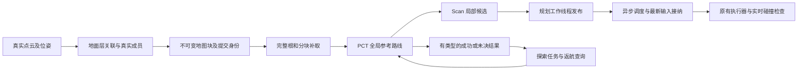
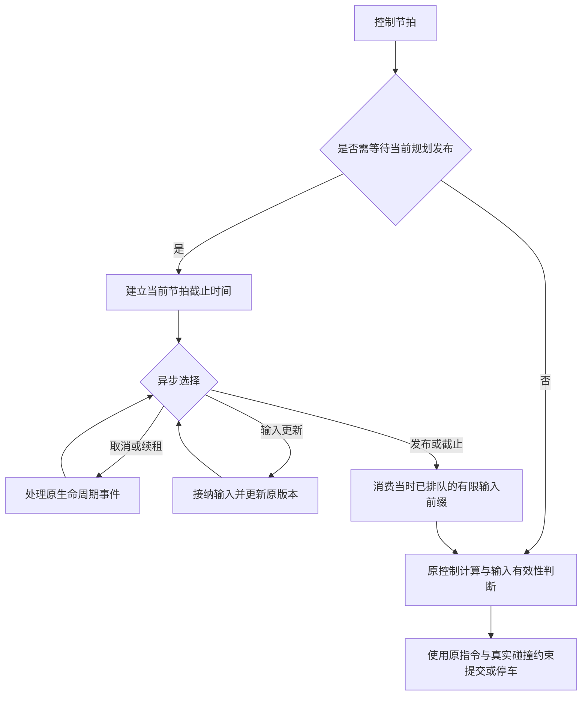

# 建图、导航与探索持续复查：2026-10-17 晚间

## 范围与基准

- 接入开发机提交后的基准：`23278603aa87b12c730665cbf7bb91462688bf0a`
- 已包含上午云端修复：`4ddfcd3dee25a720ad2c3796211c8cb537bd10ad`
- 云端 x86_64，Rust 1.88.0，运行时 Python 3.8.10；开发模拟工具另外验证 Python 3.12
- 所有 Rust 构建复用一个 `CARGO_TARGET_DIR`，不复制每个版本的完整构建产物
- 本报告是持续专项的阶段记录。通过某组离线测试不代表 Go2 实机问题已全部解决

## 链路与本轮检查位置

本轮不增加导航准入门槛、不提高搜索预算、不以未知地面伪造观测，也不删除真实障碍碰撞检查。

## 已复现的问题及修改原则

### 1. 地面层关联遍历无关列

`ground_observations.rs` 原关联路径为每个候选扫描整个块的已有地面层，随后才排除不同 XY 的层。
改为利用已有锚点编码，仅查询同一 XY 的候选，并按实际已存在的高度范围限制查询。
关联优先级、原始样本、平面和成员必须逐项等价。

真实 geometry release 测试二进制中的 Writer/地面回归已完成：20 项通过、3 项原有手动诊断忽略；完整层、样本与来源逐值等价。
独立 harness 的内存存储替身不覆盖生产验证、脏块计数和 IO，因此其加速结果不能当作整机收益。

真实二进制另执行关联阶段 12 布局 × 7 对交替样本，每次 1024 次更新，全部输出等价。初始同列查询在少量记录但 Z 跨度大的场景回退，已按实际记录数与待查询 Z 键数选择更小枚举，两路保留原升序和同一个处理函数。最终 4 列高跨度中位数 241.6 → 196.6 μs；1024 列单层 11221.1 → 509.8 μs，4 层 42666.3 → 1080.0 μs。极小布局接近持平；以上不含 capture、Writer IO 或整机导航。

### 2. 同粗格内地面选择不一致

真实 MLS 反例：上层直接查询为 0.07500000111758709 m，定位接口却返回 0.02500000037252903 m，随后机身验证错误拒绝。
修复在同一实际查询 XY 上比较各个实测层与高度参考，再把已选平面投影到原粗格坐标。
不能在粗格中心重新选一次层，也不能把另一层的实体成员一并豁免。

同格上层、下层碰撞、未分类回波、实时障碍、离中心平行斜面及高度缓存隔离已加入成对测试。
相邻粗格的层连续性另行验证：首个推测反例实际通过，已保留该结果。
随后在实际允许的图单元上构造 21.8° 平行坡面，真实每列增高 0.04 m，却因中间列错选层形成 0.10 m 假台阶；真实二进制已复现 patch 缺少下一合法单元。对应最小平面参考传播修正已经通过最终 MLS 全套：360 通过、0 失败、18 原有忽略。原步高和成员判定保持不变。缺失成员配对测试曾因删除整排而非单细列的夹具错误失败，修正夹具后通过，原失败日志保留。

### 3. 地图分片重复读取整个对象

协议分片为 256 KiB，但旧服务端每个分片均读取完整对象再复制切片。
4 MiB 对象的 16 次请求累计返回了 64 MiB 文件读取结果。
新方法复用原对象打开和类型/长度检查，定位并读取所需范围，保持原根保留关系及错误类型。
不增加传输会话、全量缓存或额外逐片 metadata 检查。

实际仓库方法的暖缓存 A/B，50 组交替样本，逐次核对重组字节：

| 对象 | 旧中位数 | 新中位数 | 旧 P95 | 新 P95 |
|---|---:|---:|---:|---:|
| 4 MiB / 16 片 | 16.033 ms | 2.197 ms | 22.596 ms | 6.413 ms |
| 393232 B / 2 片 | 0.0548 ms | 0.0363 ms | — | — |

这是本机文件读取与重组耗时，不含 RPC、真实磁盘冷读或机器人导航。
64 → 4 MiB 表示成功读取结果的累计长度，不是物理磁盘 IO 或进程峰值内存。

### 4. 搜索中的重复工作与测试默认值偏差

- PCT 对精确相同状态先判断代价是否严格改善，再执行完整的边段验证和状态分配
- 保留原过滤回调顺序；半径外的边仍完整验证后才可构成计算域截断证据
- Scan 普通测试改为使用生产的加权公式和调用方预算；显式诊断覆盖仍保留
- 红测发现配置预算 0 原来仍展开 256 个状态；修复后实际展开数对应 0、1、3
- 不改变生产权重，不提高预算，不把预算耗尽称为物理不可达

PCT 全套 65 通过、3 忽略；Scan 全套 68 通过、1 忽略。
全套运行时有并行任务，不用其耗时计算加速倍数。

### 5. 同步等待堵塞调度器

原 `PlannerWorker::step` 的 publication 条件变量等待阻塞调度器线程。
真实 scheduler 加真实 worker 线程的 gated 测试复现：

- 取消请求等待约 30.86 ms
- 位姿在 70 ms 到期，却在约 85 ms 仍提交非零意图
- 5 ms 配置仍进入固定 50 ms 等待

改为 publication watch 驱动异步等待。取消、续租和输入仍可处理；完成通知前先消费有限的已排队输入前缀；不延长原等待期限。
已有位姿有效性判断在等待结束后执行，不用额外重复校验补偿阻塞。

8 个真实 scheduler 定向用例重复 3 次通过；取消约 0.153–0.178 ms；新结果仍在下一节拍前被接纳。
这些数字使用立即确认的 FakeMotion，衡量调度器阻塞，不是 Go2、UDS 或网络延迟。
完整 runtime 当前为 279 通过、58 原有忽略；5 个已确认 UDS EPERM 用例明确过滤。
另外显式运行三个原有真实几何 scheduler 场景，均保持原运动历史/制动 oracle：持续障碍绕行到原目标（248 条唯一回执、768 条实际运动边）、障碍真正消失后恢复（239/734）、取消后替换目标（186/574）。这些仍是进程内确认的模拟执行器闭环，不是真机资格证明。
异步等待之后的续租/运输期间位姿到期竞态仍是独立待查边界，不据此宣布全部时效问题解决。

### 6. 工具入口和测试契约

- 模拟矩阵入口现在复用 NativeWorker 的点云验证及 JSON 数组/JSONL 位姿归一化，保留原输入路径溯源
- 新输入测试最初误设了 Python 3.10 以下跳过；父审查实际验证 Python 3.8.10 可导入并执行全部三项，已删除该跳过，生产脚本无需兼容性改动
- 补齐交付记录器直接导入的 TFMessage Python 生成模块；与已入库 C 协议字段及递归指纹一致
- 安装器刻意在启动时派生导航 profile；过期测试改为验证没有遗留 profile 锁死后续切换，不修改生产安装行为
- CLI 缺失 owner 测试显式使用二维链，并在独立子进程配置环境，避免依赖已变为三维的默认值

## 基线与环境限制

未经本轮修改的基线：PCT 63、Scan 64、MLS 352、地图块 71 项通过；runtime 269 项通过、5 项 UDS 绑定 EPERM；stack 308 项通过、2 项失败。

- 云端没有该测试所需的 multicast 路由，原分块 RPC 子进程与新增多片测试均在 liblcm 初始化失败；不能报告真实多进程传输通过
- 不更改网络策略、路由或测试期限来制造通过
- 两项 stack 预算用例在并行负载下等待结果尚未完成，原条件串行复跑通过；保留失败和复跑日志，不将其耗时作空载基准
- 真实机器人、ARM 端侧 CPU、生产传感器及实际执行器仍未在本云端验证

## 本阶段交付边界

本次提交包含已验证的 MLS、PCT/Scan、异步调度、地图块范围读取方法和 Python 工具入口。第一阶段之后，geometry Writer 关联优化已补齐实际回归和独占关联 A/B，作为后续单独阶段交付。后续第三阶段已完成 RPC owner 接线的 4 项明确 unit_transport 服务回归，包含错误分层、完整末片、换 frame 保留旧根及已接纳但排队等待 IO 的请求取消。真实 LCM 服务测试仍在缺少 multicast 路由的初始化阶段失败，进程内服务测试不等于真实传输覆盖。

## 第三阶段：探索任务资格与错误归因

- 真实返航核已返回 ResourceLimited，探索 owner 却提前归为连续失败。已保留底层错误类型，将未决资源结果映射到既有 PlanningResourceLimited；真实 owner 完整回归与 candidate 对照通过，不增加重试线程或导航门槛
- 真实 composite builder 证明地图输入完全相同，仅 committed_map revision/sequence 前进时，旧实现会在 Accept 前 Discard 或 Accept 后 Cancelled。两项实际红测保留
- 修复只对 Surface：完整 same_source_view 不变、原坐标域相同且提交单调前进时保留计算。Planar 仍要求原完整身份相等。GoalIntent 保留捕获时的原始来源，不改写成新提交
- 复用导航现有域比较函数，保留 session、generation、frame、boot 与真实 ground/observations/recent-obstacle/mask 的资格；7 项正负例及无 LCM 的生产准入函数测试全部通过
- 终点附近转向的另一个怀疑经真实几何测试不成立：默认 256 预算下受阻中心公开入口只展开 4 次就成功，开放中心也成功。该场景关闭缺陷假设，保留 3 项诊断回归，没有修改生产搜索优先级
- 射线历史点物化优化前，6 项真实 kernel/PGO 基线已通过并保存完整业务数据；包含节流、flush、检查点恢复、48 帧 interval=0、并行分片和取消后继续。随后单独完成射线优化，见下节

## 第四阶段：取消射线历史点云的无消费者物化

射线核构图使用当前帧点云，但旧代码为了检查点中的健康点数，每次候选构建仍导出、转成 f64 并排序全部健康历史点云；PGO 的 interval=0 会逐帧执行。现在用现成 healthy_count 的同一个 health>0 谓词取得计数，取消该派生数组与恢复时的重建；不改变当前帧占据计算、错误路径或检查点原计数的提交时刻。诊断测试显式需要点坐标时才按需物化。

- 优化前后同一 6 项真实 kernel/PGO 用例均通过，六份完整业务 JSON 与检查点 byte 数组逐值、逐字节一致
- 现有 mapping_backend 21 项、PGO 11 项回归通过；5 个原手动 PGO 诊断未运行
- 这些测试不覆盖生产监督 sidecar 的跨进程协议，不宣称该项通过
- healthy_count 仍遍历体素，复杂度 O(V)；没有端侧时延或整机加速倍数声明
- 探索缓存工作量也得到实际基准：同源的 3 次真实 Goal 选择各冷算全部 3000 格，夹着的 Pending 为 0，共 9000 格；随后复用优化见下节

## 第五阶段：真实探索 owner 复用私有前沿查询

唯一 backend 保留一份符合完整来源与配置资格的私有查询视图。普通反馈和活跃检查点读取不清除它；来源或配置改变、取消、Discard、Stop、Install、Retire 等仍按原生命周期释放。不共享或获取原源图缓存锁，不改变原 fork 隔离，也不新增全图复制、哈希或独立缓存系统。

- 真实 owner 的 4 次 capture 实际重建次数从冷基线对应的重复构建变为 [1,0,0,0]，实际 evaluated_cells=[3000,0,0,0]，累计 3000，对旧核实测 9000；不是读取旧 stats 冒充零工作
- geometry 工作量 1 项、backend 25 项、其余 owner 31 项全部通过，包含冷暖结果一致、配置/来源失效和停止释放
- workspace Surface adapter 56 项通过、5 项原忽略；MLS 源缓存隔离 2 项、frontier 9 项通过
- 本阶段只复用前沿相关私有查询；Tomogram 每次派生的问题尚未处理。没有宣称完整探索耗时按比例降低

## 第六阶段：投影段与执行索引一致

真实 partial 反馈试验发现：完整 detour 从较早位姿计算返回时，机器人已靠近墙前。原接纳把 progress 更新到后方投影段，却把 path_index 重置为 1，导致重新消费该段之前的旧支点转向。冻结采样回归中，wide/short 应采用投影段索引 55/35，旧版都是 1；早到同路径、完整机体扫掠资格均通过。

最小修复仅在原投影计算返回时携带段终节点索引，并与 progress 一起接纳。保留原几何投影、tie 规则、当前 applied、控制器和碰撞守卫，不引入完整姿态连接器、不要求所有移动换轨停车。精确顶点仍保留 incoming 节点及后续同 XY 朝向序列。

- 旧版 2 个移动/退化正例通过，4 个结构回归实际失败；修后 6 项结构全部通过
- wide/short 修后实际 admission_index 为 55/35，实际 target 为 175/171，不再回放旧 pivot
- 普通 runtime 全套 283 通过、64 ignored；仅精确过滤已知 5 个 UDS 权限用例；其中正常 SurfaceFollower 68 项通过
- 原两个更强的晚到首转向进展诊断仍失败：现在是新前瞻目标的对齐转向被真实墙体扫掠拒绝。没有放宽原 oracle，不能把结构修复称为靠墙恢复已解决
- 原 45 秒模型窗 normal 未到达、detour-first 对照到达停稳的证据保留；模型时间不是实时周期性能。相关长诊断按原样显式 ignored，必须手动运行，普通绿套件不代表它们已通过

## 第七阶段：精确重复失败不再重跑全局 PCT

原真实墙前日志中，停稳后的请求输入完全相同，两个 Scan 分支已经命中既有失败缓存，但每次仍先执行成功的 PCT 参考搜索。将原两槽资格从“已派生参考”改为“该分支的精确输入”，在 PCT 前命中；不另造缓存、等待或任务。仍只复用原有非取消 Scan 失败，不把预算不足变成物理不可达结论。

Scan 预算与 partial 首点/最小进度纳入真实资格；共享 PctPlanner 成本可同 epoch 改变，因此复用本次原有成本快照并让两槽共享，PCT 也使用同一快照。保留位姿、来源、边界、目标、最终朝向及原 epoch/取消规则，无额外哈希或新锁。

- 真实 wide/short 首次 PCT 各 1 次（42276/39713 展开），精确重复变为 0 次；两分支原失败的逐位输出一致
- 同 epoch 的真实成本 report/clear 均重新规划，并实际改变/恢复参考，与 fresh kernel 结果相同；预算改变、真实安全位姿恢复、取消和新 epoch 均验证
- route_planning 13 项、真实重复回归 2 项通过；同生产的 route_follower 44 项通过、6 项原 ignored
- 旧 seed 测试曾把两个合法分支槽互换却要求全部失效；保留失败日志，修为真实双向分支隔离与同分支命中，不修改生产规则迁就测试
- 本改动省掉没有新信息的重复计算，不能让本来无法从当前站姿完成的动作变得可行，也不代表墙前整体恢复已经解决

## 第八阶段：复用探索层析图，并测清初始规划阶段

现有 opaque planning pair 持有私有 PctPlanner，仅调用其 map 缓存不可变 Tomogram，随现有合格私有查询一起 rebind/释放；没有第二套清理协议。实际当前碰撞、候选/搜索预算、路线代价和历史仍走原逻辑，普通同步调用保留原构图入口。

- 原 builder 实际 owner builds=[1,1,0,1]、cells=[3000,3000,0,3000]；候选实际变为 [1,0,0,0]、[3000,0,0,0]。共 9000→3000 格，前沿原已复用的 3000 格不变
- 真实 owner 主项 1、其余 Surface owner 11、backend 25 全通过；来源/observations 替换及取消后 retirement 仍冷重建
- workspace Surface adapter 60 通过、5 ignored；MLS 隔离 2、PCT 取消/来源 3 通过。原默认 feature 的七包 tests 类型检查另通过
- 原构建没有终态回执时，同一 target 增量恢复，保留旧日志为未证实完成；最终实际 binary 及全部结果均重新取得终态，未用旧 binary 冒充

新增阶段观测仅显式 Scan/profile 或 cfg(test) 生效，默认生产行为不变；8 个手动资格测试通过计数分割断言。公开弧目标先由 quick_direct 完成，root-arc 为 NOT_QUALIFIED；私有 root 弧另验证 0 展开，不能混为公开弧结果。

同一 profile 诊断内，两墙 nominal 剩余搜索为 7.957/8.729 秒、各 256 展开；root miss 约 0.22/0.21 ms。detour 由 PCT 240.6/190.5 ms 加参考样条 1100.3/899.8 ms 完整，无局部搜索。反例同时成立：公开 1cm 出发用例只展开 1 次，remaining 75.25 ms；固定窄边界 detour 先花失败 PCT 40.48 ms，仍搜索 7.959 秒并只得到 partial。因此不把所有请求改成 PCT 优先，先保留现有排序。

尺度限定：两墙源体素为 1cm、122241 输入点，规划网格虽为 10cm，仍是密集细源压力场景；体型 0.60×0.32m。1cm 出发反例机体宽仅 3.98cm。以上不是 Go2 常规 5cm 实测，也不能直接与旧无 profile 墙钟比较或推导完整导航加速倍数。

## 第九阶段：去除地面查询中无用的兼容工作

同一不可变观察源、同一 voxel key 的相邻重复 get 已直接复用既有存在性结果。实测层选择提取为共享借用 helper，成功与“有实测层但不合格”都直接返回原结果；仅真正 legacy 列走原单次批读与冷建。没有新缓存、哈希、锁或精度/避障变化，mixed 列原顺序与 legacy 回退边界不变。

- tests-only 旧核在预期工作量断言失败：measured bands 4 对目标 0，mixed 4 keys 对目标 2；完整冻结旧 selector 与 Option 契约先通过
- 合并候选五项精确测试通过；180 条完整 pose/motion 旧新 trace 逐字节一致，包含合法/拒绝结果及 witness；measured 拒绝没有转入 legacy 放行
- MLS 364 通过/19 ignored，Scan 75/10 ignored，runtime 287/67 ignored且仅已知5 UDS过滤，Surface 60/5 ignored；默认无 Scan/profile 的七包 tests 类型检查通过
- 原8项阶段观测一致性通过，解析出的11条观测在路径类别、资格、展开、几何调用计数及阶段顺序/结果方面均与原记录相同，公共arc-root仍为NOT_QUALIFIED
- 4→0、mixed4→2仅是这段真实缓存工作量；完整pose其他路径仍可能构建bands。未做受控耗时A/B，不宣称全链时延下降或已解决1cm墙压力热点

## 第十阶段：普通生产 sidecar 的真实跨进程协议

使用普通 `cargo build --release --bin nuwax-geometry-runtime` 产物（Cargo artifact 的 test=false），以 stdin/stdout 实际驱动生产 ray sidecar。完整生命周期、新进程恢复、历史计数、三类待决取消、STOP/EOF 和错误事务/阶段/来源共 11 项全部通过，候选业务 wire bytes 与完整 checkpoint 对照一致。没有用测试 binary 冒充生产入口。

首次第10项因诊断脚本漏写生产 Option 调试文本的 Some(...) 失败；只修脚本精确预期，ERROR帧、阶段、exit1/EOF都保留，同一binary全量重跑通过。原失败和前9项证据保留。诊断脚本已在repo路径、不同cwd及相对参数下用Python3.8.10再次完成11项；不强制用户Python恰为3.8.10，结果记录实际版本。

可复用入口为 `scripts/diagnostics/qualify_mapping_sidecar.py`，说明见 `mapping-sidecar-production-qualification.md`。大oracle、构建产物及原始响应保留在外部工作目录，不入Git。本资格不包含生产父supervisor/commit-owner/watchdog、LCM网络、ARM或真实机器人，也不推导端侧性能。

## 第十一阶段：旋转采样不再构造未使用的接触几何

旋转地形采样只读取原四帧插值、归一化端点和中间姿态，旧实现却同时构造完整机身顶点、面、边及各自扫掠范围。现提取私有 MotionInterpolation，采样只构造所需数据；完整 RotationEvents 在实际接触检查处仍复用同样插值并构造原几何。没有新增缓存、锁、哈希、采样容差或运动许可，也未删除地形、机体及边界检查。

- tests-only 先验证原实现：4 项数学/真实接触/异常分类对照通过，结构断言实际 1 对预期 0 失败；候选同一 5 项全部通过，支撑网格不再构造未消费的完整几何
- 486 组完整采样时刻逐位对照；完整接触预计算字段和接触区间与冻结原构造器一致。实际接触路径仍构造完整几何，纯平移原路径不变
- 真实 pose/project/motion、近期障碍、凹边界及 first witness 的 240 条完整旧新 trace 逐字节一致；原 clear/interior-obstacle/boundary sanity 保持
- 默认无 Scan/profile 的同配置增量 check/no-run 通过；MLS 369 通过/20 ignored，Scan 71/1 ignored，runtime 287/67 ignored且仅原5 UDS过滤，Surface adapter 60/5 ignored全部通过。默认与此前profile配置的测试数量不同，不混为新增跳过
- 验证后只删除新测试文件末尾一个多余空行，未改变任何语句。结构构造减少不代表全导航耗时比例；未做受控整链或端侧性能比较

原晚到路径进展失败、真实网络/ARM限制仍保留。新的5cm诊断另外发现旧Wall测试把无边界未知域当成禁止域；该测试契约正在独立纠正，不混入本性能补丁，也不追溯改判旧失败。

## 第十二阶段：真实来源与测试世界诊断（闭环仍有失败）

新增显式真实输入捕获、fixed-recent测量资格、无mask平地与显式mask许可域测试。默认导航策略不变。默认/显式构建通过，16项纯控制和preflight通过；3项新live测试失败，fixedWall未运行，不能称为完整导航资格通过。旧Wall观测域前提冲突、新时序碰撞、fixedBox晚到绕行分别保留和归因。

诊断自身的fork-owner误断言已修正：原request source用于账本关联，实际planning fork用于复放，二者不能用owner相等替代数据继承关系。两个真实fork接缝回归通过，合成admission不是实际h资格。详细结果、守卫与时序边界、可重跑入口见 [真实owner资格记录](navigation-real-owner-qualification-20261017.md)。后续仍需实际分支和actor时序观测，未实施新选择策略或延长超时。

## 第十三阶段：证实首个 partial 的真实分支来源

新增独立首partial事实窗口，保留原h资格与默认导航策略。显式增量check/no-run和两个fork接缝回归通过；一次原参数fixed Box闭环仍失败（38.16秒，PlannerFailed），但本次来源测量、原连续运动oracle及cleanup均通过。实际捕获唯一Inserted来源的nominal partial，request/branch detour均false，尚未尝试另一分支即返回。具体输入、输出、不可推导的接纳/执行关系与候选边界见 [真实owner资格记录](navigation-real-owner-qualification-20261017.md)。

这验证了选择策略候选的触发条件，并未实施该候选或宣称改善。输入延迟诊断另行进行，不能用上次晚期过期解释本次持续有效输入下的规划失败。

## 第十四阶段：分离实际 actor 耗时与最终状态推断

增加仅显式诊断会话启用的定容、非等待标量记录，观察真实输入、状态输出ACK以及renew当时内部快照。原数据/线程/控制/TTL不变，默认不开启记录。6项控制和显式/默认增量类型检查通过；唯一flat Wall运行原到达与几何oracle通过，但42701条记录有91条竞争丢失，时间观察不完整，也没有复现旧失败。旧失败保留，不称为时序修复或性能收益。细节见 [真实owner资格记录](navigation-real-owner-qualification-20261017.md)。

## 第十五阶段：保留 nominal partial，只探测快速完整绕行

原实现遇到 nominal partial 即返回，未给已有 detour 参考候选一次完整接续机会。曾试验“保存 partial 后运行完整 detour”，但固定窄域反例额外执行一轮 256 展开仍只得 partial；这份中间策略没有单独发布。

本阶段保留原 partial 的所有权，仅为此情况调用共享 Scan 的 reference-only 入口：复用原参考候选、几何、到达与取消逻辑，在 search_prepare 之前返回 Complete 或 Miss。Complete 优先；Miss/普通失败保留原 partial，不写入完整搜索失败缓存。取消仍丢弃过期结果。nominal full、nominal 真正失败及显式 detour 请求仍使用原完整路径。没有复制参考算法、增加搜索预算、改精度、放宽避障或延长超时。

- Scan tests-only 旧 Full 适配器：3 控制通过、2 目标断言红；候选同 5 项绿。普通 Scan 79 通过/11 ignored，原 256-partial 资格用例另外通过；probe Miss 的 search_prepare/root/remaining 工作为零
- runtime tests-only：7 控制通过、7 reference-only 选择断言红；候选 14 矩阵和 4 observer/fork 控制通过。route_planning 27、route_follower 46/9 ignored、planning_owner 4 通过；这些计数互有重叠，不相加为独立覆盖数
- 独立 arrival=None 的参考交接断言通过。默认无 Scan/profile 的七包 tests 类型检查通过；诊断 feature 与默认配置的结果分开记录
- 真实 wide/short 阶段均为 N256 partial→T quick_spline_reference full，无 T 剩余搜索；旧 N-only/noPCT 资格公式仍如实为 NOT_QUALIFIED。true-only full 仍为 QUALIFIED
- bounded false 保留原 N256 partial，T 明确为 reference_miss，未进入 search_prepare/root/remaining。本次 T Scan 仍花 330.872ms，前置 PCT 52.485ms，不能称免费探测。bounded true 仍执行原完整 T256 partial
- 机会损失反例保留：真实 Full 可经 1 次展开找到完整路径，而 reference-only 返回 Miss。Miss 不等于没有路径；这是仅在已有可用 partial 时采用的有限探测策略

同原 A/D 配置的单次 fixedRecentBox 闭环使用 recovery-only、Scan=[]、trace=None：12.80s，原目标/停车 fence/cleanup/固定近期障碍测量与连续几何 oracle 均通过，728 段实际 SE2 运动检查通过。该运行没有分支观察器，不能证明 E 的可选探测实际被触发；A、D、E 各一次运行本来都成功，不构成原失败被修复或统计加速的证据。此为同实例真实 liblcm memq/codec 仿真，不是 UDP、ARM 或 Go2 实机资格。

当前显式 profile 的 N remaining 仍分别约 17.385/16.883/7.769 秒，主要落在 project 与 sweep。它们是含调度影响的墙钟，不是 CPU 独占耗时；嵌套阶段不能重复相加，也不能和旧版本直接算倍数。此前完整 runtime 的一次 urgent cancellation 50.768ms 超过原 20ms 断言仍未解释，后续独立观察成功不撤销该失败。探索早终态交接另行修复和验证，不混入本阶段通过结论。

## 第十六阶段：探索不再丢失提交返回前的导航终态

真实交接顺序存在空窗：Nav 已分配目标并收到结束结果，但 Explore 尚未拿到 submit 返回的 ticket；实时 fanout 找不到已附着的子目标，随后 Explore 反而装入一个已经结束的 child。Stop 再取消这个已退休目标也会失败，留下逻辑占用。

修复复用 Nav 原有 32 条有界终态记录，在原精确执行退休点保留该条结果的自然退休出处。Explore 安装并发布 child 身份后，只回读一次该目标的结束结果；读取等待者被取消时，由下一 tick 的原 active-child 分支续读，保留既有 Stop/返航优先级。补读和实时反馈共用原去重与源状态结算。Stop 对已自然结束的 child 结算原待决动作，不重开普通反馈，也不伪造 Nav 的取消结果。已发出的取消仍要求原票据对应的真实 ZERO；旧路径记录不能冒充当前执行已结束。

- 旧实现的 early Reached、已退休 Failed/Reached 后 Stop 三项命中真实逻辑红。early Failed 首轮被错误的缓存 diagnostics 断言挡住，未计作合格目标红
- 最终原 7 项加新 10 项共 17 个 exact 全通过：早终态、停止优先、等待者取消恢复、重复反馈、旧路径/原始结果归属、取消事务、忙 telemetry 下的第二次结果查询等均保留原限制
- 前一批 69 个既有相关回归已通过；43 个原 UDPM 测试在当前云环境的 lcm_create/组播路由初始化受阻，没有以 memq 替换或记为通过。上述是分批证据，不是同一次 129 项全通过
- 测试使用实际 geometry bin 的原 release/LTO 构建。最后增量 check 1m07s、no-run 14m28s；实际 binary 与冻结源码核对，单一 target 复用，没有降低构建配置
- 验证中修正了测试前提：源历史经原 owner inspection 读取，不能把最后一次 poll 的 diagnostics 当作反馈后的状态；无 MappingAdapter 的 Bridge 使用 frame=0，不能为公开 checkpoint 强设 frame=1；独立 workspace TMPDIR 避免不同执行 namespace 重用 PID 时读到上轮 journal。原失败日志与旧 journal 保留，生产接纳、first-winner 和 ZERO 合同未放宽

此阶段修复的是终态交接与探索逻辑占用，不是实机路径质量、网络通信或主搜索耗时资格。主搜索的细分归因与建图增量成本优化继续进行。

## 第十七阶段：局部地图查询裁剪目录并借用 dirty 块

Writer::region 原来逐项扫描全部持久块和 dirty 块目录，再筛选附近范围。现复用仓内 ArchiveReader 已有的 BTreeMap X 范围查询，再执行原 Y/Z 与体素边界筛选；原有序集合去重、dirty 优先、块内输出及错误/预算顺序不变。dirty 分支直接只读借用现有 Block，持久分支仍以 reader 返回的局部 Arc 保活，省去每个命中 dirty 块的临时整块 clone 和 Arc 分配。

- 独立测试先在原生产上验证 11 项全部通过，再装入候选验证同一 11 项；这是等价验证，不制造虚假的 RED。冻结原全扫/clone oracle 未随候选改写
- 完整 map-chunks 84 通过、1 原 ignored、0 filtered；默认七包 tests 类型检查通过。负坐标、跨块边界、删除空块、dirty 覆盖、预算/读取错误优先级、极值、移动窗口及部分 flush 失败保持原结果；返回拥有值在后续修改后仍不变
- 结构模型中 131072 个目录 key 缩为 1248 个 X 范围候选，之后仍需 Y/Z 精筛。这不是生产访问计数或同倍数耗时收益；地图沿 Y 延伸且 X 均在窗口内时，仍可能扫描全部 key
- 原必须执行的块内读取/坐标转换/输出分配保持，未新增空间索引、缓存、锁、哈希或运行时校验。没有整链或实机提速结论

## 后续持续检查

1. 墙前晚到路径的实际恢复与初始 full/partial/PCT 顺序，保留及时移动和真实避障
2. 持续核查规划缓存与真实输入变更后的恢复，不把缓存命中当作可达性证明
3. 投影/扫掠的重复查询与 measured/legacy 分支无用工作，跨分辨率验证精确等价
4. 真实多进程通信与 ARM/Go2 端侧资格，云端已知网络限制仍未解除
5. 真实来源、地图变更、控制/规划并发和执行反馈的持续边界检查

本清单会随红绿验证更新。发现疑点不等于确认缺陷，未复现的推测不直接作为修改依据。专项继续进行，不因单个阶段通过而宣布导航整体完成。
