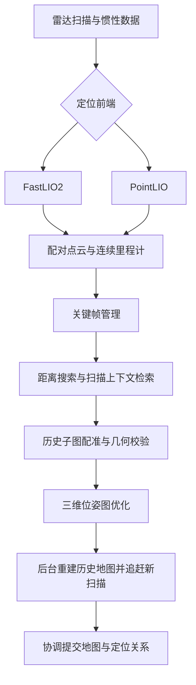

# 双 LIO 建图与回环纠偏

Nuwax Robot Bridge 的三维链路支持两种 LIO（激光惯性里程计）前端：FastLIO2（快速激光惯性里程计）与 PointLIO（逐点激光惯性里程计）。两种前端负责连续估计运动，共用关键帧、地图管理和回环纠偏后端。

这让定位前端的选择与地图资产的管理保持清晰分工：前端根据传感器求解当前运动，后端在重访已有区域时检查历史约束，并将有效校正应用到地图。

## 选择前端与后端

先安装并构建所选前端，完成雷达、IMU（惯性测量单元）、源时间和外参配置。在设置页选择三维链路及相应后端，或在实际生效的配置文件中设置：

```dotenv
NUWAX_GEOMETRY_PIPELINE=lio_3d
NUWAX_GEOMETRY_LIO_BACKEND=fastlio2
NUWAX_GEOMETRY_MAPPING_BACKEND=voxel
NUWAX_GEOMETRY_CORRECTION_BACKEND=library_pgo
```

使用 PointLIO 时，将定位前端改为 `pointlio`，并确保对应程序可用。`voxel` 表示体素地图后端，`library_pgo` 表示共用库内 PGO（位姿图优化）后端；`none` 表示关闭校正。按设置页提示重启相关服务。

两个前端都需要真实扫描内点时间、连续惯性输入及准确标定。前端配置值只表示所选方案，实际就绪状态还需核对数据与程序。

## 数据如何形成校正地图



回环候选只是“可能回到了旧位置”的证据。系统还要执行独立配准、几何校验、图优化和地图重建，最终提交后才能认为公共地图已应用纠偏。

### 找到可能重访的位置

关键帧按实际位移和转动筛选。距离搜索之外，Scan Context（扫描上下文描述子）用于检索历史地点，并在条件允许时提供航向初值。

描述子相似不直接生成有效回环。视野不足或旋转对称等情况，会限制可用的航向信息。

### 检查几何是否支持闭环

候选需要与历史子图进行由粗到细的点云配准。后端检查几何约束、双向覆盖、独立对应和空间支撑，避免仅靠单面墙或近期相邻帧确认回环。

图优化中的噪声和置信度参数用于约束求解，不是实机精度指标。开启回环也不能补偿错误时间、外参或输入缺失。

### 把校正真正应用到地图

历史重建在后台分段推进，并追赶期间新增的扫描。提交前再次核对当前会话、地图来源与修订，协调安装地图、后端状态以及地图到里程计的变换。

当前使用 GTSAM（因子图优化库）的 LM（列文伯格—马夸尔特）求解器。兼容配置中的 `native_pgo` 有独立的检索与配准策略；本文的扫描上下文流程对应 `library_pgo`。

## 二维投影、三维地图与完整扫描

三维链路同时提供多种数据表达：

| 数据 | 作用 |
| --- | --- |
| 三维规范点云与精细地图 | 表达空间几何，为后续三维计算提供依据 |
| 水平扫描二维投影 | 从同帧雷达原点和水平回波累积平面占据信息 |
| 完整扫描资产 | 保留已接纳扫描的原坐标点，用于完整点云显示等用途 |

水平投影不替代三维支撑与净空判断。完整点云显示也不等于所有算法都会对全部历史点逐点计算。

保存和激活沿平台地图资产流程进行。旧栅格不会因为升级投影算法自动重绘；重新生成需要新建地图，或使用具备必要原始扫描与配对位姿的重建流程。

## 怎样核对效果

先在日志中区分候选、后台准备和最终应用：

| 事件 | 需要确认的内容 |
| --- | --- |
| `pgo.loop.candidate` | 已产生候选，尚未表示地图纠偏完成 |
| `pgo.map.background_prepared` | 后台准备结果，以及失败原因 |
| `nuwax_correction_candidate_finalized_v1` | 最终处理结果是否为 `Applied`（已应用） |

现场验证应同时检查闭合路线误差、重复墙面重合、平层高度、运动轨迹和位姿源时间。若地图显示改善但定位更新明显积压，仍需继续分析输入与计算链。

项目已有真实原生程序配合合成输入的回环与地图一致性验证。这类结果用于确认算法接线和流程，实机精度需用实际设备、标定和路线重新测量。

## 容量与当前限制

回环历史归档有独立容量限制，当前实现的归档点数上限为 800 万；耗尽时记录 `pgo.history.exhausted`，后续完整历史校正可能被拒绝。这一限制属于回环历史，不是浏览器当前显示点数。

后台分段处理可降低长时间独占计算的影响，但单次内核调用不能强制抢占，不构成固定耗时保证。当前仍使用历史扫描重建，尚未提供无限规模的持久分区子图方案。

实现参考：[原生前端](../../services/nuwax-workspace/crates/nuwax-lio-backends)、[回环地图重建](../../services/geometry/nuwax_geometry_runtime/src/pgo_map.rs)、[校正协调](../../services/geometry/nuwax_geometry_runtime/src/correction_coordinator.rs)。

[返回文档导航](阅读指南.md) · [地图与导航能力](功能列表.md)
