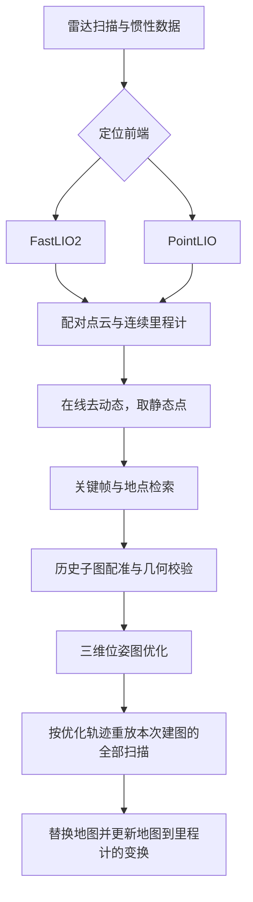

# 双 LIO 建图与回环纠偏

Nuwax Embodied Harness（NEH，具身运行框架）的三维链路支持两种 LIO（激光惯性里程计）前端：FastLIO2（快速激光惯性里程计）与 PointLIO（逐点激光惯性里程计），也可以直接使用设备自带里程计。前端负责连续估计运动；回环校正在机器人回到走过的地方时检查历史约束，并用优化后的轨迹重建地图。

## 选择前端与后端

先安装所选前端模块（`fastlio2` 或 `pointlio`，两者可共同安装），完成雷达、IMU（惯性测量单元）、源时间与外参配置。未指定后端时，安装器优先选择已选模块中的 Point-LIO，已有后端配置沿用。然后在设置页修改，或用命令行：

```bash
neh config --set geometry.pipeline lio_3d
neh config --set geometry.lio_backend pointlio
neh config --set geometry.mapping_backend voxel
neh config --set geometry.correction_backend library_pgo
neh restart --wait
```

| 键 | 取值 |
| --- | --- |
| `geometry.lio_backend` | `fastlio2`、`pointlio`，或 `device`（设备自带里程计） |
| `geometry.mapping_backend` | `voxel`（体素窗口）或 `raytracing`（射线追踪） |
| `geometry.correction_backend` | `none`（不校正，默认）、`library_pgo`（进程内 PGO，位姿图优化）、`native_pgo`（原生 PGO 进程）、`relocalization`（只做重定位） |

两个前端都需要真实的扫描内逐点时间、连续的惯性输入和准确标定。

**PGO 与重定位二选一。** 选择 `library_pgo` 或 `native_pgo` 时不能对已保存地图重定位，因此也不能在已保存地图上续建；需要“加载地图后重定位、导航、续建”的场景使用 `none` 或 `relocalization`。

## 数据如何形成校正地图



**找到可能重访的位置。** 关键帧按实际位移（默认 0.5 米）和转角（默认 10°）选取。除了按距离搜索，Scan Context（扫描上下文描述子）用于检索历史地点。描述子相似本身不构成回环。

**检查几何是否支持闭环。** 候选要与历史子图做点云配准，检查重叠比例、配准误差与多帧确认，避免只靠一面墙或刚走过的相邻帧确认回环。PointLIO 使用更严的一组默认门槛。参数可用 `geometry.pgo_options`（JSON，字段见[参数定义](../../contracts/pgo_options.json)）调整。

**把校正应用到地图。** 回环成立后，用 GTSAM（因子图优化库）求解的轨迹在各帧源时间上插值，把本次建图记录的扫描逐帧重放：重新去动态、重建三维点云与二维占据栅格，然后整体替换当前地图，并更新地图到里程计的变换，实时位姿随之更正。重放在建图线程内完成，期间新到的扫描只保留最新一帧。

送进校正的是在线去动态判定的全部静态点（包括地面），地面帮助约束高度与俯仰、滚转。

## 二维投影、三维地图与完整点云

| 数据 | 作用 |
| --- | --- |
| 精细层点云（5 厘米体素）与实测地面 | 三维导航、探索与重定位的依据 |
| 水平切片二维栅格 | 用雷达高度上下各 0.1 米、0.3—30 米内的回波累积平面占据；改变已知格需要多次真实观测 |
| 完整点云 | 保留未判为动态的原始点，供网页查看与存档 |
| 原始扫描暂存 | 回环重放与地图清理使用；按位移、转角与时间间隔选帧记录，保存地图时拷进地图目录 |

水平切片不代表低矮障碍、悬空物或完整机体的可通行性，这些由三维导航判断。

## 怎样核对效果

几何运行时的日志（`安装根/data/logs/geometry.log`）记录回环过程：

| 事件 | 含义 |
| --- | --- |
| `pgo.loop.measured` | 得到一个回环候选的配准结果 |
| `pgo.loop.rejected` | 候选被拒绝及原因（几何校验不通过的拒绝为调试级，默认日志级别下不显示） |
| `pgo.loop.confirmed` | 回环确认，随后重建地图 |
| `pgo.loop.search_summary` | 本帧回环搜索的摘要 |

现场验证同时检查闭合路线误差、重复墙面是否重合、平层高度、运动轨迹与位姿时间。用合成输入的验证只能说明算法接线正确，实机精度需要用实际设备、标定和路线重新测量。原生 PGO 的完整回环尚未在实机上验收。

## 当前限制

- 回环重建要重放本次建图的全部扫描，耗时随建图长度增加；重放期间地图暂不更新。
- 原始扫描暂存有总量上限（`geometry.raw_scan_max_mib`，默认 1024 MiB），写满时建图会话进入故障，长时间建图前确认预算足够。
- 开启回环不能弥补错误的时间、外参或缺失的输入。

实现参考：[原生前端](../../services/nuwax-workspace/crates/nuwax-lio-backends)、[回环与重定位](../../services/geometry/nuwax_geometry_runtime/src/corrector.rs)、[回环检测与优化](../../services/nuwax-workspace/crates/nuwax-mapping/src/loop_closure)、[建图与重建](../../services/geometry/nuwax_geometry_runtime/src/mapper.rs)。

[返回文档导航](阅读指南.md) · [地图与导航能力](功能列表.md)
