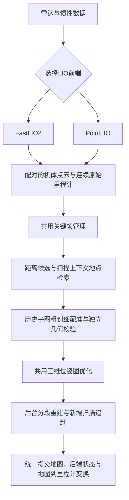

# 双LIO建图与回环纠偏

本项目让FastLIO2（快速激光雷达惯性里程计）和PointLIO（逐点激光雷达惯性里程计）共用地图与回环后端。高精度建图需要正确的扫描内运动补偿、标定、地点检索、独立几何配准，以及真正提交到地图的历史轨迹校正。

## 使用同一后端

在已有传感器和外参配置中选择：

```dotenv
NUWAX_GEOMETRY_LIO_BACKEND=fastlio2
NUWAX_GEOMETRY_MAPPING_BACKEND=voxel
NUWAX_GEOMETRY_CORRECTION_BACKEND=library_pgo
```

切换到PointLIO时，只需将第一项改为`pointlio`，并使用对应已构建程序。`library_pgo`表示共用库内PGO（位姿图优化）后端；基础配置的`none`表示关闭校正。二维后端也可按已有配置选择`raytracing`（射线建图），与前端LIO选择独立。

配置重启生效。两种LIO都需要带真实点时间的雷达扫描、连续惯性数据和准确外参。修复后的实机精度复测应新建地图，保留旧图作对照。

## 实际数据链路



原生前端负责连续局部里程计，Geometry（几何运行时）拥有规范地图与校正。图优化使用已有GTSAM（因子图优化库）的LM（列文伯格—马夸尔特）求解器；本实现未改成iSAM2（增量平滑与建图求解器）。现有`native_pgo`兼容后端也使用统一地图重建与提交流程，但其地点检索与配准策略独立；上述扫描上下文与噪声模型属于`library_pgo`。

## 怎样确认回环可信

关键帧按实际移动与转动筛选。距离搜索补充Scan Context（扫描上下文描述子）：先按惯性姿态水平化机体点云，生成极坐标高度描述子，以环均值检索候选，再用扇区移位提供回程航向初值。描述子不直接生成回环边；视野过少或旋转对称时不给出猜测航向。

每个关键帧最多对六个环键近邻作描述子精比、执行四次几何配准。历史子图排除当前时间邻域，避免用最近几帧的里程计自证回环。点到平面配准复用目标法线与搜索树，先粗匹配，再把对应距离收紧到最多0.3米；默认最终均方误差上限为0.04平方米。每次迭代先检查实际对应的法线约束是否能观测完整六自由度，避免单平面等退化场景使底层线性求解产生非有限变换并触发进程断言。最终变换还要通过双向覆盖、足够的唯一对应点和非共线几何支撑检查。

未提供关键帧增量协方差时，里程计使用随移动、转动增长的保守噪声模型。回环权重考虑有限独立对应支撑和空间力臂，并保留2厘米平移、0.5度旋转的标准差下限。它们属于算法置信度参数，不能解释为已达到的实机精度。

## 后台性能与一致性

普通回环的历史重建保留同一私有状态，按约8毫秒、最多16帧一个计算片推进，片间至少让出2毫秒。单次内核调用不能被强制抢占，因此这不是硬实时上限。累计计算超过三秒时继续推进，关闭、取消和会话退休仍能结束准备。

后台准备只追赶新增扫描，追赶完成后再生成完整地图；等待正在提交的扫描时复用已准备结果。同进程体素后端直接转移已验证的内核，隔离射线后端保留跨进程编码。私有点云采用匿名内存，排序状态随累加器转移；后台射线与法线计算走串行入口，控制处理器占用。关键帧、配准和图优化也在保留的后台计算任务运行。

候选尚未交付时保留五秒交付期限；拥有方实际开始后台准备后，不再用该期限截断历史计算。领取最终提交后的五秒看门狗仍有效。提交前检查会话、地图坐标代次、后端代次、校正修订和已接纳扫描尾部，再同时安装二维地图、三维地图、后端状态及地图到里程计变换。公共位姿按最新原始里程计重新表达，保持真实源时间。

## 排查与验证

从运行日志区分三个阶段：

| 事件 | 含义 |
| --- | --- |
| `pgo.loop.candidate` | 已测得约束并生成优化候选，尚未表示公共地图已纠偏 |
| `pgo.map.background_prepared` | 后台地图准备完成或拒绝，检查`success`和`error` |
| `nuwax_correction_candidate_finalized_v1` | 校正最终结果，确认`disposition`确为`Applied` |

现场曾出现八次候选全部因`RebuildBudgetExceeded`（重建预算耗尽）拒绝。此次修复处理了累计三秒重建截止时间、五秒回执误取消、重复物化和弱回环权重，并修复了单平面配准可能终止进程的问题。

本机已用已知真值场景验证跨搜索半径回程、航向反转、真实表面匹配、部分重叠与退化拒绝，以及地图/后端/位姿的一致提交。2400帧后台重建实测超过三秒仍成功完成；详细数值随运行环境变化。实机精度应通过闭合路线、重复墙面重合、平层高度和连续位姿延迟共同验收，不能只看有无候选日志。

## 本轮本机验证结果

以下使用真实原生算法程序与合成雷达/惯性输入，各运行900帧、90秒，不是实机成绩。

| 前端 | 已应用回环 | 最长后台准备 | 观测位姿的最大源时间间隔 |
| --- | ---: | ---: | ---: |
| FastLIO2 | 2次 | 6.51秒 | 约100毫秒 |
| PointLIO | 2次 | 3.01秒 | 约100毫秒 |

输入周期为100毫秒，两种后端都在超过旧三秒窗口后完成了地图纠偏。独立2400帧后台基准用时约4.8秒，五毫秒定时任务最大间隔约7毫秒，最大驻留内存约185 MiB（兆二进制字节），处理器用量约一个核心的74%。这些是特定数据与主机上的测量，不是任意地图规模的耗时保证。

合成终点未对齐坐标误差分别约12.8厘米、1.03厘米；FastLIO2关闭回环的对照约13.5厘米。取第十秒以后数据并作一次固定刚体坐标对齐，最终两种前端的路线位置均方根误差分别约3.13毫米、0.56毫米。该对齐只用于检查路线形状，运行输出仍保留原坐标；它不能替代外参、重力基准和实机精度验收。

主机与Ubuntu 20.04目标架构模拟器均通过地点检索、回环/定位、正常表面及单平面安全拒绝测试。实机验收应在部署对应构建后，按真实闭合路线重新测量。

## 当前容量边界

完整扫描归档仍受800万点上限约束，GTSAM接口最多接收2000个图节点。归档容量耗尽时会记录`pgo.history.exhausted`（扫描历史耗尽）并拒绝后续完整历史校正。三维运行快照仍按既有容量进行体素加粗。此实现保留后台全历史重放，尚未提供持久化分区子图或无限规模地图；部署时须结合任务长度与点数检查容量。

## 参考资料

- [FAST_LIO_SLAM原作者仓库](https://github.com/gisbi-kim/FAST_LIO_SLAM)：前端里程计与回环后端独立，后端消费点云和里程计。
- [Scan Context原作者实现](https://github.com/gisbi-kim/scancontext_tro)：极坐标高度描述、环键检索与航向对齐。
- [LIO-SAM原作者仓库](https://github.com/TixiaoShan/LIO-SAM)：关键帧、独立回环约束和全局因子图。
- [Cartographer算法说明](https://google-cartographer-ros.readthedocs.io/en/latest/algo_walkthrough.html)：局部建图与后台全局优化分工。
- [small_gicp原作者仓库](https://github.com/koide3/small_gicp)：点云配准中的预处理复用与线程控制。
