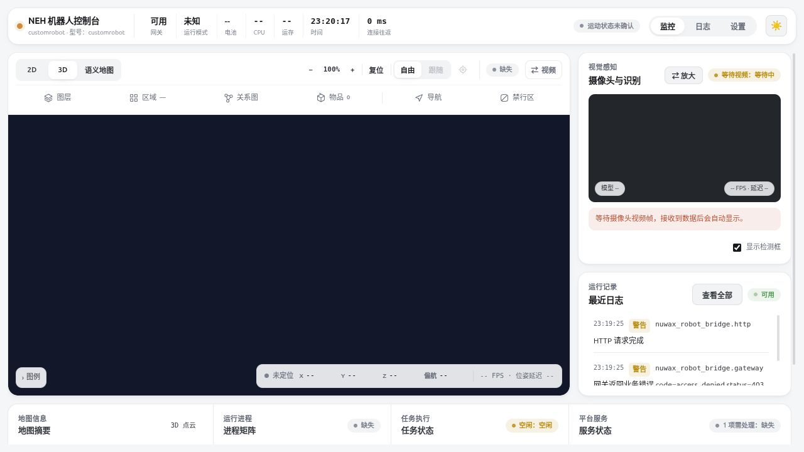

# 控制台使用指南

Nuwax Embodied Harness（NEH，具身运行框架）的业务控制台在浏览器中打开，无需安装扩展：在设备本机是 [http://127.0.0.1:8766/console](http://127.0.0.1:8766/console)，从其它电脑经管理页地址访问 `http://设备地址:管理端口/console`。

下面是基础模块安装后、尚未接入机器人时的界面，地图和视频为空。

控制台有三个视图：**监控**（地图、摄像头、任务与服务状态）、**日志**和**设置**。网页只发出与智能体相同的能力调用；关闭网页或断网不会取消已经受理的任务。

## 先判断系统处于哪一步

| 界面现象 | 表示什么 | 下一步 |
| --- | --- | --- |
| 页面打不开 | 地址、端口或网络不通 | 检查管理页是否可用、业务是否已启动 |
| 已连接，机器人无数据 | 网关正常，设备输入未到达 | 接入设备状态、视频和传感器 |
| 有视频，没有地图 | 相机与空间链路条件不同 | 检查是否在建图或已加载地图、雷达/惯性输入与标定 |
| 地图可见，导航等待或失败 | 能显示不等于可执行 | 看任务消息中的等待原因（例如定位、栅格、位姿哪一项未就绪） |
| 任务已受理 | 已创建任务，尚未完成 | 继续看任务最终状态 |

右侧“任务状态”页签列出运行中和最近结束的任务，“服务状态”页签显示各组件与服务的真实状态，“最近日志”显示最新记录。

## 地图

地图区上方可切换 **2D**、**3D** 和**语义地图**：

- **2D**：占据栅格、机器人、轨迹、路径和禁行区。三维链路的二维图是雷达高度附近的水平切片。
- **3D**：点云、高度与支撑面；“图层”中可选高度、完整点云、单层、地面、结构等显示样式。
- **语义地图**：区域、名称候选与关系图，需要先启用语义地图（实验能力）。

镜头可选“跟随”或“自由”，“定位机器人”回到机器人位置，滚轮或加减按钮缩放。切换视图不会改变底层算法。

建图会话（开始建图、保存、加载、结束会话、删除地图）通过能力接口完成，见[快速上手](快速上手.md#3-完成一次建图)与[智能体接入](智能体接入.md)。控制台在建图、加载地图、导航或探索期间显示地图与定位；会话结束后隐藏缓存的旧地图。地图加载后会自动重定位，定位成功才能导航。

## 导航与探索

发起前确认机器人处于允许测试的场地，设备的独立停止方法可用。

打开地图工具中的“导航”，有三种方式：

- **选点导航**：单击地图选目标（三维视图请点在地面上），可填写目标机体高度，点“开始导航”。默认到达位置误差 0.15 米以内即算到达，不检查最终朝向。点“取消导航”取消当前任务。
- **自动探索**：填写地图名称（留空用当前地图）、最长运行时间，可选总路程、返航余量和“结束后返回起点”，点“开始探索”。探索在建图会话中进行，结束时默认保存地图。“暂停并保存”会停止探索并保存地图与进度；之后在“已保存的探索”中选择并点“继续所选探索”，恢复时会重新加载地图并定位。“停止探索”只停止探索，建图会话保留。
- **跨楼层**：选择已登记的建筑与目标楼层，填写目标层地图中的坐标后“前往目标层”；“逐层探索建筑”依次探索各层；“导入楼层配置”登记楼层与设施。跨层依赖实际设施与已建好的楼层地图。

任何新的导航或探索命令都会替换正在进行的运动任务，旧任务以“已取消”结束。导航任务停在“等待输入”时，消息会写明缺的是哪一项，输入就绪后自动继续，无需重新提交。

## 禁行区

打开“禁行区”，选择形状（直线、矩形、圆形、自定义多边形）、禁行方向（内部禁行或外部禁行）和边界宽度，点“开始绘制”：直线、矩形和圆形用鼠标拖拽，多边形逐点单击后“完成多边形”。“保存禁行区”后，下一次规划即使用新的禁行区，不会先让机器人停下。禁行区属于当前地图。

## 地图清理

“清理”面板用于去掉已保存三维地图中的残影（例如走过的行人）：选择已保存的地图，调整清理力度（0 保守、100 激进），点“计算预览”。面板显示原图与红色候选点；确认后输入新地图名称，点“确认并另存新图”。源地图不变，另存后需要时再加载新地图。没有可用原始扫描的旧地图只做离群点清理，预览会说明这一点；一直静止的人体不保证被清除。

## 摄像头、识别与记忆

“摄像头与识别”显示相机画面和检测框。“开启手动识别”加入一个持续识别的使用原因；“关闭手动识别”只移除手动原因，探索、跟随或找目标仍在使用时识别会继续。只有关键帧写入记忆。

“物品”面板列出当前记忆库中的物品，可按“有物体位置”“仅观察记录”“位置待确认”筛选。记忆库随当前地图自动切换，没有建图功能时使用默认库。仅观察记录只表示“在这里看见过”，不是物体坐标。

“区域”与“关系图”面板（语义地图）显示区域边界、名称与证据，以及区域、连接口与物品的关系。区域相邻不代表机器人可以直接通过，能否通行以导航检查为准；点“识别当前地图”触发一次语义识别（勾选“采用达标标签”时，本次识别采用证据达标的名称），“持续识别”开启后台周期识别，“停止识别”停止后台识别。

## 日志

“日志”视图按等级、来源（平台服务、Rust 运行进程、原生组件）、组件、全文、请求标识和任务标识筛选；“暂停更新”后可连续阅读和复制，“加载更早记录”翻页，“下载文本”或“下载结构化日志”导出当前筛选结果。导出内容可能包含设备信息和现场数据，分享前检查。

## 设置

“设置”分为三类：

- **软件更新**：检查更新、“更新并重启”，以及自动检查、空闲时自动安装和检查间隔。更新要求没有任务运行、没有正在进行的建图且运动已停止；不需要停用电机。
- **设备管理**：经管理页打开控制台时显示，返回设备管理页。
- **平台设置**：选择机器人与方案，查看每项的说明、默认值和生效方式；“保存改动”后，需要重启的项点“立即重启相关进程”。“另存为新方案…”复制方案，“设为运行方案”切换方案。

配置键与生效规则见[配置说明](配置说明.md)。不确定字段含义时先看说明，不要靠放宽限值掩盖接入错误。

[快速上手](快速上手.md) · [排障](常见问题与排障.md) · [文档导航](阅读指南.md)
