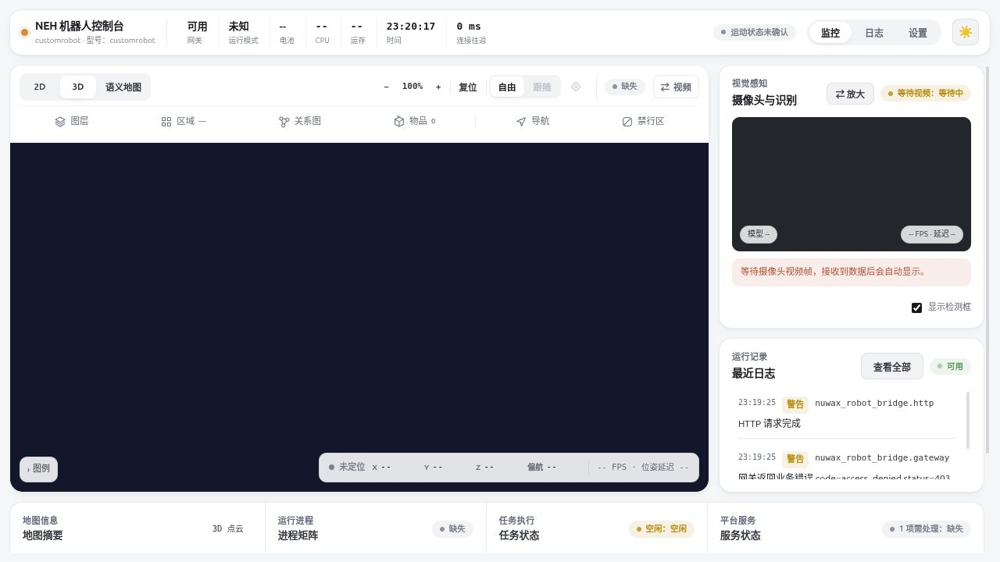

# 控制台使用指南

Nuwax Embodied Harness（NEH，具身运行框架）启动后，在浏览器打开配置中的 `/console`，本机默认是 [http://127.0.0.1:8766/console](http://127.0.0.1:8766/console)。无需安装浏览器扩展。

下面是基础模块安装后的真实界面，尚未接入机器人，因此地图和视频为空。日志中的未暴露能力提示也不代表机器人已连接。

## 先判断系统处于哪一步

| 界面现象 | 表示什么 | 下一步 |
| --- | --- | --- |
| 页面打不开 | 地址、监听或网络尚未连通 | 先检查启动终端与健康接口 |
| 网关已连接，机器人无数据 | 软件接口可响应，设备输入未就绪 | 接入设备状态、视频和传感器 |
| 有视频，没有地图 | 相机和空间链路条件不同 | 检查所选建图模块、雷达、惯性或里程计与标定 |
| 地图可见，导航等待或失败 | 地图展示不等于可执行路径 | 查看定位、目标落点、机体与执行链原因 |
| 任务已受理 | 已创建任务，尚不表示完成 | 继续观察任务最终状态 |

首页顶部有网关、运行模式、资源和连接往返信息。往返耗时包含网页与服务端调度及网络，不等于传感器采样周期或导航计算时间。

## 地图与工作区

先创建或选择一个有明确名称的地图工作区，再启动建图。建图时观察轨迹是否与实际移动一致、墙面是否连续、地图是否持续更新。结束后分别确认停止与保存回执。

- **二维视图**：查看栅格轮廓、机器人、路径和禁行区域。三维链路的二维图是水平投影。
- **三维视图**：查看高度、支撑和点云。切换视图不会切换底层算法。
- **语义地图**：查看区域标签与空间关系；需已启用且具备对应数据，当前属于实验能力。
- **图层、区域、关系图和物品面板**：按需查看叠加内容及节点依据，空列表先检查数据来源。

地图工具集中在视图切换附近，镜头操作位于地图内。二维可选择机器人跟随或自由拖拽；自由视角不会因每次数据更新而重置。全局路径与局部路径分别展示，局部路径可能随障碍和机器人状态改变。

已有地图再次使用时，先激活并等待定位/重定位。仅有截图或导出的地图图片不足以恢复完整定位、续建和探索状态。跨地图的旧物品记录不能直接用于当前地图导航。

## 发起导航与探索

发起前确认机器人处于允许测试的场地，设备的停止入口可用，并已完成该设备的基础执行验收。

选点导航：在目标地图选择真实可通行的目标，检查位置后发起，保存任务标识并等待终态。普通选点以到达位置为目标；只有接口显式要求朝向时才检查最终朝向。三维目标应落在实际地面上。

探索：设置明确边界和预算，观察目标是否持续推进。需要保留进度时使用暂停并保存，等待停车和检查点结果；恢复前重新定位。当前复杂三维环境的性能和完整覆盖仍需场景验证。

取消后查看原任务与停止结果。关闭浏览器或网络断开不会自动取消已经受理的任务。重新连接时先查询状态，避免重复发起相同动作。

## 视觉与空间记忆

视频来自设备相机；检测框、跟踪结果和空间坐标来自不同处理阶段。有画面但没有检测时，检查模型与感知错误；有检测但无坐标时，检查相机标定与空间证据。

物品可能只有观察位置，界面会保留这一含义。名称相似或检索分数高，不代表找到同一个真实物品。语义区域名称是几何与观察支持下的候选或已采用标签，区域相邻也不等同机器人可直接通过。

## 日志与设置

“日志”按来源、级别、请求和任务筛选；先缩小到发生时间和任务，再导出需要的条目。导出文件使用 NEH 名称，内容仍可能包含设备信息和现场数据，分享前检查。

“设置”提供机器人方案、参数说明和生效提示。第一次使用、另存方案、重启与覆盖关系见[配置说明](配置说明.md)。不确定字段含义时查看其说明和真实来源，避免通过放宽限值掩盖接入错误。

[快速上手](快速上手.md) · [排障](常见问题与排障.md) · [文档导航](阅读指南.md)

## 完成地图清理

停止建图并保存三维地图后，在地图管理中打开清理面板，选择已完成地图并生成预览。面板显示原图与红色候选；清理力度0～100调整支撑间隙阈值。点云加载完成后可输入新地图名称、确认并另存，随后通过通常的地图加载操作选择副本。另存成功不会自动切换当前地图。

预览期间可取消。加载点云失败仍可取消；另存名称无效时修正后可重试同一预览。结果会说明是否具备完整原始扫描与对应最终位姿；缺少历史的地图只进行实际可用的浮空分析，不能据此认定人体残留已经全量重判。没有运动证据、一直静止的人体也不保证删除，请检查预览后再使用副本。

辅助扫描的目录和预算通过配置管理设置，缺省上限8192 MiB（兆二进制字节）。达到预算或存储失败会停止该会话扫描记录，地图仍可保存，预览会明确历史不完整。已发布地图中的扫描副本独立保留；暂存只在成功固化、原写入器结束且无新增记录后回收。
