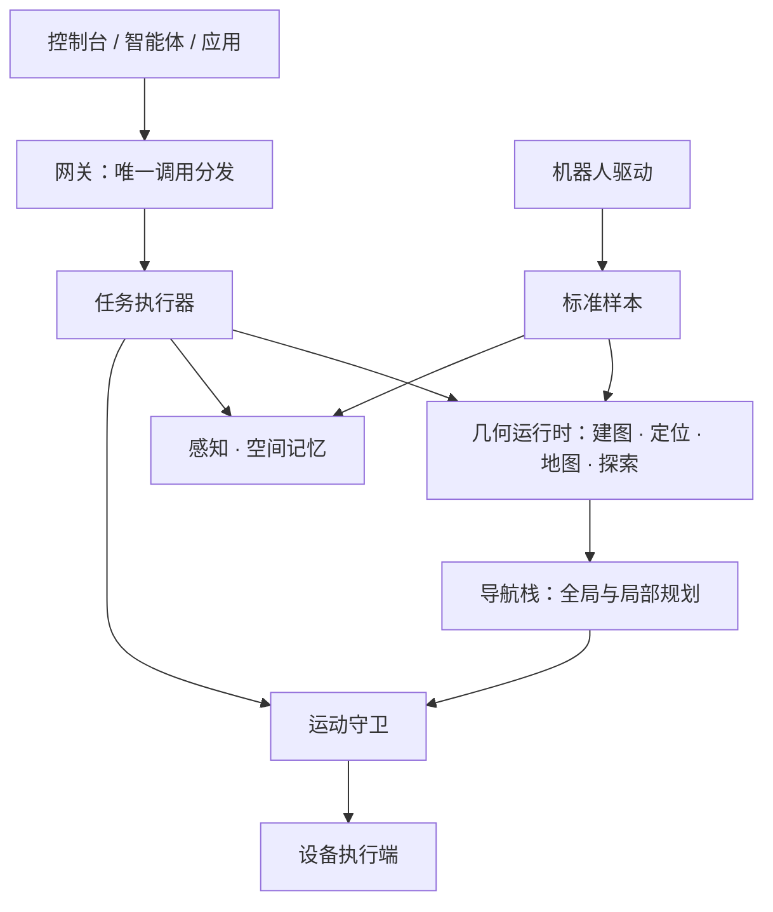

# 架构与机器人接入

Nuwax Embodied Harness（NEH，具身运行框架）把设备接入、空间计算和外部调用分开：设备提供真实数据、标定与运动执行；平台提供定位、建图、导航、探索、感知与记忆；应用表达目标并组织任务。接入新机器人时复用平台已有的全部能力，不需要为它另写建图或规划。

## 先选择接入路径

| 当前设备条件 | 起点 |
| --- | --- |
| 只有状态或相机 | 装 `core`，发布状态与图像 |
| 二维雷达与所需里程计 | 装 `slam2d`，配置 `geometry.pipeline = slam_2d` 与 `geometry.slam2d_config` |
| 三维雷达与惯性传感器 | 装 `fastlio2` 或 `pointlio`，核对扫描内逐点时间与外参 |
| 设备已有可靠里程计 | 装 `geometry`，`geometry.lio_backend = device` |
| 需要自主运动 | 数据与定位验证后加 `navigation`，再接入运动执行端 |

管理页可直接安装的机器人为 `customrobot`（通用接入）、`go2` 和 `unitree_sim`（按 `unitree-sim/1` 设备协议接入的仿真设备）。其它机型需要先实现并注册驱动。

## 一次任务如何执行



网页、MCP（模型上下文协议）和 HTTP（超文本传输协议）接口进入同一个调用分发，参数只在这里校验一次。所有运动命令都经过运动守卫：新命令覆盖旧命令，急停立即生效，执行方停止续租后 0.75 秒内速度归零。业务进程由业务监督者统一启停，几何运行时、导航栈和运动守卫按需启动（见[部署与运行边界](部署文档.md)）。

计算核心在 Rust（系统编程语言）工作区：几何运行时负责定位、建图、地图文件、导航桥与探索，导航栈负责规划与跟随。Python（编程语言）负责设备驱动、网关、任务、感知与记忆。平台计算主链不依赖 ROS 2（机器人操作系统第二版）；已有 ROS 2 驱动的设备在驱动边界把数据转成标准样本即可。

## 源码导航

| 目录 | 职责 |
| --- | --- |
| [contracts](../../contracts) | 标准数据、几何、任务与制品契约 |
| [providers](../../providers) | 状态、传感器、运动等提供器接口 |
| [drivers](../../drivers) · [adapters](../../adapters) | 机器人驱动、设备连接、厂商数据转换 |
| [core](../../core) | 配置、能力定义、任务执行器、事件与日志 |
| [gateways](../../gateways) | 装配根、调用分发、能力表（`gateways/capabilities/`）、网页、MCP、HTTP 与数据流 |
| [services/geometry](../../services/geometry) | 几何运行时客户端、地图目录；`nuwax_geometry_runtime/` 是 Rust 几何运行时 |
| [services/nuwax-workspace](../../services/nuwax-workspace) | 公共 Rust 工作区：导航栈、运动守卫客户端、算法库 |
| [services/navigation](../../services/navigation) | 运动守卫、楼层与设施、命名地点 |
| [services/perception](../../services/perception) · [services/memory](../../services/memory) | 感知、空间记忆与语义地图 |
| [scripts](../../scripts) | 业务监督者、设备管理程序、安装构建与诊断 |

## 接入需要提供什么

按功能逐步接入，不必一次实现全部传感器：

| 目标 | 接入内容 |
| --- | --- |
| 读取设备状态 | `RobotState`（机器人状态）及真实采集时间 |
| 视频与拍照 | `ImageFrame`（图像帧）；空间定位还需相机内外参 |
| 三维激光惯性定位 | `CanonicalLidarFrame`（规范雷达帧，带逐点时间）、`CanonicalImuSample`（规范惯性样本）及外参 |
| 二维激光链 | `CanonicalLaserScan`（规范二维扫描）、所需里程计与标定 |
| 导航与跟随 | 速度与停止接口（`MotionControl`）及设备速度上限 |
| 厂商特有动作 | 驱动私有能力声明和真实实现 |

真实结构以[传感器契约](../../contracts/sensors.py)、[标定契约](../../contracts/calibration.py)、[图像契约](../../contracts/image.py)和[机器人状态](../../contracts/robot_state.py)为准。

## 数据、时间与坐标

1. 距离、角度、速度和时间转换成契约单位：米、弧度、米/秒、弧度/秒，规范传感器时间为纳秒并带时钟域（`unix_ns`、`monotonic_ns`、`device_ns`）。
2. 保留采样时刻，说明设备时钟与平台时钟的关系；消息到达时间不能冒充采样时间。三维定位需要真实的扫描内逐点时间。
3. 坐标变换方向统一为 `p_parent = R × p_child + t`（子坐标的点变到父坐标）。雷达、相机、惯性与机体通过真实标定联系，外参写在 `geometry.lio_body_from_sensor`、`geometry.lio_body_from_imu`。
4. 发布后不再修改同一帧；采集回调快速返回，耗时计算放到工作线程。
5. 断线或重启时如实报告不可用，不重复旧帧冒充持续更新。

**仿真设备的时间。** 样本时间不是本机时钟（例如仿真时间比真实时间慢）时，驱动保留样本原时间，另外写一张“来源时间 → 本机采集时刻”的对照表，平台的所有新鲜度判断都按这张表换算。`unitree_sim` 驱动自动维护这张表；接入其它仿真设备时可参照 [drivers/unitree_sim/clock.py](../../drivers/unitree_sim/clock.py)。

## 使用通用装配入口

`customrobot` 是标准接入入口：把 `robot.driver` 设为 `customrobot`，网关会创建一个[通用装配](../../drivers/customrobot/assembly.py)，接入方向它的提供器发布标准数据。下面是最小发布例，在仓库根、已装项目依赖的 Python 环境中可直接运行，只验证发布与读取，不连硬件：

```python
from datetime import datetime, timezone
from contracts.image import ImageEncoding, ImageFrame
from contracts.robot_state import RobotState, SafetyState
from drivers.customrobot.providers import CustomRobotProviderBundle

inputs = CustomRobotProviderBundle()
inputs.start()
try:
    stamp = datetime.now(timezone.utc)
    assert inputs.publish_robot_state(RobotState(
        robot_id="example_robot", frame_id="base_link", timestamp=stamp,
        safety=SafetyState(motors_enabled=False, can_move=False),
        metadata={"synthetic": True},
    ))
    assert inputs.publish_image(ImageFrame(
        camera_id="front", frame_id="camera_front", timestamp=stamp,
        width_px=1, height_px=1, encoding=ImageEncoding.RGB8,
        data=bytes([0, 0, 0]), metadata={"synthetic": True},
    ))
    assert inputs.capture_image("front").data == bytes([0, 0, 0])
finally:
    inputs.stop()
```

发布的数据必须送进网关实际使用的那个装配；另一个进程里新建的提供器不会与网关共享数据。真实设备一般以驱动形式接入（见下文“注册新的机器人类型”），在驱动里读取设备数据并发布到装配的提供器。

**深度相机等辅助点云** 可以用 `PointCloudFrame` 发布并设置 `mapping_only=True`：点与 `sensor_origin`（传感器光心）放在机体坐标，元数据带 `source_timestamp_ns`、`sensor_id`、`clock_id` 与 `calibration_ref`。辅助点云按采集时刻与激光定位位姿配对后更新同一地图，不参与定位。

## 接入运动执行

所有运动经运动守卫执行，驱动只需提供执行端：

- **通用执行端**：实现 [MotionControl（运动控制接口）](../../providers/motion.py)的 `send_twist`（发送速度）与 `stop_motion`（停止），在配置中设置 `motion_guard.backend = motion_control`、`motion_guard.control_factory = 模块:函数`。守卫在自己的进程中调用该函数创建执行端，所以函数要能在守卫进程里独立连接设备（参照 `drivers.unitree_sim.device:create_motion_control`）。
- **速度上限**：执行端提供 `get_motion_command_limits` 时，超限命令会被整体按比例缩到上限内并标记 `limited`；三维导航使用的速度上限与运动形式可在配置中声明：`robot.actuator_max_linear_mps`、`robot.actuator_max_yaw_rps` 与 `robot.actuator_motion_model`（三项同时填写；Go2 留空时使用官方速度上限）。
- **Go2** 使用专用执行端 `unitree_sdk2py`，安装时自动配置。

机体外形用实际模型或实测尺寸（`robot.model_path` 或 `robot.length_m` 等外形键），显示、规划与探索都用这一份外形。

## 注册新的机器人类型

1. 在 `drivers/` 下建设备包：清单、默认帧名、装配类和工厂 `create_<名字>_assembly(config, iface=None, ...)`，工厂返回尚未启动的装配。
2. 在[驱动注册表](../../drivers/registry.py)登记包名、工厂名与私有能力模块（没有私有动作时为空声明）。
3. 在[配置模式文件](../../core/config_schema.toml)的 `robot.driver` 可选值中加入名字；驱动需要的设置新建一段。
4. 需要由设备管理程序安装时，在安装器的机型目录与写入方案的步骤中加入该机型（参照 `unitree_sim`）。
5. 经[统一设备入口](../../drivers/entry.py)启动，验证能力发现、数据到达、停止与重启。

注册表里出现名字不代表该设备的功能已经完成。

## 验证接入

先检查状态与图像，再检查时间、坐标与连续传感器输入，然后验证建图、保存与重新加载，最后验证运动、停止与错误处理。这样能把设备问题与算法问题分开。

无设备环境可运行[离线平台检查](../../scripts/diagnostics/offline_platform_smoke.py)；原生定位程序已构建时，[原生定位检查](../../scripts/diagnostics/native_lio_smoke.py)用合成输入核对真实算法流程。两者都不能代替设备精度与实际运动验收。

| 阶段 | 成功依据 | 要检查的失败路径 |
| --- | --- | --- |
| 状态与图像 | 真实样本持续更新，源时间正确 | 拔线、重连、停止后旧帧退出 |
| 定位与建图 | 真实移动与位姿一致，地图可保存并重新加载 | 缺输入、错误标定、换地图 |
| 运动执行 | 速度与方向正确，停止有效 | 连接断开、取消、急停后旧命令被拒 |
| 组合任务 | 导航到达、探索、找目标按终态确认 | 无路径、失去定位、重启、超时 |

为每个设备记录系统与固件、源码提交、模块、传感器与标定版本，先给小场景证据，再扩大支持范围。

[返回文档导航](阅读指南.md) · [部署与运行边界](部署文档.md)
