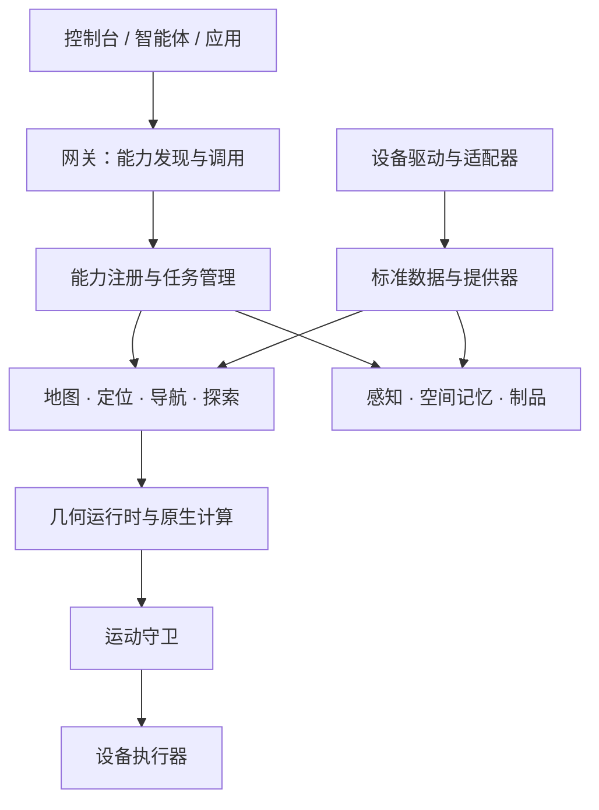

# 架构与机器人接入

Nuwax Embodied Harness（NEH，具身运行框架）把设备接入、空间计算和外部调用分开：设备负责提供真实数据与执行动作，平台提供通用能力，应用负责表达目标和组织任务。接入新机器人时，可复用已有地图、导航、感知和记忆服务。

## 先选择接入路径

| 当前设备条件 | 推荐起点 |
| --- | --- |
| 只有状态或相机 | 安装 `basic` 方案，先发布状态与图像 |
| 二维雷达和所需里程计 | 安装 `map2d`，核对规范扫描与外参 |
| 三维雷达和惯性传感器 | 安装 `map3d` 或显式选择 `pointlio`，核对扫描内点时间与标定 |
| 设备已提供有效里程计 | 选择 `geometry`，按后端要求接入实际数据 |
| 希望增加自主运动 | 在数据与定位验证后 `add navigation`，再接入运动守卫与执行器 |

仅改变 `--robot` 不会自动生成新设备驱动；现有安装器可选择通用接入或 Go2（宇树四足机器人）。

## 一次任务如何执行



图表示主要职责与数据方向。任务结果通过网关返回，地图、视频与状态由相应数据流更新。网页与 MCP（模型上下文协议）调用进入同一公共能力层。

计算核心位于 Rust（系统编程语言）工作区，几何运行时负责组合原生定位、地图、导航与探索。Python（编程语言）服务负责设备装配、业务编排、感知记忆和对外接口。设备协议可保留在适配边界，当前平台计算主链不要求 ROS 2（机器人操作系统第二版）。

## 源码导航

| 目录 | 职责 |
| --- | --- |
| [contracts](../../contracts) | 标准数据、几何、能力、任务与制品契约 |
| [providers](../../providers) | 状态、传感器、运动等提供器接口 |
| [drivers](../../drivers) · [adapters](../../adapters) | 设备装配、连接、数据转换与私有动作 |
| [core](../../core) | 配置、事件、能力注册、任务和资源协调 |
| [skills](../../skills) | 工具定义、处理器与地图工作区流程 |
| [gateways](../../gateways) | 网页、MCP、HTTP（超文本传输协议）接口与数据流 |
| [services/nuwax-workspace](../../services/nuwax-workspace) | 公共计算库、导航与运动相关程序 |
| [services/geometry/nuwax_geometry_runtime](../../services/geometry/nuwax_geometry_runtime) | 独立几何运行时与原生算法编排 |
| [services/perception](../../services/perception) · [services/memory](../../services/memory) | 感知、检索与空间记录 |
| [services/scene_decision](../../services/scene_decision) | 实验语义决策后端 |
| [scripts](../../scripts) · [deploy](../../deploy) | 安装、构建、诊断与服务模板 |

## 接入需要提供什么

按实际功能逐步接入，不必一次实现全部传感器。

| 目标 | 接入内容 |
| --- | --- |
| 读取设备状态 | `RobotState`（机器人状态）及真实采集时间 |
| 视频与抓图 | `ImageFrame`（图像帧），空间投影还需相机内参与外参 |
| 三维激光惯性定位 | `CanonicalLidarFrame`（规范雷达帧）、`CanonicalImuSample`（规范惯性样本）及传感器拓扑 |
| 二维激光链 | `CanonicalLaserScan`（规范二维扫描）、链路所需里程计及对应标定 |
| 导航与跟随执行 | 速度、停止接口及执行链实际需要的状态反馈 |
| 厂商特有动作 | 设备私有能力声明和真实实现 |

位置、姿态、坐标系和源时间必须能相互解释。三维定位需要真实扫描内点时间，不能用消息到达时间填补；二维扫描也须保留真实角度与测量语义。

具备一个数据类型只说明接线可能成立。功能是否就绪，还取决于连续输入、时效、标定和后端要求。

## 数据契约与时间坐标

真实结构以[传感器契约](../../contracts/sensors.py)、[标定契约](../../contracts/calibration.py)、[图像契约](../../contracts/image.py)及[机器人状态](../../contracts/robot_state.py)为准。不要把示例中的帧名或单位直接用作设备标定。

1. 距离、角度、速度和时间转换成契约要求的单位；记录转换发生在哪个适配器。
2. 保留采集时刻和时钟来源，说明设备时钟如何对应平台时间；到达时间只用于传输诊断。
3. 雷达、相机、惯性与机体坐标通过真实标定联系起来，明确变换方向。
4. 发布后不继续修改同一帧。采集回调快速返回，耗时计算交给有界工作线程。
5. 数据丢失、断线或重启时返回实际不可用状态，不能重复旧帧伪装持续更新。

## 使用通用装配入口

[通用装配](../../drivers/customrobot/assembly.py)接收标准数据，并可注入执行器。下面是程序内接线片段；`config` 为已加载配置，`topology` 为真实标定，`motion_control` 为设备实现。片段不包含设备采集循环或服务器启动。

```python
from drivers.customrobot import create_customrobot_assembly
from gateways.runtime import GatewayRuntime

assembly = create_customrobot_assembly(
    config,
    sensor_topology=topology,
    motion_control=motion_control,
)
runtime = GatewayRuntime(config=config, robot=assembly)

# 由运行时拥有方管理启动和关闭。
# 设备采集回调向同一个装配发布数据；以下变量均来自真实采集。
assembly.providers.publish_robot_state(state)
assembly.providers.publish_image(image, camera_info)
assembly.providers.publish_imu(imu_sample)
assembly.providers.publish_point_cloud(lidar_frame)
```

发布的数据必须送入网关实际使用的同一个装配。另一个进程里创建的内存提供器不会自动与网关共享数据；跨进程接入需要实际传输适配器。

## 接入运动执行

[MotionControl（运动控制接口）](../../providers/motion.py)定义速度发送 `send_twist` 与停止 `stop_motion`，并继承基础提供器协议。将实现接入统一运动守卫后，导航和跟随复用这一执行路径。

通用执行后端通过 `NUWAX_MOTION_GUARD_BACKEND=motion_control` 和 `NUWAX_MOTION_CONTROL_FACTORY=模块:工厂` 配置；工厂需可被守卫进程导入。Go2 保留相应设备执行后端。

当链路要求执行反馈或步态切换时，按同文件中的对应协议提供真实实现。机体外形、支撑距离和可通行参数需要根据设备测量与能力配置。

## 注册新的机器人类型

希望通过 `NUWAX_ACTIVE_ROBOT` 在普通启动器中选择新设备时，还需完成驱动注册：

1. 在 `drivers/` 下建立设备包，提供清单、默认配置、装配工厂和能力声明。
2. 工厂接收入口配置，返回尚未启动的装配对象。
3. 在[驱动注册表](../../drivers/registry.py)登记设备包和工厂。
4. 为私有动作提供真实处理器；没有私有动作时保留空声明。
5. 经[统一设备入口](../../drivers/entry.py)启动，验证能力发现、数据到达、关闭和重启。

现有 `customrobot`（通用机器人）是标准接入参考。注册目录中出现设备名称，不代表对应硬件全部能力已经完成。

## 验证接入

先检查状态和图像，再检查时间、坐标与连续传感器输入。随后验证定位、地图保存与重新激活，最后验证运动、停止及错误处理。该顺序有助于把设备问题与算法问题分开定位。

无设备环境可以运行[离线平台检查](../../scripts/diagnostics/offline_platform_smoke.py)。算法程序已构建且依赖完整时，[原生定位检查](../../scripts/diagnostics/native_lio_smoke.py)可使用合成输入核对真实算法与进程流程。两者都不能替代设备精度和实际运动验收。

## 深度点云与多相机

深度相机的真实反投影点云可通过现有 `PointCloudFrame` 发布：设置 `mapping_only=True`，将点与 `sensor_origin`（传感器光心）按标定转换到估计机体坐标，并在元数据保留 `source_id`、`source_sequence`、`source_timestamp_ns`、`clock_id` 与 `calibration_ref`。辅助点云按采集时刻的激光定位姿态配对，更新同一地图；它不进入激光惯性里程计，也不冒充激光扫描的来源证明。无有效采集姿态的帧不会补成地面或障碍物。

多台相机使用各自的 `camera_id`、标定和图像来源。单路网页预览只发布绑定相机，其他相机的感知或抓拍不会清空当前预览；图像与检测框须对应同一相机。空间记忆使用图像采集时刻的机体位姿，物品高度不作为导航机体高度。

## 同机仿真的采集时钟

慢速物理仿真保留逻辑采样时间和扫描内时间差，可显式设置 `NUWAX_SOURCE_TIME_FILE` 指向同一 Linux（操作系统）主机的采集配对表。生产者记录逻辑时间与实际采集的 Unix（通用纪元）和单调时间，消费者只用它计算新鲜度、停车先后和执行期限；原始源时间、处理时间与文件时间保持各自语义。未设置时继续按设备原有 Unix 时间工作。

配对表为小端格式：8 字节 `NEHTIME1`、最新序号 `u64`，随后是 16,384 个环槽。每槽包含序号、逻辑源纳秒、实际 Unix 纳秒、实际单调纳秒，均为 `u64`。序号从 1 开始，槽号为 `(序号-1)%16384`；生产者先将槽序号置零，写入三个时间，再发布槽序号和表头最新序号。暂停或延迟送达不能刷新旧帧的采集年龄。此配对仅适用于共享单调时钟的同机进程，不替代跨设备时钟同步。

真实反馈可用但没有保证制动模型时，`NUWAX_MOTION_STOP_FEEDBACK_TIMEOUT_SEC` 设置等待停稳的期限，默认 1 秒。增加等待时间不改变速度、采样先后或实际停稳的判定条件。

## 接入验收记录

为每个设备保存系统/固件、源码提交、模块、传感器与标定版本，再逐项记录结果：

| 阶段 | 成功依据 | 应检查的失败路径 |
| --- | --- | --- |
| 状态与图像 | 真实样本持续更新，源时间正确 | 拔线、重连、停止后旧帧退出 |
| 定位与建图 | 真实移动与位姿一致，地图可保存并重新使用 | 缺输入、错误标定、地图切换 |
| 运动执行 | 受控速度与方向正确，停止反馈真实 | 连接断开、取消、守卫拒绝 |
| 复合任务 | 导航到达、探索和跟随按终态确认 | 无路径、失去定位、重启和超时 |

先提供小场景证据，再扩大支持范围。不要用未接线提供器、静态能力注册或模拟运动替代设备验收。

[返回文档导航](阅读指南.md) · [部署指南](部署文档.md)
