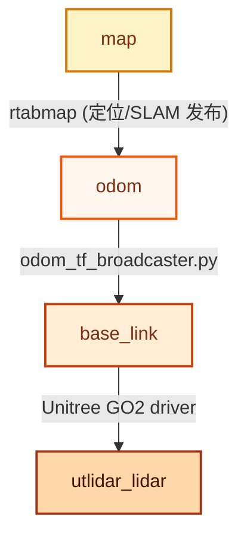
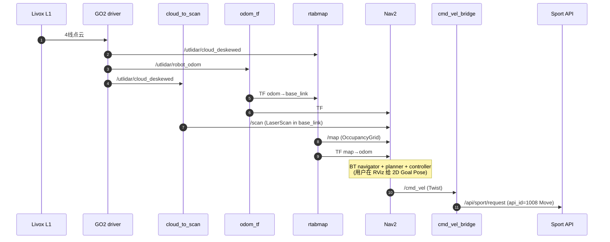
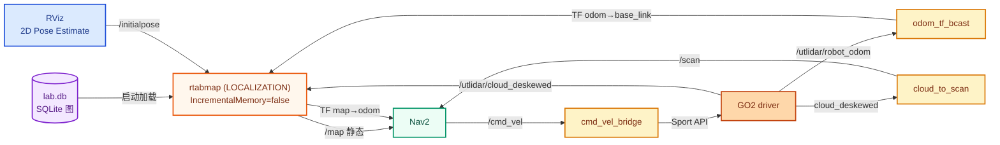
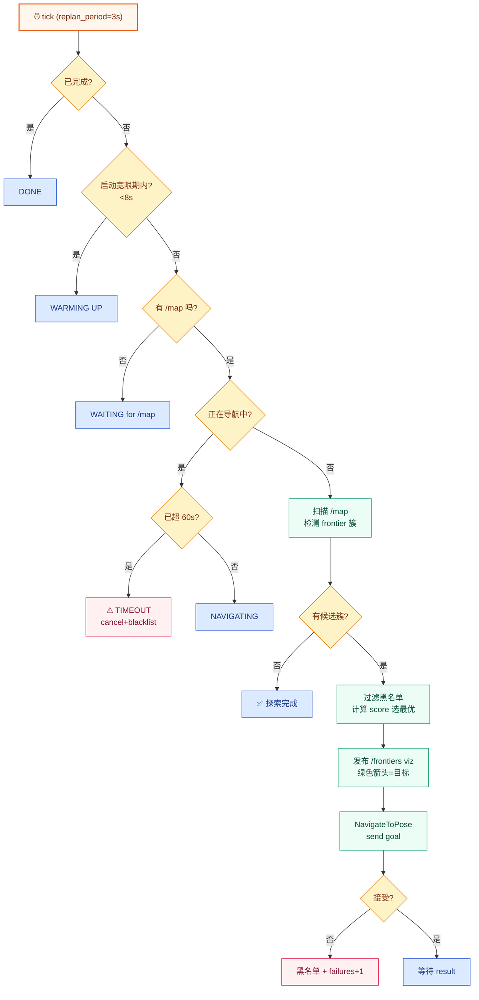

# GO2 · RTAB-Map · Nav2 — 项目架构总览

> 基于 **Livox L1 4线激光雷达** 与 **RTAB-Map** 图优化 SLAM，结合 **Nav2** 路径规划与
> **frontier-based exploration**，为 Unitree GO2 提供完整的自主导航栈。

| 模块 | 版本 / 选型 |
|---|---|
| 操作系统 | Ubuntu 20.04 |
| ROS 发行版 | ROS 2 Foxy |
| RMW | `rmw_cyclonedds_cpp`（**必须**，匹配 GO2 驱动） |
| SLAM | RTAB-Map 0.21.x（点云 ICP 模式，无视觉） |
| 导航 | Nav2（Foxy 版本） |
| 平台 SDK | Unitree `unitree_api` / `unitree_go` |
| 自定义节点 | Python (rclpy + numpy + scipy) |

---

## 目录

1. [项目总览](#1-项目总览)
2. [整体架构与数据流](#2-整体架构与数据流)
3. [建图模式 (`--new`)](#3-建图模式---new)
4. [定位模式 (`--localization`)](#4-定位模式---localization)
5. [探索模式 (`--explore`)](#5-探索模式---explore)
6. [自定义节点详解](#6-自定义节点详解)
7. [技术栈与依赖](#7-技术栈与依赖)
8. [文件结构](#8-文件结构)
9. [关键调参速查](#9-关键调参速查)

---

## 1. 项目总览

通过统一入口脚本 `./go2.sh` 提供 **三种互斥模式**，共享同一套底层节点
（`odom_tf_broadcaster` · `cloud_to_scan` · `cmd_vel_bridge`），上层根据模式叠加
RTAB-Map（mapping / localization）+ Nav2（可选）+ Frontier Explorer（仅探索）。

| 模式 | 启动命令 | RTAB-Map | Nav2 | Frontier |
|---|---|:-:|:-:|:-:|
| 🗺 **建图** `--new / -m` | `./go2.sh --new ./maps/lab.db` | SLAM | ✅ | ❌ |
| 🧭 **定位** `--localization / -l` | `./go2.sh --localization ./maps/lab.db` | LOCALIZATION | ✅ | ❌ |
| 🚀 **探索** `--explore / -e` | `./go2.sh --explore ./maps/lab.db` | SLAM | ✅ | ✅ |

> **注：** `--localization` 必须传入**已存在**的 `.db` 文件；`--new` / `--explore`
> 会**覆盖**目标 db。

---

## 2. 整体架构与数据流

> 传感器 → 感知节点 → SLAM/定位 → 规划 → 执行。所有模式共用前两层与最后一层，
> 只在中间的 SLAM/规划层差异化组合。

### 2.1 总体数据流

```mermaid
graph LR
    classDef hw fill:#fed7aa,stroke:#c2410c,color:#7c2d12,stroke-width:2px
    classDef custom fill:#fef3c7,stroke:#d97706,color:#7c2d12,stroke-width:2px
    classDef rtab fill:#fff7ed,stroke:#ea580c,color:#7c2d12,stroke-width:2px
    classDef nav2 fill:#ecfdf5,stroke:#059669,color:#064e3b,stroke-width:2px
    classDef explore fill:#fff1f2,stroke:#e11d48,color:#881337,stroke-width:2px

    L1["Livox L1<br/>4线雷达"]:::hw
    GO2["GO2 driver"]:::hw

    L1 --> CD["/utlidar/cloud_deskewed<br/>PointCloud2 odom系"]
    GO2 --> RO["/utlidar/robot_odom<br/>nav_msgs/Odometry"]

    CD --> CTS["cloud_to_scan.py<br/>点云→2D LaserScan"]:::custom
    RO --> OTB["odom_tf_broadcaster.py<br/>odom→base_link TF"]:::custom

    CTS --> SCAN["/scan"]
    CD --> RTAB["rtabmap_slam<br/>SLAM / Localization"]:::rtab
    RO --> RTAB
    OTB -.tf.-> RTAB

    RTAB --> MAP["/map<br/>OccupancyGrid"]
    RTAB -.tf.-> MAPTF["map→odom"]

    SCAN --> NAV2["Nav2 stack<br/>controller·planner·BT"]:::nav2
    MAP --> NAV2
    MAPTF -.tf.-> NAV2

    MAP --> FE["frontier_explorer.py<br/>仅 --explore"]:::explore
    FE -->|"NavigateToPose<br/>action"| NAV2

    NAV2 --> CV["/cmd_vel"]
    CV --> CVB["cmd_vel_bridge.py<br/>Twist→Sport API"]:::custom
    CVB --> SR["/api/sport/request"]
    SR --> GO2
```



### 2.2 TF 树

| TF 链路 | 发布者 |
|---|---|
| `map → odom` | `rtabmap`（定位/SLAM 时） |
| `odom → base_link` | `odom_tf_broadcaster.py` |
| `base_link → utlidar_lidar` | Unitree GO2 driver（含倾角与外参） |



### 2.3 关键话题清单

| Topic | 类型 | 方向 | 备注 |
|---|---|---|---|
| `/utlidar/cloud_deskewed` | `PointCloud2` | 驱动→项目 | 运动补偿后 3D 点云，odom 系 |
| `/utlidar/robot_odom` | `Odometry` | 驱动→项目 | 高频里程计 |
| `/scan` | `LaserScan` | 项目内 | base_link 系，给 Nav2 障碍层 |
| `/map` | `OccupancyGrid` | rtabmap→Nav2/explorer | TRANSIENT_LOCAL QoS |
| `/cmd_vel` | `Twist` | Nav2→bridge | 速度指令 |
| `/api/sport/request` | `unitree_api/Request` | bridge→驱动 | Sport API id=1008 Move |
| `/initialpose` | `PoseWithCovarianceStamped` | RViz→rtabmap | 重定位辅助 |
| `/frontiers` | `MarkerArray` | explorer→RViz | 簇/目标/黑名单可视化 |
| `/tf`, `/tf_static` | `TFMessage` | 全局 | 见 §2.2 |

---

## 3. 建图模式 (`--new`)

启动 RTAB-Map 增量 SLAM。机器狗每走一段就把当前 3D 点云作为关键帧入图，
形成位姿图（pose graph）。回环 / proximity-by-space 触发图优化（GTSAM/g2o），
地图通过 `/map` 实时反馈给 Nav2。

> **入口 launch：** `src/go2_nav/launch/go2_mapping.launch.py`
> 包含 → `rtabmap_mapping.launch.py` + `nav2.launch.py` + `cmd_vel_bridge`

### 3.1 SLAM 核心配置

| 参数 | 值 | 含义 |
|---|---|---|
| `Mem/IncrementalMemory` | `true` | 持续添加新节点 |
| `Reg/Strategy` | `1` | ICP（无视觉，纯激光） |
| `Reg/Force3DoF` | `true` | 平面运动假设 |
| `RGBD/LinearUpdate` | `0.05` m | 5cm 触发新关键帧 |
| `RGBD/AngularUpdate` | `0.05` rad | ≈3° 触发新关键帧 |
| `Rtabmap/DetectionRate` | `3.0` Hz | 节流控制 CPU |
| `Rtabmap/CreateIntermediateNodes` | `true` | 路径稠密化但不进图谱 |
| `RGBD/ProximityBySpace` | `true` | 基于空间近邻找回环 |

### 3.2 ICP 与栅格

L1 是 4 线**稀疏** lidar，点法线估计极易出错。本项目**禁用法线分割**，
全部用纯高度做地面/障碍分类。

| 参数 | 值 | 含义 |
|---|---|---|
| `Icp/PointToPlane` | `true` | 点对面 ICP |
| `Icp/VoxelSize` | `0.10` m | 体素降采样 |
| `Icp/MaxCorrespondenceDistance` | `0.20` m | 建图收敛容差 |
| `Icp/Iterations` | `20` | 单次 ICP 迭代 |
| `Grid/NormalsSegmentation` | `false` | **不依赖法线** |
| `Grid/MaxGroundHeight` | `-0.15` m | 地面阈值 (base_link 系) |
| `Grid/MaxObstacleHeight` | `1.0` m | 忽略天花板 |
| `Grid/CellSize` | `0.10` m | 栅格分辨率 |
| `Grid/3D` | `true` | 保留 Z 维（cloud_map 用） |

### 3.3 占用栅格的"黏性"（Sticky obstacles）

为了防止机器狗原地小转一圈就把已观测到的墙"擦掉"，项目配置了**不对称对数概率**：

| 事件 | 参数 | log-odds 增量 |
|---|---|---|
| 🟢 命中 | `GridGlobal/ProbHit: 0.85` | **+1.73** 每次（很快累积成饱和） |
| 🔴 未命中 | `GridGlobal/ProbMiss: 0.45` | **−0.20** 每次（缓慢） |

> 需要约 15 次连续 miss 才能清除一个饱和障碍 ≈ **5 秒 @ 3Hz**。
> 真实可移动物体仍能被清除，但短促回头不会"擦墙"。

```
GridGlobal/ProbClampingMin: 0.10
GridGlobal/ProbClampingMax: 0.95   → log-odds 饱和值 +2.94
GridGlobal/OccupancyThr:    0.50
GridGlobal/FullUpdate:      true
```

### 3.4 建图模式时序



---

## 4. 定位模式 (`--localization`)

载入之前 SLAM 出来的 `.db` 文件，进入**只读重定位模式**。RTAB-Map 把数据库中
**所有节点加载进 Working Memory**，对当前激光帧用 ICP 匹配存档点云，匹配上之后
发布 `map → odom` TF，让 Nav2 知道机器狗在世界中的真实位置。

> **入口 launch：** `src/go2_nav/launch/go2_navigation.launch.py`
> 包含 → `rtabmap_localization.launch.py` + `nav2.launch.py` + `cmd_vel_bridge`

### 4.1 与建图模式的关键差异

| 参数 | 建图 | 定位 | 解释 |
|---|---|---|---|
| `Mem/IncrementalMemory` | `true` | **`false`** | 不再添加节点 |
| 启动参数 | `--delete_db_on_start` | **不加** | 保留已有 db |
| `Mem/InitWMWithAllNodes` | `true` | `true` | 全图加载到 WM |
| `Icp/MaxCorrespondenceDistance` | `0.20` m | **`1.0` m** | 初次重定位需更宽容 |
| `Icp/Iterations` | `20` | `30` | 定位迭代更彻底 |
| `Icp/PointToPlaneK` | — | `20` | 法线估计邻居数 |
| `RGBD/ProximityMaxGraphDepth` | `50` | **`0`** | 0=全图搜索 proximity |
| `RGBD/ProximityPathFilteringRadius` | — | `1.0` m | 候选筛选半径 |
| `RGBD/StartAtOrigin` | `false` | `false` | 用上次保存的位姿做猜测 |
| `Rtabmap/StartNewMapOnLoopClosure` | — | `false` | 不分裂新图 |
| `Rtabmap/LoopThr` | 默认 | `0.11` | 定位时降低阈值 |

### 4.2 初始位姿与重定位状态

启动后看 RTAB-Map 日志判断：

```
[rtabmap]: rtabmap (1): ... (local map=0, WM=N)   ← 还没重定位成功
[rtabmap]: rtabmap (5): ... (local map=8, WM=N)   ← ✅ 重定位完成
```

未重定位时 Nav2 会报：

```
[global_costmap]: Robot is out of bounds of the costmap!
```

**触发重定位的方式：**

1. RViz 工具栏 `2D Pose Estimate` 在地图上点+拖
2. 命令行发 `/initialpose`（`PoseWithCovarianceStamped`）
3. 把机器狗物理摆回上次建图的起点

### 4.3 定位模式数据流



---

## 5. 探索模式 (`--explore`)

在建图基础上叠加 `frontier_explorer.py`。它周期性扫描 `/map`，找出"已知 free
区域与未知区域的边界"（frontier），聚类后选择最优簇作为 Nav2 目标点。机器狗
自动驶过去 → 雷达扫到新区域 → 地图扩张 → frontier 收缩 → 直到全部消失，探索结束。

> **入口 launch：** `src/go2_nav/launch/go2_exploration.launch.py`
> 包含 → 建图 launch + Nav2 + cmd_vel_bridge + **`frontier_explorer.py`**

### 5.1 Frontier 检测算法

1. 把 `/map` 转 numpy 数组：`0=free, -1=unknown, >0=occupied`
2. **frontier 像素 = `free` 且 4-邻域中至少有一个 `unknown`**
3. 对 frontier 像素做 **8-连通区域标记**（`scipy.ndimage.label`，无 scipy 时用 BFS fallback）
4. 过滤掉 `size < min_frontier_size`（默认 10 cells）
5. 每个簇算质心 → 候选目标

### 5.2 目标打分（贪心 + 距离惩罚）

```
score = size − α × dist_in_cells
```

| 变量 | 含义 |
|---|---|
| `size` | 该簇 frontier 像素数（越多越优先） |
| `dist` | 机器狗到簇质心的欧氏距离（cell 单位） |
| `α` | `distance_weight = 0.5` |

取最大 `score` 作为下一个目标。

### 5.3 失败处理：黑名单 + 看门狗

**🚫 失败黑名单**（Nav2 返回任何非 SUCCEEDED 状态时）：

- 把当前目标加入黑名单：`(x, y, expire_time)`
- TTL 默认 `blacklist_ttl: 60s`
- 所有距离 < `blacklist_radius: 0.5m` 的候选都被过滤
- 连续失败 `max_consecutive_failures: 5` 次后停止探索

**⏱ 启动宽限期 + 目标超时**（针对 Foxy + CycloneDDS rmw 的 bt_navigator 偶发段错误）：

- `startup_grace_period: 8s` — 等 Nav2 内部 action chain 完全就绪
- `goal_timeout: 60s` — 超时则 cancel + 黑名单 + 找新前沿
- 避免 `result_future` 永远不回调时整个探索器死锁

### 5.4 探索器主循环



### 5.5 RViz 可视化

探索器在 `/frontiers` 上发布 `MarkerArray`，包含：

| 元素 | 含义 |
|---|---|
| 🔵 **青色簇球** | 所有候选 frontier，球径 ∝ √size |
| 🟢 **绿色箭头** | 当前选中的目标点（垂直向下） |
| 🔴 **红色立方** | 黑名单点 |
| 📝 **TEXT** | 状态心跳：`WARMING UP (Xs)` / `NAVIGATING (Xs)` / `TIMEOUT (recovering)` / `DONE` |

---

## 6. 自定义节点详解

项目共写了 **4 个 Python 节点**，每个解决一个具体的桥接/转换问题。
代码都在 `src/go2_nav/scripts/`。

### 6.1 `cloud_to_scan.py` — 点云 → 2D 扫描

**核心问题：** Livox L1 输出的 `/utlidar/cloud_deskewed` 在 `odom` 系，但 Nav2
obstacle layer 期望 `base_link` 系的 `LaserScan`。

**实现要点：**

- numpy 向量化解析 `PointCloud2`（避免 `sensor_msgs_py` 慢）
- `tf2` 查 `odom → base_link`（用 `Time(0)` 取最新可用 TF，避免 single-thread executor 阻塞）
- 四元数 → 旋转矩阵自己算（避免 `tf2_geometry_msgs` 依赖）
- **高度切片：** `z ∈ [-0.20, +0.30]` 在 base_link 系下抓"膝盖到头顶"，避地面避天花板
- 极坐标 binning：每个角度槽取最小距离
- QoS：sub=`BEST_EFFORT`（匹配 GO2 发布器），pub=`RELIABLE`（Nav2 默认）

### 6.2 `odom_tf_broadcaster.py` — 里程计 → TF

**核心问题：** GO2 内置驱动也发 TF，但 DDS QoS 配置偶尔与 ROS 2 端不匹配，导致 TF 缺失。

**实现：** 极简 — 订阅 `/utlidar/robot_odom` Odometry → 转 `TransformStamped` → broadcast。
是冗余路径，确保 `odom → base_link` 一定有。

### 6.3 `cmd_vel_bridge.py` — Twist → Sport API

**核心问题：** Nav2 输出 `/cmd_vel`（Twist），GO2 需要 Sport API（JSON 包裹的
`unitree_api/Request`，`api_id=1008` Move）。

**实现要点：**

- 速度限幅：`max_vx=0.4`, `max_vy=0.2`, `max_vyaw=0.8`
- JSON 序列化为 `{"x":vx, "y":vy, "z":vyaw}` 放到 `req.parameter`
- `cmd_timeout=0.5s` 超时自动发零速（防失控）
- 每收到 Twist 立即 publish + 0.1s 定时器兜底超时

### 6.4 `frontier_explorer.py` — 自主探索器

**核心问题：** 纯自主建图，机器狗自己决定下一步去哪。

**实现要点：**

- 3s 周期 tick，订阅 `/map`（QoS=`TRANSIENT_LOCAL`）
- numpy + `scipy.ndimage` 做 frontier 检测和 8-连通标记
- `score = size − α·dist` 选最优簇
- Nav2 `NavigateToPose` action client 异步发送
- 失败黑名单（半径过滤 + TTL 过期）
- 启动宽限期 + 目标超时看门狗（防 BT navigator 崩死锁）
- RViz `MarkerArray` 可视化：簇球 + 目标箭头 + 黑名单 X + 状态文本

---

## 7. 技术栈与依赖

所有依赖都来自 ROS 2 Foxy 官方仓库 + 项目自建的两个 workspace
（`cyclonedds_ws`, `unitree_msgs_ws`），无私有 fork。

### 7.1 ROS 2 中间件

- `ros2 foxy` — 基础 client / launch / lifecycle
- `rmw_cyclonedds_cpp` — **必须**，GO2 驱动用的就是 CycloneDDS
- `cyclonedds.xml` — 自定义 IP / interface 配置
- `tf2_ros` · `geometry_msgs` · `nav_msgs` · `sensor_msgs`

### 7.2 SLAM

- `rtabmap_slam` 主节点（`rtabmap`）
- `rtabmap_msgs`
- 底层：ICP（点对面）、g2o / GTSAM 图优化、SQLite 存储
- Loop closure：proximity-by-space（**无** BoW 视觉特征，因 GO2 雷达单模态）

### 7.3 导航 (Nav2)

| 节点 | 作用 |
|---|---|
| `nav2_controller` | 局部规划（DWB / RPP） |
| `nav2_planner` | 全局规划（NavFn / Smac） |
| `nav2_recoveries` | 恢复行为：BackUp / Spin / Wait |
| `nav2_bt_navigator` | 行为树驱动主流程 |
| `nav2_lifecycle_manager` | 自动激活以上 4 个节点 |

Costmap 2D：global + local，启用 obstacle / inflation 层。

### 7.4 Unitree

- `unitree_api` — `Request` / `Response` JSON-over-DDS
- `unitree_go` — `SportModeState` 等
- Sport API id `1008` = `Move(vx, vy, vyaw)`
- 来自 `~/unitree_msgs_ws` 单独编译

### 7.5 Python 库

- `rclpy` — ROS 2 Python 客户端
- `numpy` — 向量化点云 / 栅格运算
- `scipy.ndimage` — 8-连通标记（带 BFS fallback）
- `tf2_ros` — Buffer / Listener / Broadcaster
- 标准库：`math` · `json` · `time`

### 7.6 构建与启动

- `colcon` + `ament_cmake` 构建
- Launch 链路：`go2.sh` → `go2_*.launch.py` → 子 launch（rtabmap + nav2）
- `scripts/env.sh` 统一 source ROS / Cyclone / Unitree / overlay
- CUDA 11.4（保留以防 RTAB-Map 链了 cuda 库）

---

## 8. 文件结构

单包 `go2_nav`，按 _launch / config / scripts_ 三段式组织。

```
GO2_RTABMAP/
├── go2.sh                              # 入口脚本：--new / --localization / --explore
├── scripts/
│   └── env.sh                          # 统一环境 source（CycloneDDS, Unitree msgs, overlay）
├── maps/                               # RTAB-Map 数据库 .db 文件
├── src/
│   └── go2_nav/
│       ├── CMakeLists.txt
│       ├── package.xml
│       ├── launch/
│       │   ├── go2_mapping.launch.py           # --new 入口
│       │   ├── go2_navigation.launch.py        # --localization 入口
│       │   ├── go2_exploration.launch.py       # --explore 入口
│       │   ├── rtabmap_mapping.launch.py       # RTAB-Map SLAM 模式
│       │   ├── rtabmap_localization.launch.py  # RTAB-Map 定位模式
│       │   └── nav2.launch.py                  # Nav2 stack（4 节点 + lifecycle）
│       ├── config/
│       │   └── nav2_params.yaml                # costmap / DWB / BT / inflation 等
│       └── scripts/
│           ├── cloud_to_scan.py                # PointCloud2 → LaserScan
│           ├── odom_tf_broadcaster.py          # Odom → TF odom→base_link
│           ├── cmd_vel_bridge.py               # Twist → Sport API Move(1008)
│           └── frontier_explorer.py            # 自主探索器
├── install/                            # colcon build 输出
└── log/
```

---

## 9. 关键调参速查

> 下面这些参数都是项目针对 GO2 + Livox L1 + Foxy **实测调出来的**，
> 改之前先理解原因。

### 9.1 RTAB-Map：建图 vs 定位差异

| 参数 | 建图模式 | 定位模式 | 含义 |
|---|---|---|---|
| `Mem/IncrementalMemory` | `true` | **`false`** | 是否新增节点 |
| `--delete_db_on_start` | ✅ | ❌ | 是否清空 db |
| `Icp/MaxCorrespondenceDistance` | `0.20` m | **`1.0` m** | 初次重定位需更宽容 |
| `Icp/Iterations` | `20` | `30` | 定位迭代更彻底 |
| `RGBD/ProximityMaxGraphDepth` | `50` | **`0`** | 0 = 全图搜索 proximity |
| `RGBD/StartAtOrigin` | `false` | `false` | 用上次保存的位姿 |
| `Rtabmap/LoopThr` | 默认 | `0.11` | 定位时降低阈值 |

### 9.2 Frontier Explorer

| 参数 | 默认值 | 说明 |
|---|---|---|
| `replan_period` | `3.0` s | tick 周期 |
| `min_frontier_size` | `10` cells | 过小簇直接丢弃 |
| `distance_weight` (α) | `0.5` | score 中距离的惩罚系数 |
| `blacklist_radius` | `0.5` m | 黑名单去重半径 |
| `blacklist_ttl` | `60` s | 黑名单条目过期时间 |
| `max_consecutive_failures` | `5` | 连续失败上限 → 停止探索 |
| `startup_grace_period` | `8` s | 等 Nav2 完全就绪 |
| `goal_timeout` | `60` s | 单目标硬超时（防 Nav2 崩死锁） |

### 9.3 cmd_vel 桥

| 参数 | 默认值 | 说明 |
|---|---|---|
| `max_vx` | `0.4` m/s | 纵向速度限幅 |
| `max_vy` | `0.2` m/s | 侧向速度限幅（保守） |
| `max_vyaw` | `0.8` rad/s | 角速度限幅 |
| `cmd_timeout` | `0.5` s | 无新指令则发零速 |

### 9.4 cloud_to_scan（高度切片）

> **关键：** 切片高度是在 `base_link` 系下的相对值。GO2 base_link 在身体中心
> （≈30cm 离地），所以地面 z ≈ −0.30。设 `min_height=-0.20`, `max_height=+0.30`
> 抓"膝盖到头顶"那段，避开地面、避开天花板。

| 参数 | 默认值 | 说明 |
|---|---|---|
| `input_topic` | `/utlidar/cloud_deskewed` | 输入点云 |
| `output_topic` | `/scan` | 输出 LaserScan |
| `target_frame` | `base_link` | 目标坐标系 |
| `min_height` / `max_height` | `-0.20` / `+0.30` m | 高度切片 |
| `range_min` / `range_max` | `0.30` / `8.0` m | 距离过滤 |
| `angle_increment` | `0.01` rad | ≈0.57° 角分辨率 |

### 9.5 启动顺序与故障恢复

**⚠ 已知问题**

- Foxy + CycloneDDS rmw 偶发 `bt_navigator` 段错误（`serdata.cpp:308 invalid data size`）
- Nav2 lifecycle 报 active **≠** bt_navigator 的内部 action chain 完全就绪
- RTAB-Map 数据库目录不存在会 SIGABRT 拖垮整个 launch

**✅ 缓解措施**

- `go2.sh` 启动前先 `pkill` 残留进程，`mkdir -p` db 目录
- 探索器 `startup_grace_period: 8s` 推迟首次发目标
- 探索器 `goal_timeout: 60s` + cancel + 黑名单
- 失败计数到 5 整体退出，不死循环

---

## 附录 A：常用命令

```bash
# 建图
./go2.sh --new ./maps/lab.db

# 定位（必须传已存在的 .db）
./go2.sh --localization ./maps/lab.db

# 自主探索
./go2.sh --explore ./maps/lab.db

# 重新构建
colcon build --packages-select go2_nav --symlink-install

# 给目标点（CLI 等价于 RViz 2D Nav Goal）
ros2 topic pub --once /goal_pose geometry_msgs/PoseStamped \
  '{header: {frame_id: "map"}, pose: {position: {x: 1.0, y: 0.0}, orientation: {w: 1.0}}}'

# 给初始位姿（重定位）
ros2 topic pub --once /initialpose geometry_msgs/PoseWithCovarianceStamped \
  '{header: {frame_id: "map"}, pose: {pose: {position: {x: 0, y: 0}, orientation: {w: 1}}}}'

# 查看 TF
ros2 run tf2_tools view_frames

# 查看 Nav2 行为树状态
ros2 topic echo /behavior_tree_log
```

## 附录 B：调试要点

- **没有 `/map` 输出** → 检查 RTAB-Map 是否成功订阅 `cloud_deskewed`，看 `local map=` 计数
- **`Robot is out of bounds`** → 定位模式还没重定位上，发 `/initialpose`
- **bt_navigator 段错误** → 已知 Foxy + CycloneDDS bug；探索器有看门狗会自动恢复
- **机器狗不动** → 检查 `/cmd_vel` 是否有 Twist；`/api/sport/request` 是否有 Request
- **TF 报缺失** → 看 `odom_tf_broadcaster` 节点是否活着
- **RTAB-Map "send_goal failed"** → 启动太早，加大 `startup_grace_period`

---

> 🐕 **GO2_RTABMAP** · 一份给自己看的项目档案
